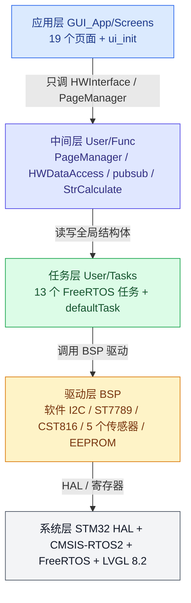
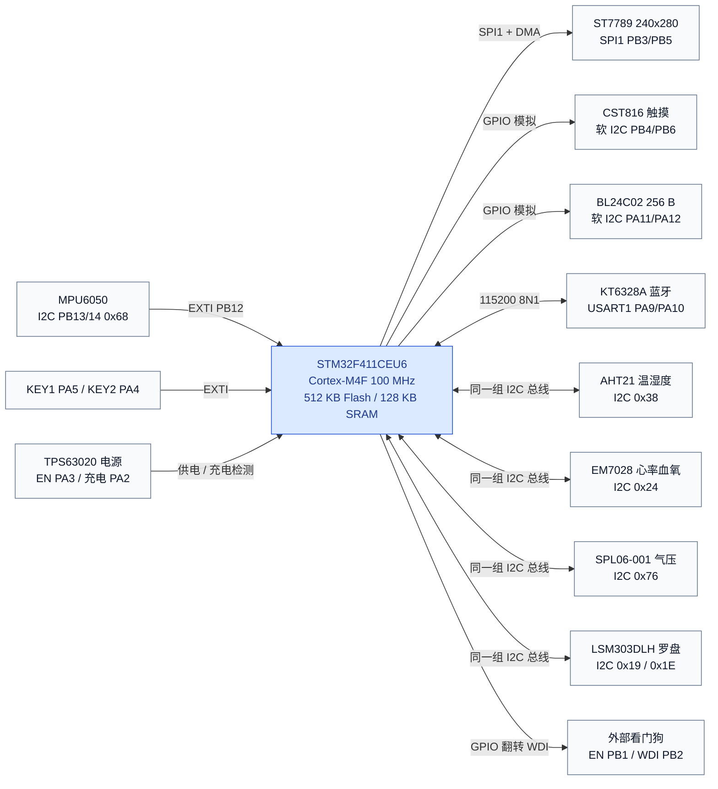
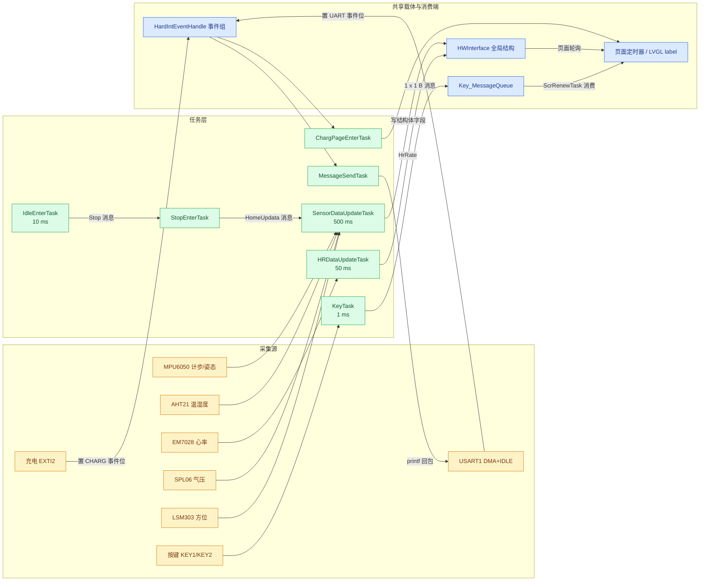

# OV-Watch 源码详解 00：总览、硬件与阅读路线

> 适用源码：`OV-Watch/Software/OV_Watch`（固件 V2.4.5）
> 脚本工程：Keil MDK `Software/OV_Watch/MDK-ARM/OV_Watch.uvprojx`
> 本系列共 10 篇，位于 `OV-Watch/Docs/`，建议按编号阅读。

---

## 1. 这个项目是什么

OV-Watch 是一块 **STM32F411 + FreeRTOS + LVGL** 的开源智能手表：

- 主控：STM32F411CEU6（Cortex-M4F，100 MHz，512 KB Flash / 128 KB SRAM）
- 显示：ST7789 SPI 彩屏，竖屏 240×280
- 触摸：CST816 电容触摸（I2C）
- 传感器：MPU6050（六轴 + DMP 计步/抬腕）、AHT21（温湿度）、EM7028（心率/血氧）、SPL06-001（气压/高度）、LSM303DLH（加速度 + 磁力计，指南针）
- 存储：BL24C02 EEPROM（I2C，256 B）
- 蓝牙：KT6328A（串口透传，接 USART1）
- 电源：TPS63020 + 锂电池，支持 STOP 低功耗、RTC 定时唤醒、按键/充电/MPU 中断唤醒
- 看门狗：外部硬件看门狗（GPIO 喂狗）
- 固件升级：独立 IAP Bootloader（Ymodem，串口升级）

软件栈：

```
应用层   GUI_App/Screens（19 个页面，SquareLine 生成 + 手改）
          ↓ 只调用 HWInterface / PageManager
中间层   User/Func：PageManager（页面栈）、HWDataAccess（硬件接口表）、
          pubsub（发布订阅）、StrCalculate（字符串/表达式工具）
          ↓
任务层   User/Tasks：13 个 FreeRTOS 任务（初始化/显示/传感器/按键/存数/低功耗…）
          ↓
驱动层   BSP：软件 I2C、ST7789、CST816、MPU6050、AHT21、EM7028、SPL06、LSM303、
          BL24C02、KEY、POWER、KT6328、WDOG
          ↓
系统层   STM32 HAL + CMSIS-RTOS2 + FreeRTOS 内核 + LVGL 8.2
```

关键设计：**UI 与硬件解耦**。页面代码不直接调用 HAL，而是通过 `HWInterface`
函数指针表访问硬件；PC 模拟器只要把 `HW_USE_HARDWARE` 置 0，就能复用同一份 UI。

**软件分层架构**：



---

## 2. 硬件管脚表（从 BSP 头文件整理）

| 功能 | 引脚 | 说明 |
|---|---|---|
| LCD SCLK | PB3 | SPI1 SCK |
| LCD MOSI | PB5 | SPI1 MOSI |
| LCD RES | PB7 | 屏复位 |
| LCD DC | PB9 | 命令/数据选择 |
| LCD CS | PB8 | 片选 |
| LCD 背光 | TIM3_CH3 | PWM 调光，5%~100% |
| 触摸 SDA/SCL | PB4/PB6 | 软件 I2C |
| 触摸 RST | PA15 | 复位 |
| 触摸 INT | PB1 | 中断（当前未用） |
| KEY1 | PA5 | 下降沿中断，长按 3 s 关机 |
| KEY2 | PA4 | 上升沿中断 |
| 充电检测 | PA2 | EXTI 双边沿，1=充电中 |
| 电池 ADC | PA1 | ADC1 通道 |
| 电源使能 | PA3 | TPS63020 EN，低=断电 |
| EEPROM SDA/SCL | PA11/PA12 | 软件 I2C，地址 0x50 |
| MPU6050 INT | PB12 | EXTI15_10，抬腕/运动唤醒 |
| 蓝牙使能 | PA8 | KT6328A 电源/使能 |
| 看门狗 EN / WDI | PB1 / PB2 | EN 低有效，WDI 翻转喂狗 |
| USART1 TX/RX | PA9/PA10 | 115200 8N1，接 KT6328A |
| RTC 时钟 | LSE 32.768 kHz | 低功耗走时 |
| 调试串口 | USART1 | `printf` 重定向 |

> 注意：WDOG_EN 与触摸 INT 都定义在 PB1；触摸中断当前未启用，实际用作看门狗使能。

**硬件拓扑**：



---

## 3. Flash / 内存布局

STM32F411CEU6 片内 Flash 512 KB：

```
0x08000000 ─────────────────────────────┐
           │ IAP Bootloader（Ymodem）      │  48 KB（Sector 0~2）
0x0800C000 ├────────────────────────────┤
           │ OV-Watch 应用固件（APP）      │  从 0x0800C000 开始
           │ 启动时 SCB->VTOR = 0xC000     │
           └────────────────────────────┘
0x08008000  │ APP FLAG 标志（"APP FLAG"）   │  位于 Boot 区 Sector 2
```

- Bootloader 只占前 48 KB，APP 的中断向量表偏移为 `0x0000C000`。
- Bootloader 在跳转前会检查 `0x08008000` 处的 8 字节是否为 `"APP FLAG"`；
  不匹配则停在 "No App!" 界面等待 Ymodem 下载。
- APP 的链接地址、Keil 的 IROM1 起始地址、`SCB->VTOR` 三者必须一致，
  否则中断会跳错位置（典型现象：能跑但一进中断就 HardFault）。

RAM：128 KB SRAM。FreeRTOS 堆只有 **16 KB**（`configTOTAL_HEAP_SIZE`），
LVGL 使用自己的静态内存池（`LV_MEM_CUSTOM=0`），两者互不占用。

---

## 4. 目录地图

```
Software/OV_Watch/
├── Core/
│   ├── Inc/             CubeMX 生成的头文件、FreeRTOSConfig.h
│   └── Src/             main.c / freertos.c / 外设初始化 / 中断向量
├── User/
│   ├── Tasks/           13 个 FreeRTOS 任务（本系列第 02 篇）
│   ├── Func/            PageManager、HWDataAccess、pubsub、StrCalculate
│   ├── GUI_App/         LVGL 页面（Screens）、字体、图片
│   └── version.h        版本号
├── BSP/                 板级驱动（第 06 篇）
├── Middlewares/
│   ├── Third_Party/FreeRTOS/   内核 + CMSIS-RTOS2 封装
│   └── LVGL/                   LVGL 8.2 与 lv_conf.h
├── SYSTEM/              delay、sys
├── MDK-ARM/             Keil 工程与启动文件
└── Drivers/             STM32F4 HAL 库
```

相关但独立的工程：

- `Software/IAP_F411/`：Bootloader（Ymodem 升级，见第 08 篇）
- `lv_sim_vscode_win/`：Windows LVGL 模拟器（不开硬件也能跑 UI）

---

## 5. 任务总表（详见第 02 篇）

| 任务 | 入口 | 栈大小 | 优先级（CMSIS 值） | 周期/触发 |
|---|---|---|---|---|
| HardwareInitTask | `HardwareInitTask` | 1280 B | High3 = 43 | 上电一次，完成后自删 |
| WDOGFeedTask | `WDOGFeedTask` | 128 B | High2 = 42 | 100 ms |
| StopEnterTask | `StopEnterTask` | 2048 B | High1 = 41 | 等 Stop 队列 |
| IdleEnterTask | `IdleEnterTask` | 128 B | High = 40 | 10 ms |
| defaultTask | `StartDefaultTask` | 512 B | Normal = 24 | 500 ms 翻转 PC13 |
| KeyTask | `KeyTask` | 128 B | Normal = 24 | 1 ms 扫描 |
| LvHandlerTask | `LvHandlerTask` | 3072 B | Low = 8 | 1~30 ms 自适应 |
| ScrRenewTask | `ScrRenewTask` | 1280 B | Low1 = 9 | 10 ms |
| SensorDataUpdateTask | `SensorDataUpdateTask` | 640 B | Low1 = 9 | 500 ms |
| HRDataUpdateTask | `HRDataUpdateTask` | 640 B | Low1 = 9 | 50 ms |
| ChargPageEnterTask | `ChargPageEnterTask` | 1280 B | Low1 = 9 | 等充电事件 |
| MessageSendTask | `MessageSendTask` | 640 B | Low1 = 9 | 等 UART 事件 |
| MPUCheckTask | `MPUCheckTask` | 384 B | Low2 = 10 | 300 ms |
| DataSaveTask | `DataSaveTask` | 640 B | Low2 = 10 | 等存数队列 |

> CMSIS-RTOS2 的优先级数值直接传给 FreeRTOS（`configMAX_PRIORITIES=56`），
> 所以 `osPriorityLow=8`、`Low1=9`、`Low2=10`、`Normal=24`、`High=40`、`High1=41`、
> `High2=42`、`High3=43` 就是真实 FreeRTOS 优先级，数字越大越优先。

---

## 6. 数据流总览

```
传感器/外设                         任务                         界面
────────────────────────────────────────────────────────────────────────
MPU6050  ──► SensorDataUpdateTask ──► HWInterface.IMU.Steps ──► 首页表盘
AHT21    ──► SensorDataUpdateTask ──► temperature/humidity  ──► 环境页/首页
EM7028   ──► HRDataUpdateTask    ──► HrRate               ──► 心率页
SPL06    ──► SensorDataUpdateTask ──► altitude             ──► 指南针页
LSM303   ──► SensorDataUpdateTask ──► direction            ──► 指南针页
按键     ──► KeyTask ──► Key_MessageQueue ──► ScrRenewTask ──► Page_Back/Page_Load
充电中断 ──► EXTI ──► HardIntEvent ──► ChargPageEnterTask ──► 充电页
串口命令 ──► DMA+IDLE ──► HardIntEvent ──► MessageSendTask ──► printf 回包
空闲计时 ──► IdleEnterTask ──► 背光变暗 ──► StopEnterTask ──► STOP 模式
```

**运行期数据流**：



---

## 7. 阅读路线（源码顺序）

如果想按代码顺序读，推荐：

1. `Core/Src/main.c` → `Core/Src/freertos.c` → `User/Tasks/Src/user_TasksInit.c`
   （上电 → 调度器 → 所有任务的地图）
2. `User/Tasks/Src/user_HardwareInitTask.c`（一次性初始化链）
3. `User/Tasks/Src/user_RunModeTasks.c`（低功耗主线）
4. `User/Func/Src/PageManager.c` + `User/GUI_App/ui.c`（页面栈与 GUI 入口）
5. 挑一个任务读：`user_ScrRenewTask.c`、`user_KeyTask.c`、`user_SensUpdateTask.c`
6. `BSP/IIC/iic_hal.c` → `BSP/LCD/lcd_init.c` / `lcd.c` → 其它传感器
7. `Software/IAP_F411/Core/Src/main.c`（升级与跳转）

对应详细文档：

| 篇号 | 文件 | 内容 |
|---|---|---|
| 00 | 本篇 | 总览、硬件、布局、路线 |
| 01 | `01-启动流程与时钟配置.md` | 上电→IAP→APP→调度器→初始化任务 |
| 02 | `02-FreeRTOS任务系统详解.md` | 14 个任务、队列、事件、堆预算、调度分析 |
| 03 | `03-页面管理器与GUI架构.md` | Page_t/页面栈、LVGL 接入、页面生命周期 |
| 04 | `04-数据流与发布订阅.md` | HWInterface 接口表、pubsub、UI 数据来源 |
| 05 | `05-中断与通信协议.md` | USART DMA+IDLE、命令协议、EXTI、RTC 唤醒 |
| 06 | `06-外设驱动详解.md` | I2C/LCD/触摸/5 个传感器/EEPROM/按键/电源/看门狗 |
| 07 | `07-低功耗与运行模式.md` | 自动熄屏、STOP 模式、唤醒源、功耗优化 |
| 08 | `08-数据存储与IAP升级.md` | EEPROM 地址表、每日步数、Ymodem/IAP 跳转 |
| 09 | `09-调试构建与实验指南.md` | Keil 构建、模拟器、常见问题、动手实验 |

---

## 8. 设计亮点与容易踩的坑

**亮点**

1. **接口表解耦**：`HWInterface` 是一张函数指针表，换传感器只改表，不改 UI。
2. **页面栈**：`Page_t { init, deinit, page_obj }` + 栈，切页自动释放 LVGL 对象。
3. **引导任务自删**：HardwareInitTask 初始化完调用 `vTaskDelete(NULL)`，
   不占用常驻 RAM/调度时间。
4. **中断只发事件**：UART/充电/MPU 中断里只 `osEventFlagsSet`，重活交给任务。
5. **低功耗编排**：IdleEnterTask 负责“变暗→熄屏”，StopEnterTask 负责“STOP→唤醒→恢复外设”。

**坑**

1. `HardwareInitTask` 用 `vTaskSuspendAll()` 包住整个初始化过程，
   这期间**不能用任何会阻塞的 API**（`osDelay` 在调度器挂起时是忙等）。
2. `configTOTAL_HEAP_SIZE` 只有 16 KB，新增任务/队列前先算堆。
3. 页面 `deinit` 之后再 `init` 会重建控件；页面栈深度只有 6。
4. `StopEnterTask` 里 `goto sleep` 会跳过 `xTaskResumeAll()` 的路径，
   修改该函数时要特别小心（见第 07 篇）。
5. GBK 编码文件（`iic_hal.c`、`lcd_init.c`、`rtc.c`、`delay.c`、`lcdfont.h`）
   用 UTF-8 编辑器保存会产生乱码，需保持 GB2312/GBK。
