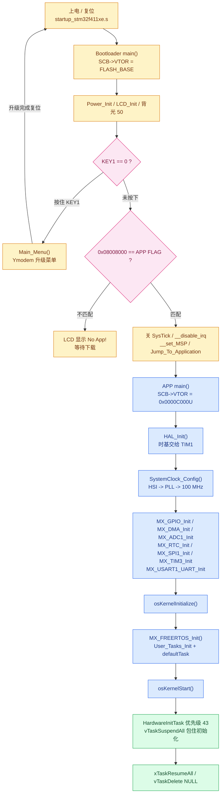
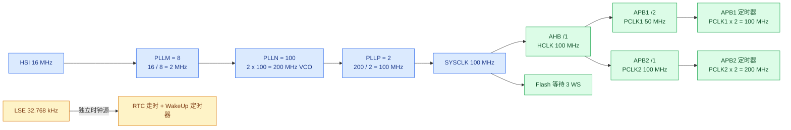
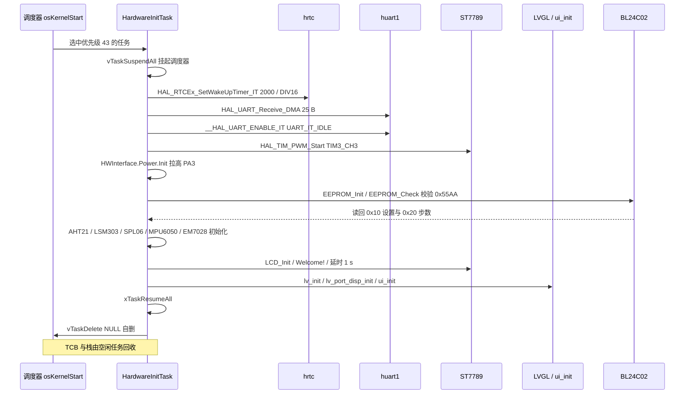

# OV-Watch 源码详解 01：启动流程与时钟配置

> 涉及文件：
> - `Software/IAP_F411/Core/Src/main.c`（Bootloader）
> - `Software/IAP_F411/Ymodem/flash_if.h`
> - `Software/OV_Watch/Core/Src/main.c`（APP）
> - `Software/OV_Watch/Core/Src/freertos.c`
> - `Software/OV_Watch/Core/Src/stm32f4xx_hal_timebase_tim.c`
> - `Software/OV_Watch/User/Tasks/Src/user_HardwareInitTask.c`

---

## 1. 三个阶段，不要混在一起看

```
上电/复位
  │
  ├─ 阶段 A：STM32 启动文件（startup_stm32f411xe.s）
  │     初始化 SP、.data/.bss，跳到 main()——但链接地址是 0x08000000，
  │     所以先跑的是 Bootloader 的 main()
  │
  ├─ 阶段 B：IAP Bootloader（0x08000000，48 KB）
  │     若 KEY1 按下 → Ymodem 升级菜单
  │     否则检查 0x08008000 的 "APP FLAG"
  │         有 → 跳转到 0x0800C000
  │         无 → 显示 "No App!" 等待升级
  │
  └─ 阶段 C：APP main()（0x0800C000）
        HAL_Init → 时钟 → 外设 MX_*_Init → FreeRTOS 初始化/启动
        → 调度器选中 HardwareInitTask → 初始化外设/LVGL → 自删
```

**启动链执行流**：



---

## 2. 阶段 B：IAP Bootloader

### 2.1 关键地址

来自 `IAP_F411/Ymodem/flash_if.h`：

```c
#define APPLICATION_ADDRESS   (uint32_t)0x0800C000   // APP 起始地址（Sector 3）
#define USER_FLASH_END_ADDRESS        0x0807FFFF     // 可升级区域结束
```

- Bootloader 自己占 `0x08000000 ~ 0x0800BFFF`（Sector 0~2，共 48 KB）。
- APP 从 `0x0800C000` 开始，最大约 464 KB。
- `0x08008000` 位于 Sector 2，被当作 **APP FLAG** 存放点（不在 APP 区内）。

### 2.2 启动判断逻辑

`IAP_F411/Core/Src/main.c` 的 `main()`：

```c
SCB->VTOR = FLASH_BASE;          // Bootloader 自己的向量表在 0x08000000
Power_Init();                     // 保持整机供电
HAL_TIM_PWM_Start(&htim3, TIM_CHANNEL_3);
LCD_Init(); LCD_Fill(...); LCD_Set_Light(50);

if (KEY1 == 0) {                  // 开机时按住 KEY1
    delay_ms(500);
    if (KEY1 == 0) {
        printf("Bootload");
        FLASH_If_Init();
        Main_Menu();              // 进入 Ymodem 升级菜单
    }
} else {
    // 读取 0x08008000/0x08008004 的 8 字节
    // 与 "APP FLAG" 比较
    if (strcmp(combined_str, "APP FLAG") == 0) {
        SysTick->CTRL = 0;        // 关 SysTick
        SysTick->LOAD = 0;
        SysTick->VAL  = 0;
        __disable_irq();          // 关总中断

        JumpAddress = *(__IO uint32_t*)(APPLICATION_ADDRESS + 4);
        Jump_To_Application = (pFunction)JumpAddress;
        __set_MSP(*(__IO uint32_t*)APPLICATION_ADDRESS);  // 取 APP 的初始 SP
        Jump_To_Application();    // 跳到 APP 的 Reset_Handler
    } else {
        LCD_ShowString("No App!");
        LCD_ShowString("Please Download");
    }
}
```

**跳转四步**是 Cortex-M 的标准做法：

1. 从 APP 起始地址读第一个字 → 初始 MSP；
2. 从 APP 起始地址 +4 读第二个字 → Reset_Handler 地址；
3. `__set_MSP()` 设置主栈指针；
4. 函数指针调用 Reset_Handler。

跳转前必须关 SysTick 和全局中断，否则 Bootloader 的中断会在 APP 环境里触发。

### 2.3 Ymodem 升级

`Ymodem/` 目录包含：

| 文件 | 作用 |
|---|---|
| `ymodem.c` | Ymodem 协议状态机（1024 字节包、CRC16、重传） |
| `flash_if.c` | 擦除/写入 APP 区，按 Sector 擦除 |
| `menu.c` | 串口菜单（下载/校验/运行） |
| `common.c` | 串口收发底层 |

升级流程：菜单 → 接收 `APP FLAG` → 擦除 `0x0800C000` 起扇区 → 逐包写 Flash →
校验 → 写 `"APP FLAG"` → 复位。详见第 08 篇。

---

## 3. 阶段 C：APP 的 main()

`Software/OV_Watch/Core/Src/main.c`：

```c
int main(void)
{
    SCB->VTOR = 0x0000C000U;   // ① 向量表搬到 APP 区
    HAL_Init();                // ② HAL 初始化 + HAL 时基（TIM1）
    SystemClock_Config();      // ③ 100 MHz
    __enable_irq();

    MX_GPIO_Init();            // ④ CubeMX 外设初始化
    MX_DMA_Init();
    MX_ADC1_Init();
    MX_RTC_Init();
    MX_SPI1_Init();
    MX_TIM3_Init();
    MX_USART1_UART_Init();

    osKernelInitialize();      // ⑤ 初始化 FreeRTOS 内核对象
    MX_FREERTOS_Init();        // ⑥ 创建队列/事件/13 个任务
    osKernelStart();           // ⑦ 启动调度器，不再返回

    while (1) {}               // 永远到不了
}
```

### 3.1 为什么 VTOR 是 0x0000C000

`0x0000C000` 是 `0x0800C000` 的 **TCM 别名**。Cortex-M4 把 `0x00000000`
映射到当前启动区（Boot 配置为 Flash 时就是 0x08000000），所以 `0x0000C000`
和 `0x0800C000` 指向同一块 Flash。写 `SCB->VTOR = 0xC000` 后，异常向量
从 APP 的向量表取，不再走 Bootloader 的。

### 3.2 HAL 时基为什么不是 SysTick

CubeMX 生成 `stm32f4xx_hal_timebase_tim.c`，把 HAL 的 `uwTick` 交给 **TIM1**
更新中断：

```c
void HAL_TIM_PeriodElapsedCallback(TIM_HandleTypeDef *htim)
{
    if (htim->Instance == TIM1) {
        HAL_IncTick();          // HAL_Delay/HAL_GetTick 靠它
    }
}
```

因为 **SysTick 已经归 FreeRTOS 调度器所有**（每 1 ms 产生 tick，触发 PendSV）。
如果 HAL 也用 SysTick，两边会互相干扰。这是 RTOS 工程的标准做法：
SysTick → FreeRTOS；TIM1 → HAL。

### 3.3 时钟树计算

`SystemClock_Config()` 用 **HSI**（内部 16 MHz）而不是 HSE：

| 参数 | 值 | 结果 |
|---|---|---|
| HSI | 16 MHz | PLL 输入 |
| PLLM | 8 | 16/8 = 2 MHz |
| PLLN | 100 | 2×100 = 200 MHz（VCO） |
| PLLP | 2 | 200/2 = **100 MHz SYSCLK** |
| PLLQ | 4 | 200/4 = 50 MHz（USB/SDIO/RNG） |
| AHB 分频 | /1 | HCLK = 100 MHz |
| APB1 分频 | /2 | PCLK1 = 50 MHz（TIM2~7、USART2~5、I2C 等） |
| APB2 分频 | /1 | PCLK2 = 100 MHz（SPI1、USART1、TIM1 等） |
| Flash 等待 | 3 WS | 100 MHz 必须 |

注意：APB1 的定时器时钟是 `PCLK1×2 = 100 MHz`，APB2 定时器是 `PCLK2×2 = 200 MHz`。
写 TIM 预分频时要按这个算，否则时间会差一倍。

LSE（32.768 kHz）单独开启，供 RTC 走时和低功耗唤醒。

**时钟树数据流**：



---

## 4. 从 osKernelStart 到第一个任务

### 4.1 创建了哪些东西

`freertos.c` 的 `MX_FREERTOS_Init()`：

```c
User_Tasks_Init();     // 建 6 个队列 + 1 个事件组 + 13 个任务
defaultTaskHandle = osThreadNew(StartDefaultTask, NULL, &defaultTask_attributes);
```

`User_Tasks_Init()` 的顺序很重要：

1. **先建队列/事件**（`osMessageQueueNew`、`osEventFlagsNew`）；
2. **再建任务**（`osThreadNew`）——任务一创建就可能被调度，
   所以它用到的队列必须已经存在；
3. 最后往 `HomeUpdata_MessageQueue` 放一条消息，触发首页第一次刷新。

### 4.2 第一个运行的任务

`HardwareInitTask` 优先级 `osPriorityHigh3 = 43`，是全部任务里最高的
（`defaultTask` 24，其它 Low1=9）。调度器一启动就选中它。

它做的第一件事是 `vTaskSuspendAll()`——**把调度器挂起**，保证接下来的
初始化不被打断。代价是这期间所有 `osDelay()` 都变成忙等，所以初始化
代码里不能有长延时（只有 LCD 欢迎界面的 1 s 延时，见下）。

### 4.3 HardwareInitTask 初始化链（按代码顺序）

| 步骤 | 代码 | 说明 |
|---|---|---|
| 1 | `HAL_RTCEx_SetWakeUpTimer_IT(&hrtc, 2000, RTC_WAKEUPCLOCK_RTCCLK_DIV16)` | RTC 唤醒定时器：2000 / 2048 Hz ≈ 0.98 s 一次（低功耗睡眠时用） |
| 2 | `HAL_UART_Receive_DMA(&huart1, HardInt_receive_str, 25)` | 串口 DMA 收 25 字节 |
| 3 | `__HAL_UART_ENABLE_IT(&huart1, UART_IT_IDLE)` | 开 IDLE 中断，做“变长帧”接收 |
| 4 | `HAL_TIM_PWM_Start(&htim3, TIM_CHANNEL_3)` | 背光 PWM |
| 5 | `delay_init()` | 把 SysTick 用于 `delay_us/delay_ms`（后面会说明冲突） |
| 6 | `HWInterface.Power.Init()` | PA3 拉高，整机自锁供电 |
| 7 | `Key_Port_Init()` | KEY1/KEY2 EXTI |
| 8 | AHT21 / LSM303 / SPL06 / MPU6050 / EM7028 初始化 | 每个最多重试 3 次，失败置 `ConnectionError` |
| 9 | `EEPROM_Init()` + `EEPROM_Check()` | 校验 0x55AA；读回抬腕/APP 开关、当天步数 |
| 10 | `HWInterface.BLE.Init()/Disable()` | KT6328A 先关掉，省电 |
| 11 | `CST816_GPIO_Init()` + `CST816_RESET()` | 触摸复位 |
| 12 | `LCD_Init()` → 清屏 → 背光 50 → 显示 "Welcome!" 和版本号 → 延时 1 s | 开机画面 |
| 13 | `lv_init()` → `lv_port_disp_init()` → `lv_port_indev_init()` → `ui_init()` | LVGL 与页面系统 |
| 14 | `xTaskResumeAll()` → `vTaskDelete(NULL)` | 恢复调度并自删 |

> 第 9 步的 EEPROM 检查有细节：如果 `EEPROM_Check()` 返回 0（数据有效），
> 才去读 0x10 的用户设置和 0x20 的步数；否则保持默认值（抬腕关闭、APP 开关关）。
> 步数是 16 位、大端存放（高字节在 0x21、低字节在 0x22）。

**一次性初始化时序**：



### 4.4 初始化完成后的调度顺序

HardwareInitTask 自删后，就绪任务里优先级最高的是：

```
WDOGFeedTask (42) → StopEnterTask (41) → IdleEnterTask (40)
→ defaultTask (24) → KeyTask (24) → 各 Low1/Low2 任务
```

于是依次发生：

1. `WDOGFeedTask` 初始化看门狗并每 100 ms 喂一次；
2. `StopEnterTask` 阻塞在 `Stop_MessageQueue` 上；
3. `IdleEnterTask` 开始每 10 ms 累计空闲时间；
4. `defaultTask` 每 500 ms 翻转 PC13（板载 LED，调试用）；
5. `KeyTask` 每 1 ms 扫描按键；
6. `LvHandlerTask` 开始跑 `lv_task_handler()`，界面动起来。

---

## 5. 首次启动的完整时间线

```
0 ms     复位，Bootloader 跑起来
~几十 ms  检查 KEY1 / APP FLAG → 跳转 APP
          APP: VTOR、HAL_Init、100 MHz 时钟、MX_* 初始化
          osKernelInitialize + 建队列/任务
          osKernelStart
          HardwareInitTask（挂起调度器）：
            RTC 唤醒定时器、UART DMA+IDLE、PWM、电源、按键
            传感器逐个初始化（每个最多 3 次）
            EEPROM 校验/恢复设置/恢复步数
            BLE 关闭、触摸复位
            LCD 初始化 + 开机画面（约 1 s 延时）
            LVGL + ui_init()
          xTaskResumeAll + vTaskDelete(自己)
~1 s+     其它任务开始运行，首页显示，背光 50
```

---

## 6. 启动相关常见问题

**Q1：程序下载后不跑，或一进中断就 HardFault？**

- 检查 Keil 的 IROM1 起始地址是否为 `0x0800C000`；
- 检查 `SCB->VTOR` 是否为 `0x0000C000`；
- 检查 Bootloader 是否写了 `"APP FLAG"`。

**Q2：`HAL_Delay()` 卡死？**

- HAL 时基是 TIM1，若 TIM1 没初始化/中断没开，`uwTick` 不增加；
- FreeRTOS 启动后不要用 `HAL_Delay()`，用 `osDelay()`。

**Q3：开机画面停在 Welcome 不动？**

- `HardwareInitTask` 卡在某个传感器初始化（I2C 无应答时会重试）；
- 用调试器看 `HWInterface.*.ConnectionError`，或断开对应传感器验证。

**Q4：时间走得不准？**

- RTC 时钟源应为 LSE；若 LSE 起振失败，`HAL_RTC_Init()` 会失败，
  代码里没有显式回退到 LSI，需要检查板子晶振。

**Q5：SysTick 与 delay 冲突？**

- `SYSTEM/delay.c` 用 SysTick 做微秒延时，而 FreeRTOS 也用 SysTick；
- `delay_init()` 会重配 SysTick，初始化阶段要谨慎调用；
- 第 06 篇会给出 `delay_us` 的具体实现和影响范围。
