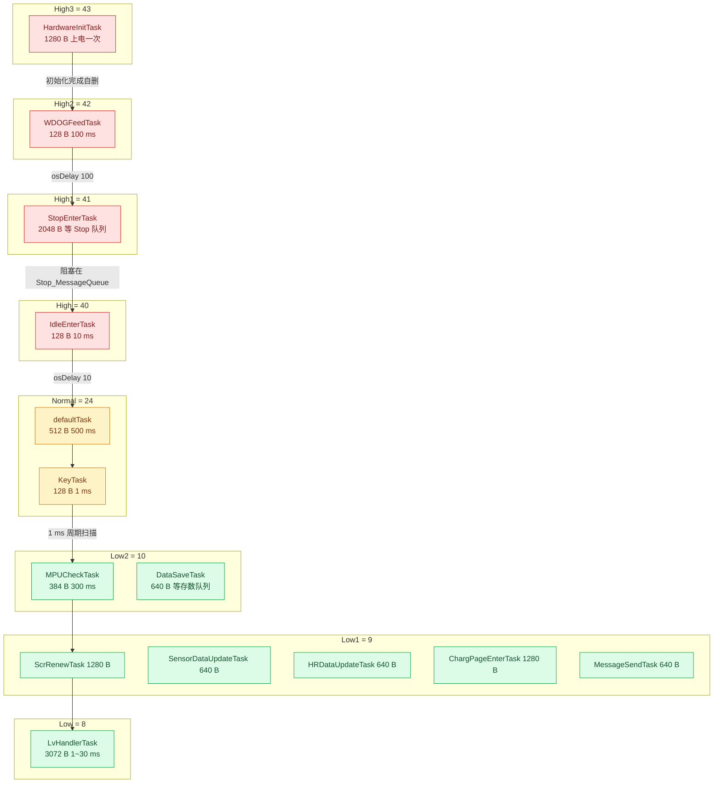
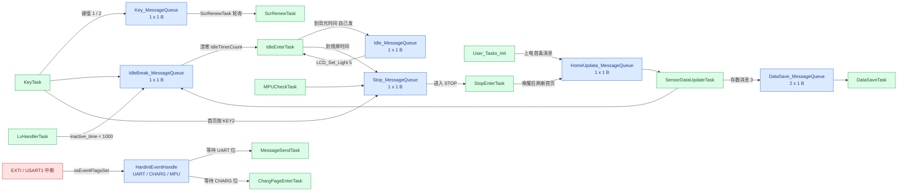
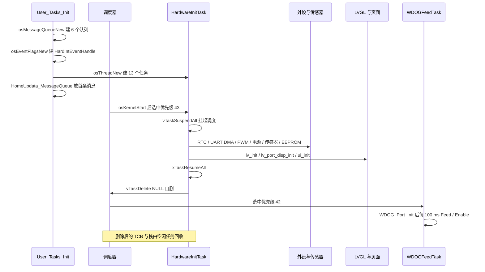
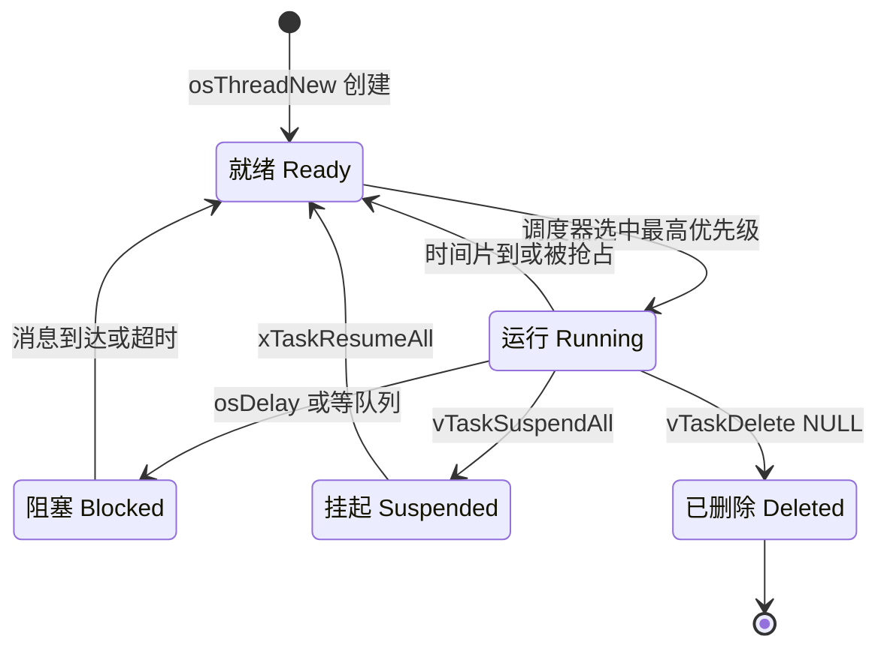

# OV-Watch 源码详解 02：FreeRTOS 任务系统

> 涉及文件：
> - `User/Tasks/Src/user_TasksInit.c`（任务/队列总装）
> - `User/Tasks/Inc/user_TasksInit.h`（事件位、队列声明）
> - `User/Tasks/Src/user_*.c`（各任务实现）
> - `Core/Src/freertos.c`（调度器钩子、defaultTask）
> - `Core/Inc/FreeRTOSConfig.h`（内核配置）

---

## 1. 先看全景：14 个任务

| # | 任务 | 入口函数 | 栈（字节） | 优先级 | 触发/周期 | 阻塞对象 |
|---|---|---|---|---|---|---|
| 1 | HardwareInitTask | `HardwareInitTask` | 1280 | 43 (High3) | 上电一次 | `vTaskSuspendAll` + 自删 |
| 2 | WDOGFeedTask | `WDOGFeedTask` | 128 | 42 (High2) | 100 ms | `osDelay(100)` |
| 3 | StopEnterTask | `StopEnterTask` | 2048 | 41 (High1) | 等消息 | `Stop_MessageQueue` |
| 4 | IdleEnterTask | `IdleEnterTask` | 128 | 40 (High) | 10 ms | `osDelay(10)` |
| 5 | defaultTask | `StartDefaultTask` | 512 | 24 (Normal) | 500 ms | `osDelay(500)` |
| 6 | KeyTask | `KeyTask` | 128 | 24 (Normal) | 1 ms | `osDelay(1)` |
| 7 | LvHandlerTask | `LvHandlerTask` | 3072 | 8 (Low) | 1~30 ms 自适应 | `osDelay(wait)` |
| 8 | ScrRenewTask | `ScrRenewTask` | 1280 | 9 (Low1) | 10 ms | `Key_MessageQueue` 非阻塞 |
| 9 | SensorDataUpdateTask | `SensorDataUpdateTask` | 640 | 9 (Low1) | 500 ms | `osDelay(500)` |
| 10 | HRDataUpdateTask | `HRDataUpdateTask` | 640 | 9 (Low1) | 50 ms | `osDelay(50)` |
| 11 | ChargPageEnterTask | `ChargPageEnterTask` | 1280 | 9 (Low1) | 等事件 | `HardIntEventHandle` |
| 12 | MessageSendTask | `MessageSendTask` | 640 | 9 (Low1) | 等事件 | `HardIntEventHandle` |
| 13 | MPUCheckTask | `MPUCheckTask` | 384 | 10 (Low2) | 300 ms | `osDelay(300)` |
| 14 | DataSaveTask | `DataSaveTask` | 640 | 10 (Low2) | 等队列 | `DataSave_MessageQueue` |

> 栈大小是 `osThreadAttr_t.stack_size` 的字节值；CMSIS 层会除以 4 后传给
> `xTaskCreate()`（FreeRTOS 的栈单位是 **word**）。例如 1280 B = 320 words。

### 1.1 优先级数值是怎么来的

`configMAX_PRIORITIES = 56`，CMSIS-RTOS2 封装直接把 `attr->priority` 传给
FreeRTOS（`cmsis_os2.c` 中 `prio = (UBaseType_t)attr->priority`），所以：

| CMSIS 名称 | 数值 | 本工程中的任务 |
|---|---|---|
| `osPriorityLow` | 8 | LvHandlerTask |
| `osPriorityLow1` | 9 | ScrRenew / Sensor / HR / Charg / MessageSend |
| `osPriorityLow2` | 10 | MPUCheck / DataSave |
| `osPriorityNormal` | 24 | KeyTask / defaultTask |
| `osPriorityHigh` | 40 | IdleEnterTask |
| `osPriorityHigh1` | 41 | StopEnterTask |
| `osPriorityHigh2` | 42 | WDOGFeedTask |
| `osPriorityHigh3` | 43 | HardwareInitTask |

数字越大越优先。空闲任务优先级 0，软件定时器服务任务优先级 2。

**优先级分层与调度流**：



---

## 2. 堆预算：16 KB 怎么塞下 14 个任务

`configTOTAL_HEAP_SIZE = 16 × 1024 = 16384 B`，FreeRTOS 的 `heap_4` 管理。
任务栈总和：

```
1280 + 128 + 2048 + 128 + 512 + 128 + 3072 + 1280
+ 640 + 640 + 1280 + 640 + 384 + 640 = 12800 B
```

| 项目 | 估算 |
|---|---|
| 14 个任务栈 | 12,800 B |
| 14 个 TCB | 约 14 × 100 = 1,400 B |
| 6 个队列控制块 + 存储 | 约 6 × 100 = 600 B |
| 事件组 | 约 60 B |
| 堆管理开销/对齐 | 约 300 B |
| **合计** | **约 15.1 KB / 16 KB** |

结论：**只剩约 1.2 KB 余量**。任何新增任务（哪怕 128 B 栈）都要重新算：

```
新增任务成本 ≈ 栈字节 + 100 B（TCB）
```

如果堆不够，`xTaskCreate()` 返回失败，`osThreadNew()` 返回 NULL；
本工程没有检查返回值，失败时表现为“某个任务完全不运行”。

LVGL 不使用这个堆：`LV_MEM_CUSTOM=0`，用 `lv_conf.h` 里的静态内存池。

---

## 3. 队列与事件组

`User_Tasks_Init()` 创建：

| 对象 | 类型 | 深度 × 消息大小 | 生产者 | 消费者 |
|---|---|---|---|---|
| `Key_MessageQueue` | 队列 | 1 × 1 B | KeyTask | ScrRenewTask |
| `Idle_MessageQueue` | 队列 | 1 × 1 B | IdleEnterTask 自己 | IdleEnterTask |
| `Stop_MessageQueue` | 队列 | 1 × 1 B | KeyTask / IdleEnterTask / MPUCheckTask | StopEnterTask |
| `IdleBreak_MessageQueue` | 队列 | 1 × 1 B | KeyTask / LvHandlerTask / 传感器任务 | IdleEnterTask |
| `HomeUpdata_MessageQueue` | 队列 | 1 × 1 B | User_Tasks_Init / StopEnterTask | SensorDataUpdateTask |
| `DataSave_MessageQueue` | 队列 | 2 × 1 B | SensorDataUpdateTask | DataSaveTask |
| `HardIntEventHandle` | 事件组 | 3 位 | 中断 | Charg/MessageSend 任务 |

事件位定义（`user_TasksInit.h`）：

```c
#define HARDINT_EVENT_UART  (1U << 0)   // 串口收到一帧
#define HARDINT_EVENT_CHARG (1U << 1)   // 充电插拔
#define HARDINT_EVENT_MPU   (1U << 2)   // MPU 中断（本工程未使用）
```

> 队列深度都是 1（DataSave 是 2），消息体只有 1 字节。这是“**事件通知**”
> 而不是“数据传输”：任务只关心“有没有发生”，数据本身放在全局
> `HWInterface` 结构里。

**队列与事件组数据流**：



---

## 4. 逐任务精读

### 4.1 HardwareInitTask —— 一次性引导任务

```c
void HardwareInitTask(void *argument)
{
    while (1) {
        vTaskSuspendAll();          // 挂起调度器
        ... 初始化 RTC/UART/PWM/电源/按键/传感器/EEPROM/BLE/触摸/LCD/LVGL ...
        xTaskResumeAll();           // 恢复调度
        vTaskDelete(NULL);          // 删除自己
        osDelay(500);               // 永远执行不到
    }
}
```

要点：

- 用 `vTaskSuspendAll()` 而不是 `taskENTER_CRITICAL()`：只关调度，不关中断，
  I2C/SPI 传输仍然能被中断服务。
- 初始化期间**不能调用会阻塞的 RTOS API**（调度器挂起时 `osDelay` 是忙等）。
- `vTaskDelete(NULL)` 删除自己后，TCB/栈由空闲任务回收。
- 代码保留 `while(1)` 和 `osDelay(500)` 只是历史遗留，删除后不会执行。

**一次性初始化时序**：



### 4.2 WDOGFeedTask —— 喂狗

```c
WDOG_Port_Init();
while (1) {
    WDOG_Feed();        // 翻转 WDI
    WDOG_Enable();      // EN 拉低（使能）
    osDelay(100);
}
```

硬件看门狗超时约几百毫秒，100 ms 喂一次有足够余量。注意 `WDOG_Enable()`
每轮都写一次 EN，虽然冗余但无害。

### 4.3 StopEnterTask —— 低功耗核心

```c
while (1) {
    if (osMessageQueueGet(Stop_MessageQueue, &Stopstr, NULL, 0) == osOK) {
sleep:
        // 关 UART、关屏/背光、触摸睡眠
        vTaskSuspendAll();
        WDOG_Disnable();
        CLEAR_BIT(SysTick->CTRL, SysTick_CTRL_TICKINT_Msk);  // 关 tick 中断
        HAL_PWR_EnterSTOPMode(PWR_MAINREGULATOR_ON, PWR_STOPENTRY_WFI);
        // —— 在这里睡到 RTC/按键/充电/MPU 中断 ——
        SET_BIT(SysTick->CTRL, SysTick_CTRL_TICKINT_Msk);
        HAL_SYSTICK_Config(SystemCoreClock / 1000);
        SystemClock_Config();       // STOP 唤醒后时钟回到 HSI，要重配
        WDOG_Feed();
        xTaskResumeAll();

        // 判断是否继续睡：抬腕方向、按键、充电
        ...
        if (需要继续睡) { IdleTimerCount = 0; goto sleep; }
        // 恢复 UART、LCD、触摸、充电页
    }
    osDelay(100);
}
```

这是全项目最“危险”的函数：

- `goto sleep` 会跳过 `xTaskResumeAll()` 之外的路径？不会——`goto sleep`
  跳回标签后会重新 `vTaskSuspendAll()`，但**不会重复 `osDelay`**；
  修改时要保证每次睡眠都成对调用 `vTaskSuspendAll/xTaskResumeAll`。
- STOP 模式下 SysTick 停止，唤醒后必须重新配置，否则 FreeRTOS 的 tick 不恢复。
- STOP 唤醒后系统时钟回到 HSI 16 MHz，必须 `SystemClock_Config()` 重新升到 100 MHz。
- `HAL_UART_MspDeInit()` 把 USART1 的 GPIO/DMA/时钟都关了，唤醒后
  `HAL_UART_MspInit()` 重新初始化；这也是为什么串口在睡眠时会掉线。

### 4.4 IdleEnterTask —— 熄屏/休眠计时

```c
while (1) {
    if (收到 Idle 消息) { LCD_Set_Light(5); light_off_sent = 1; }
    if (收到 IdleBreak 消息) { IdleTimerCount = 0; 恢复亮度; }

    if (!light_off_sent && IdleTimerCount >= ui_LTimeValue*1000)
        发 Idle 消息;                    // 到时间 → 变暗

    if (IdleTimerCount >= ui_TTimeValue*1000)
        发 Stop 消息;                    // 到时间 → 进 STOP
    osDelay(10);
}
```

`IdleTimerCount` 由 `TaskTickHook()` 每 1 ms 加 1（在 tick 中断里），
所以这里的 `*1000` 对应秒。两个时间来自设置页：默认背光 10 s、熄屏 15 s。

### 4.5 defaultTask —— 板载 LED

```c
for (;;) {
    HAL_GPIO_TogglePin(GPIOC, GPIO_PIN_13);
    osDelay(500);
}
```

CubeMX 自动生成的默认任务，实际只用来闪 LED，证明调度器活着。
可以删除，但删了要同步删 `freertos.c` 里的创建代码。

### 4.6 KeyTask —— 按键扫描

```c
switch (KeyScan(0)) {
case 1:
    发 Key_MessageQueue(1);
    发 IdleBreak_MessageQueue;      // 有按键 → 退出空闲
    break;
case 2:
    if (当前是首页) 发 Stop_MessageQueue;   // 首页按 KEY2 → 关机/休眠
    else { 发 Key_MessageQueue(2); 发 IdleBreak; }
    break;
}
osDelay(1);
```

`KeyScan()` 内部用 `osDelay(3)` 消抖（见第 06 篇），所以 KeyTask 的 1 ms
周期实际会被拉长到“扫描 + 消抖”。

### 4.7 LvHandlerTask —— LVGL 心跳

```c
if (lv_disp_get_inactive_time(NULL) < 1000)
    发 IdleBreak;                   // 用户正在操作

uint32_t wait = lv_task_handler();
if (wait < 1)  wait = 1;
if (wait > 30) wait = 30;
osDelay(wait);
```

- `lv_task_handler()` 返回“距离下一次需要处理的时间”，用它做自适应延时；
- 上下限 1~30 ms：太小会忙等，太大会掉帧；
- 这是**唯一调用 LVGL 的任务**，所有页面控件操作都发生在它的上下文
  （页面 init 也在 HardwareInitTask 里，但那时调度器挂起，等价于串行）。

### 4.8 ScrRenewTask —— 按键事件到页面动作

```c
if (osMessageQueueGet(Key_MessageQueue, &keystr, NULL, 0) == osOK) {
    if (keystr == 1) {
        Page_Back();
        if (当前页 == Menu) { 心率传感器睡眠; 指南针睡眠; }
    } else if (keystr == 2) {
        Page_Back_Bottom();
        心率传感器睡眠; 指南针睡眠;
    }
}
osDelay(10);
```

它不刷新屏幕，只处理“返回”逻辑；刷新由 LvHandlerTask 做。
命名有历史原因（早期版本在这里调 `lv_timer_handler`）。

### 4.9 SensorDataUpdateTask —— 传感器轮询

每 500 ms：

1. 非阻塞看 `HomeUpdata_MessageQueue`：有消息就更新电量/步数/温湿度，
   并给 DataSaveTask 发存数消息；
2. 根据当前页面决定额外测量：
   - 血氧页：目前空实现（`if(0)`）；
   - 环境页：读 AHT21；
   - 指南针页：唤醒 LSM303，读加速度+磁力计，算方位角；读 SPL06 算高度。

### 4.10 HRDataUpdateTask —— 心率

```c
while (1) {
    if (当前页 == 心率页) {
        发 IdleBreak;                 // 保持唤醒
        EM7028_hrs_Enable();          // 唤醒传感器
        if (!ConnectionError) {
            vTaskSuspendAll();
            hr = HR_Calculate(EM7028_Get_HRS1(), user_HR_timecount);
            xTaskResumeAll();
            if (hr 变化 && 50 < hr < 120) HrRate = hr;
        }
    }
    osDelay(50);
}
```

`user_HR_timecount` 在 tick hook 里每 1 ms 加 1，作为心率算法的时间基准。
`vTaskSuspendAll()` 包住计算，防止被其它任务打断导致采样时间不一致。

### 4.11 ChargPageEnterTask —— 充电插拔

```c
while (1) {
    flags = osEventFlagsWait(HardIntEventHandle, HARDINT_EVENT_CHARG,
                             osFlagsWaitAny, osWaitForever);
    if (flags & HARDINT_EVENT_CHARG) {
        发 IdleBreak;
        if (正在充电 && 当前页 != 充电页) Page_Load(&Page_Charg);
        else if (!充电 && 当前页 == 充电页) Page_Back();
    }
}
```

充电检测是 EXTI2 双边沿中断，中断里只置事件位，页面操作在任务里做。

### 4.12 MessageSendTask —— 串口命令

```c
while (1) {
    flags = osEventFlagsWait(HardIntEventHandle, HARDINT_EVENT_UART,
                             osFlagsWaitAny, osWaitForever);
    if (flags & HARDINT_EVENT_UART) {
        发 IdleBreak;
        printf("RecStr:%s\r\n", HardInt_receive_str);
        // 命令分支：OV / OV+VERSION / OV+SEND / OV+ST=...
        memset(HardInt_receive_str, 0, sizeof(...));
    }
}
```

协议细节见第 05 篇。注意 `osEventFlagsWait` 会**清除**本次等待的事件位
（默认 `osFlagsWaitAny` 语义），所以不需要手动清。

### 4.13 MPUCheckTask —— 抬腕检测

每 300 ms 读 MPU 姿态：

- 水平且之前朝下 → 置 `WRIST_UP`；
- 不水平且之前朝上 → 置 `WRIST_DOWN`，若当前在首页/菜单/设置页，
  发 `Stop_MessageQueue` 进入睡眠。

### 4.14 DataSaveTask —— 存设置/步数

```c
if (收到 DataSave_MessageQueue) {
    保存 wrist_is_enabled、ui_APPSy_EN 到 0x10/0x11；
    读 0x20 的“最后保存日期”：
      日期变了 → 步数清零，写 [日期, 0, 0]
      日期没变 → 写 [日期, 步数高字节, 步数低字节]
}
osDelay(100);
```

EEPROM 地址表见第 08 篇。

---

## 5. 节拍钩子：1 ms 的“软件定时器”

`freertos.c`：

```c
void vApplicationTickHook(void) { TaskTickHook(); }
```

`TaskTickHook()`（`user_TasksInit.c`）：

```c
lv_tick_inc(1);                       // 给 LVGL 提供 tick
if (ui_TimerPageFlag) {
    IdleTimerCount = 0;
    ui_TimerPage_elapsed_ms += 1;     // 计时器页在走
} else {
    IdleTimerCount += 1;              // 空闲计时
}
user_HR_timecount += 1;               // 心率算法时间基准
```

要点：

- tick hook 在**中断上下文**运行，只能做极短、无阻塞的事；
- 三个计时器都靠它，所以它们的分辨率是 1 ms，精度取决于 tick 是否丢失；
- `configUSE_TICK_HOOK=1` 才会被调用。

### 5.1 空闲钩子

```c
void vApplicationIdleHook(void) { }
```

当前为空。FreeRTOS 用空闲任务回收已删除任务的 TCB/栈，所以这个钩子
**绝不能阻塞**，否则删除的任务永远回收不了。

**任务状态机**：



---

## 6. 典型调度场景

### 场景 1：开机

```
HardwareInitTask(43) 运行，挂起调度器
  → 初始化全部外设，ui_init()
  → 恢复调度，自删
WDOG(42) → Stop(41) 阻塞 → Idle(40) → default(24) → Key(24) → Low1/Low2...
```

### 场景 2：用户按 KEY1 返回

```
KeyTask(24) 扫描到 KEY1 → Key_MessageQueue
ScrRenewTask(9) 被唤醒 → Page_Back()
LvHandlerTask(8) 下一次 lv_task_handler() 执行切页动画
```

注意：KeyTask 优先级 24 高于 ScrRenew(9)，所以按键事件会立刻入队；
但 ScrRenew 要等所有更高优先级任务让出 CPU 才跑。

### 场景 3：充电插入

```
EXTI2 中断 → osEventFlagsSet(CHARG)
ChargPageEnterTask(9) 从 osEventFlagsWait 返回 → Page_Load(充电页)
```

### 场景 4：15 s 无操作

```
TickHook 累加 IdleTimerCount
IdleEnterTask(40) 每 10 ms 检查：
  10 s → 发 Idle 消息 → 自己收到 → 背光 5
  15 s → 发 Stop 消息 → StopEnterTask(41) 进入 STOP
```

### 场景 5：STOP 唤醒

```
RTC 约 1 s 唤醒 / KEY1 / KEY2 / 充电 / MPU 中断
→ StopEnterTask 恢复时钟、tick、UART、LCD、触摸
→ 检查抬腕/按键/充电，决定继续睡还是回正常模式
```

---

## 7. 同步与竞态：这份代码的“约定”

工程里**没有使用互斥量/信号量**，共享数据靠“任务优先级 + 单写者”约定：

| 共享数据 | 写者 | 读者 | 风险 |
|---|---|---|---|
| `HWInterface` 各字段 | Sensor/HR/MPU 任务 | UI 页面 | 32 位字段读写是原子的；float 可能撕裂 |
| `HardInt_receive_str` | UART DMA/中断 | MessageSendTask | 中断写、任务清，需保证帧完整 |
| `IdleTimerCount` | TickHook（中断） | IdleEnterTask | 32 位读写原子 |
| `ui_*Value` | UI 事件（LvHandlerTask） | IdleEnterTask | 8 位原子 |
| `PageStack` | ScrRenew/LvHandler | 页面 | 页面操作集中在 LVGL 任务，基本安全 |

### 7.1 已知的竞态点

1. **`HWInterface.AHT21.temperature/humidity` 是 float**，在 Sensor 任务写、
   UI 定时器读；32 位对齐时通常原子，但编译器优化下不保证。
2. **`HardInt_receive_str`**：UART IDLE 中断里重启 DMA，任务里 `memset`；
   如果新帧在 memset 前后到达，可能丢帧（协议层没有帧头/校验）。
3. **`pubsub` 的链表用 `malloc`**，没有锁；如果多个任务同时订阅/发布，
   会破坏链表。本工程只在模拟器按键分发里使用，影响有限。

### 7.2 如果要加锁

- 短临界区：`taskENTER_CRITICAL()/taskEXIT_CRITICAL()`；
- 长操作：新建互斥量，但注意 16 KB 堆余量；
- 中断与任务共享：用队列/事件组，不要在中断里等锁。

---

## 8. 看门狗与任务健康

- 外部看门狗由 `WDOGFeedTask` 每 100 ms 喂；
- 如果系统卡死（例如 STOP 唤醒失败、堆耗尽导致任务创建失败），
  喂狗任务也跑不了 → 看门狗复位；
- STOP 模式前会 `WDOG_Disnable()`，醒来立刻 `WDOG_Feed()`，
  否则睡眠超过看门狗超时会被复位。

---

## 9. 如何新增一个任务（带堆预算）

以“每 2 s 读一次气压并打印”为例：

```c
// 1. 属性（栈 256 B = 64 words）
osThreadId_t BaroTaskHandle;
const osThreadAttr_t BaroTask_attributes = {
    .name = "BaroTask",
    .stack_size = 128 * 2,
    .priority = (osPriority_t) osPriorityLow2,
};

// 2. 任务函数
void BaroTask(void *argument) {
    while (1) {
        float alt = Altitude_Calculate();
        printf("alt=%d\r\n", (int)alt);
        osDelay(2000);
    }
}

// 3. 在 User_Tasks_Init() 里创建
BaroTaskHandle = osThreadNew(BaroTask, NULL, &BaroTask_attributes);
```

堆预算：新增 256 B 栈 + 约 100 B TCB = **356 B**。
当前余量约 1.2 KB，还能加 3 个这种小任务；加第 4 个就要减别人的栈或改
`configTOTAL_HEAP_SIZE`（同时确认 RAM 足够）。

---

## 10. 常见问题

**Q1：某个任务完全不跑？**

- `osThreadNew()` 返回 NULL（堆不够/优先级非法），但代码没检查；
- 在 `User_Tasks_Init()` 后打印各 Handle 是否为 NULL。

**Q2：按键没反应？**

- KeyTask 优先级 24，若某个高优先级任务死循环，它会饿死；
- `KeyScan()` 里的 `osDelay(3)` 依赖调度器，HardwareInitTask 挂起调度期间无效。

**Q3：界面卡顿？**

- LvHandlerTask 优先级最低（8），传感器/按键任务繁忙时会饿它；
- `lv_task_handler()` 的 wait 被限制在 30 ms，最坏 33 FPS。

**Q4：睡下去醒不来？**

- STOP 前关了 SysTick，唤醒后必须 `HAL_SYSTICK_Config()` + `SystemClock_Config()`；
- 检查唤醒源（RTC 约 1 s、KEY1/2、充电、MPU）是否真的产生中断。

**Q5：堆耗尽怎么表现？**

- 新任务创建失败（Handle=NULL）；
- 队列创建失败（NULL），后续 `osMessageQueuePut(NULL,...)` 直接 HardFault；
- 用 `xPortGetFreeHeapSize()` 在初始化后打印一次剩余堆。
