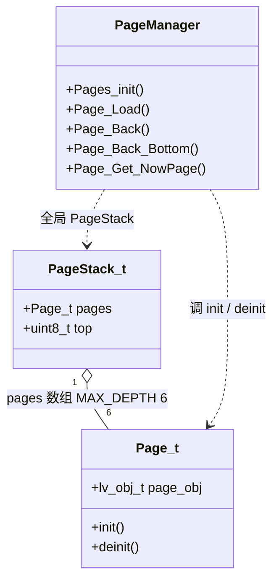
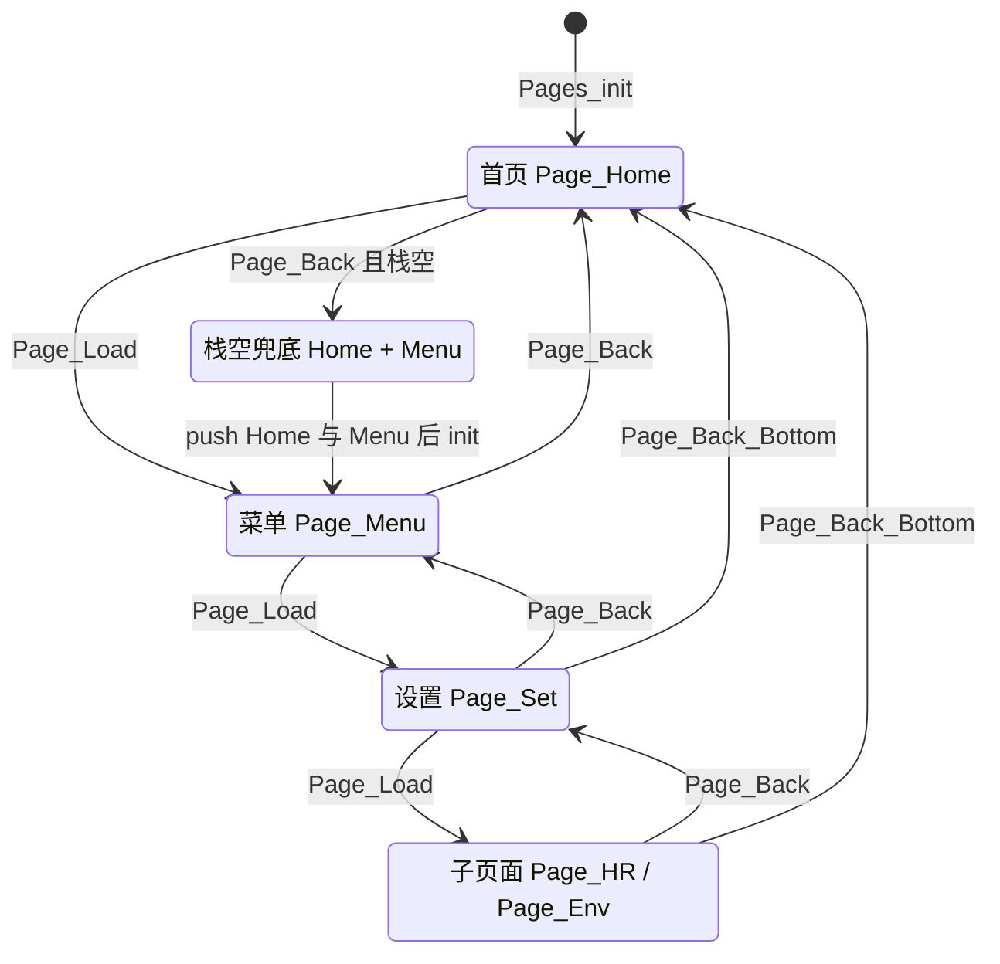
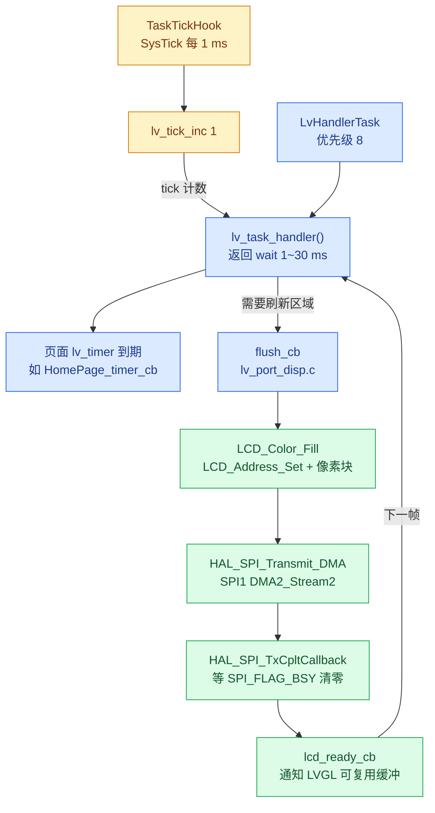
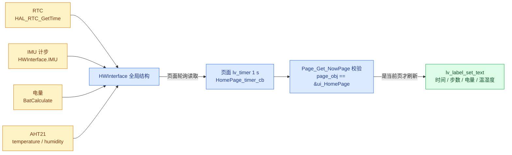

# OV-Watch 源码详解 03：页面管理器与 GUI 架构

> 涉及文件：
> - `User/Func/Src/PageManager.c` / `Inc/PageManager.h`
> - `User/GUI_App/ui.c`
> - `User/GUI_App/Screens/Src/*.c`（19 个页面文件、22 个 Page_t）
> - `Middlewares/LVGL/GUI/lv_conf.h`
> - LVGL 移植：`lv_port_disp.c` / `lv_port_indev.c`

---

## 1. 为什么需要页面管理器

手表有 20 多个界面：表盘、菜单、设置、心率、环境、指南针、计时器、日历、
2048、记忆游戏、NFC、充电、关机……如果每页都写 `switch(page_id)` + 手动
`lv_obj_del()`，代码会迅速失控。

OV-Watch 的做法是把每个页面抽象成 `Page_t`：

```c
typedef struct {
    void (*init)(void);        // 进入页面：创建或更新控件
    void (*deinit)(void);      // 离开页面：删除控件/定时器，释放内存
    lv_obj_t **page_obj;       // 指向页面根对象指针（lv_scr）
} Page_t;
```

页面管理器只做三件事：

1. **push**：进入新页面；
2. **pop**：返回上一页；
3. **调用 init/deinit**：保证 LVGL 对象在切页时正确创建/销毁。

这和 Android 的 Activity 栈、Flipper 的 SceneManager 是同一思想。

---

## 2. 数据结构

`PageManager.h`：

```c
#define MAX_DEPTH 6

typedef struct {
    Page_t *pages[MAX_DEPTH];   // 页面指针数组
    uint8_t top;                // 栈顶索引（0 表示空）
} PageStack_t;

extern PageStack_t PageStack;
```

- 栈深度只有 **6**：首页 → 菜单 → 设置 → 子设置 → …最多叠 5 层；
- `pages[top-1]` 是当前页面；
- 数组存的是 `Page_t*`，页面对象本身是全局静态变量，不动态分配。

**页面数据结构类图**：



---

## 3. 内部原语（static，只在本文件可见）

```c
static void page_stack_init(PageStack_t *stack);          // top = 0
static uint8_t page_stack_push(PageStack_t *stack, Page_t *page);
static uint8_t page_stack_pop(PageStack_t *stack);         // 出栈并调 deinit
static uint8_t page_stack_is_empty(const PageStack_t *stack);
static Page_t *get_top_page(PageStack_t *stack);
```

### 3.1 push

```c
if (stack->top >= MAX_DEPTH) return -1;
stack->pages[stack->top++] = page;
return 0;
```

### 3.2 pop

```c
if (stack->top <= 0) return -1;
stack->pages[--stack->top]->deinit();   // 先减 top，再对弹出的页面 deinit
return 0;
```

**关键点**：`deinit()` 在 `--top` 之后调用，此时该页面已经不在栈里，
但 `Page_t` 结构本身还在（全局变量），所以还能安全访问函数指针。

### 3.3 get_top_page

```c
if (stack->top == 0) return NULL;
return stack->pages[stack->top - 1];
```

---

## 4. 对外 API

### 4.1 `Pages_init()`

```c
void Pages_init(void)
{
    page_stack_init(&PageStack);
    page_stack_push(&PageStack, &Page_Home);
    Page_Home.init();
    lv_disp_load_scr(*Page_Home.page_obj);
}
```

系统启动时由 `ui_init()` 调用：清空栈、压入首页、初始化首页、直接加载
（无动画）。

### 4.2 `Page_Load(Page_t *newPage)` —— 进入新页面

```c
if (PageStack.top >= MAX_DEPTH - 1) return;      // 留 1 个位置
if (PageStack.top > 0)
    PageStack.pages[PageStack.top - 1]->deinit(); // 先销毁当前页控件
page_stack_push(&PageStack, newPage);            // 入栈
newPage->init();                                 // 建新页控件
lv_scr_load_anim(*newPage->page_obj, LV_SCR_LOAD_ANIM_MOVE_RIGHT, 100, 0, true);
```

执行顺序很重要：

1. **先 deinit 旧页**：释放它占的 LVGL 内存/定时器；
2. **再 push 新页**；
3. **再 init 新页**：创建控件；
4. **最后切屏动画**：`MOVE_RIGHT`，100 ms，`true` 表示动画结束后删除旧屏幕。

为什么栈满判断是 `>= MAX_DEPTH - 1` 而不是 `>= MAX_DEPTH`？
因为 push 之后还要保证 `top-1` 合法，留一个空位最省事。

### 4.3 `Page_Back()` —— 返回上一页

```c
if (page_stack_is_empty(&PageStack)) return;

page_stack_pop(&PageStack);       // 当前页 deinit 并出栈

if (page_stack_is_empty(&PageStack)) {
    // 特殊情况：退过头了，回到“首页 + 菜单”
    page_stack_push(&PageStack, &Page_Home);
    page_stack_push(&PageStack, &Page_Menu);
    Page_Menu.init();
    lv_scr_load_anim(*Page_Menu.page_obj, LV_SCR_LOAD_ANIM_MOVE_RIGHT, 100, 0, true);
} else {
    Page_t *previous_page = PageStack.pages[PageStack.top - 1];
    previous_page->init();        // 重新初始化上一页
    lv_scr_load_anim(*previous_page->page_obj, LV_SCR_LOAD_ANIM_MOVE_RIGHT, 100, 0, true);
}
```

注意：上一页在离开时已经 `deinit`（控件被删），所以返回时必须重新 `init()`。
这就是“页面栈 + 重建”模型，不是保存控件现场。

### 4.4 `Page_Back_Bottom()` —— 直接回首页

```c
while (PageStack.top > 1)
    page_stack_pop(&PageStack);              // 逐个 deinit
PageStack.pages[PageStack.top - 1]->init();  // 首页重新 init
lv_scr_load_anim(..., MOVE_RIGHT, 100, 0, true);
```

### 4.5 `Page_Get_NowPage()`

返回栈顶 `Page_t*`。业务代码用它判断“当前在哪一页”，例如：

```c
if (Page_Get_NowPage()->page_obj == &ui_HRPage) { ... }
```

**页面栈状态机**：



---

## 5. 页面清单（22 个 Page_t / 19 个源文件）

| 文件 | Page_t | 说明 |
|---|---|---|
| `ui_HomePage.c` | `Page_Home`、`Page_Power` | 表盘 + 电源页 |
| `ui_MenuPage.c` | `Page_Menu` | 主菜单 |
| `ui_SetPage.c` | `Page_Set` | 设置 |
| `ui_OffTimePage.c` | `Page_LOffTimeSet`、`Page_TOffTimeSet` | 背光/熄屏时间设置 |
| `ui_DateTimeSetPage.c` | `Page_DateTimeSet` | 日期时间设置 |
| `ui_DateSetPage.c` | `Page_DateSet` | 日期设置 |
| `ui_TimeSetPage.c` | `Page_TimeSet` | 时间设置 |
| `ui_CalendarPage.c` | `Page_Calender` | 日历 |
| `ui_HRPage.c` | `Page_HR` | 心率 |
| `ui_SPO2Page.c` | `Page_SPO2` | 血氧 |
| `ui_EnvPage.c` | `Page_Env` | 温湿度/环境 |
| `ui_CompassPage.c` | `Page_Compass` | 指南针 |
| `ui_TimerPage.c` | `Page_Timer` | 秒表/计时器 |
| `ui_ChargPage.c` | `Page_Charg` | 充电页 |
| `ui_ComputerPage.c` | `Page_Computer` | 计算器 |
| `ui_GameSelectPage.c` | `Page_GameSelect` | 游戏选择 |
| `ui_Game2048Page.c` | `Page_Game_2048` | 2048 |
| `ui_GameMemPage.c` | `Page_GameMem` | 记忆游戏 |
| `ui_NFCCardPage.c` | `Page_NFCCard` | NFC 卡模拟入口 |
| `ui_AboutPage.c` | `Page_About` | 关于 |
| `ui_Megboxes.c` | — | 消息框工具 |

每个页面的 `Page_t` 定义形式完全一样：

```c
Page_t Page_HR = { ui_HRPage_screen_init, ui_HRPage_screen_deinit, &ui_HRPage };
```

---

## 6. GUI 初始化：ui_init()

`User/GUI_App/ui.c`：

```c
void ui_init(void)
{
    lv_disp_t *dispp = lv_disp_get_default();
    lv_theme_t *theme = lv_theme_default_init(
        dispp,
        lv_palette_main(LV_PALETTE_BLUE),
        lv_palette_main(LV_PALETTE_RED),
        true, LV_FONT_DEFAULT);
    lv_disp_set_theme(dispp, theme);

    Pages_init();                                    // 首页

    lv_timer_t *ui_MainTimer = lv_timer_create(main_timer, 1000, NULL);
}
```

- 主题：蓝色主色 + 红色强调 + 深色模式（`true`）；
- `Pages_init()` 负责首页；
- 一个 1 s 周期的主定时器（当前 `main_timer` 为空，预留）。
- 文件开头有编译期检查：`LV_COLOR_DEPTH == 16`、`LV_COLOR_16_SWAP == 1`，
  与 SquareLine Studio 的导出设置强绑定，改配置会直接编译报错。

### 6.1 LVGL 移植层

| 文件 | 作用 |
|---|---|
| `lv_port_disp.c` | 注册显示驱动、分配 draw buffer、实现 `flush_cb` |
| `lv_port_indev.c` | 注册触摸输入，读 CST816 坐标 |
| `lv_conf.h` | `LV_COLOR_DEPTH=16`、`LV_MEM_CUSTOM=0`、刷新周期 10 ms |
| `ui_helpers.c` | SquareLine 生成的动画/样式辅助函数 |

刷新链路：

```
TaskTickHook() 每 1 ms → lv_tick_inc(1)
LvHandlerTask  循环    → lv_task_handler()
                         └─ 需要刷新时 → flush_cb → LCD_Color_Fill()
                                              └─ SPI DMA → HAL_SPI_TxCpltCallback
                                                   └─ lcd_ready_cb（通知 LVGL 完成）
```

`LCD_Color_Fill()` 用 DMA 发一整块像素，`HAL_SPI_TxCpltCallback()` 等 SPI
总线空闲后调用回调，告诉 LVGL “可以复用缓冲区了”。这是避免画面撕裂的关键。

**LVGL 渲染链路**：



---

## 7. 页面生命周期（以首页为例）

`ui_HomePage.c` 末尾：

```c
Page_t Page_Home = { ui_HomePage_screen_init, ui_HomePage_screen_deinit, &ui_HomePage };
```

### 7.1 init

`ui_HomePage_screen_init()` 做两件事：

1. 如果 `ui_HomePage == NULL`，调用 SquareLine 生成的 `ui_HomePage_screen_init()`
   创建整个页面控件树；
2. 创建页面自己的 `lv_timer`（1 s 周期），在回调里读 RTC、步数、电量、
   温湿度并刷新 label。

定时器回调里有这行保护：

```c
if (Page_Get_NowPage()->page_obj == &ui_HomePage) { ... }
```

防止页面已经切走、定时器还没删时继续访问控件。

### 7.2 deinit

`ui_HomePage_screen_deinit()`：

1. 删除页面定时器；
2. 删除页面根对象（连同所有子控件）；
3. 把 `ui_HomePage` 置 NULL。

**必须把定时器一起删掉**，否则定时器回调会访问已释放的 label，直接 HardFault。

**页面数据流**：



---

## 8. 按键如何驱动页面

```
KeyTask（1 ms 扫描）
  └─ KeyScan() 消抖 → Key_MessageQueue
       └─ ScrRenewTask（10 ms 轮询）
            ├─ key==1 → Page_Back()
            └─ key==2 → Page_Back_Bottom()
```

页面内的按钮（例如菜单项）则由 LVGL 的事件回调处理，直接
`Page_Load(&Page_HR)`，不经过 KeyTask。

---

## 9. 新增一个页面（完整步骤）

1. 用 SquareLine 导出 `ui_MyPage.c/h`，或手写一个 `lv_obj_t *ui_MyPage`；
2. 实现 `ui_MyPage_screen_init()` / `ui_MyPage_screen_deinit()`；
3. 在 `ui_MyPage.c` 末尾加：
   ```c
   Page_t Page_My = { ui_MyPage_screen_init, ui_MyPage_screen_deinit, &ui_MyPage };
   ```
4. 在 `ui_MyPage.h` 里 `extern Page_t Page_My;`；
5. 在菜单按钮的事件里 `Page_Load(&Page_My);`；
6. 如果页面需要周期刷新，在 init 里 `lv_timer_create()`，在 deinit 里
   `lv_timer_del()`。

---

## 10. 常见问题

**Q1：切页后花屏/黑屏？**

- `deinit` 删了 `page_obj` 但没置 NULL，下一次 `init` 以为已创建，跳过创建；
- 检查 `lv_scr_load_anim` 的最后一个参数是否为 `true`（动画结束删旧屏）。

**Q2：切几次页就内存耗尽？**

- 某页 `deinit` 没删定时器/子控件；
- LVGL 内存池（`LV_MEM_SIZE`）用尽后 `lv_obj_create` 返回 NULL。

**Q3：页面栈溢出？**

- `MAX_DEPTH=6`，连续 `Page_Load` 超过 5 次会被静默拒绝（函数直接 return）；
- 深层页面应改用 `Page_Back()` 返回，而不是继续 push。

**Q4：`Page_Get_NowPage()` 返回 NULL？**

- 只会在 `Pages_init()` 之前调用时发生；
- 初始化任务里不要在 `ui_init()` 之前访问页面。

**Q5：中文显示乱码？**

- 页面字体是 SquareLine 生成的 C 数组（`ui_font_Cuyuan*`），只包含用到的字；
- 新增中文要重新生成字体，不能直接写字符串。
