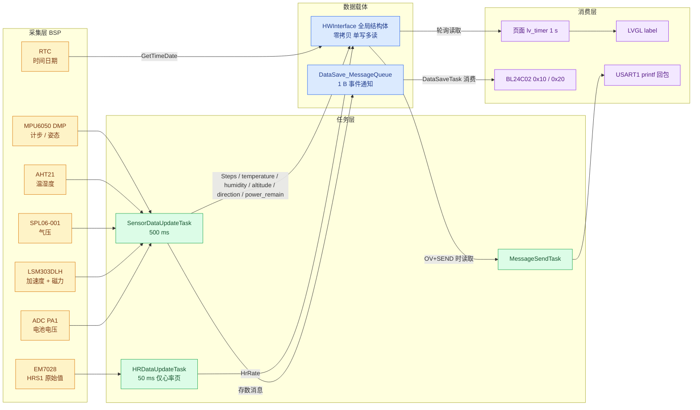
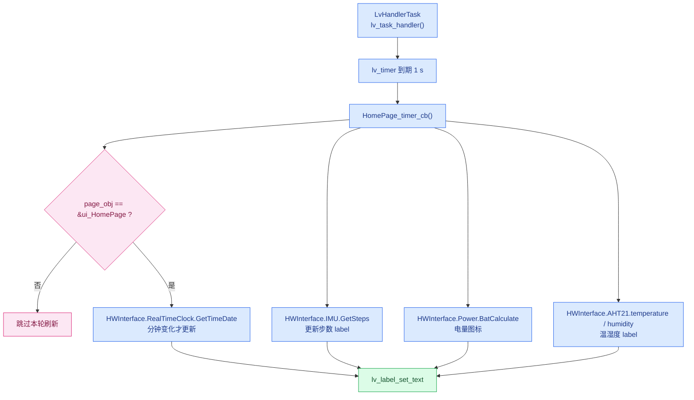
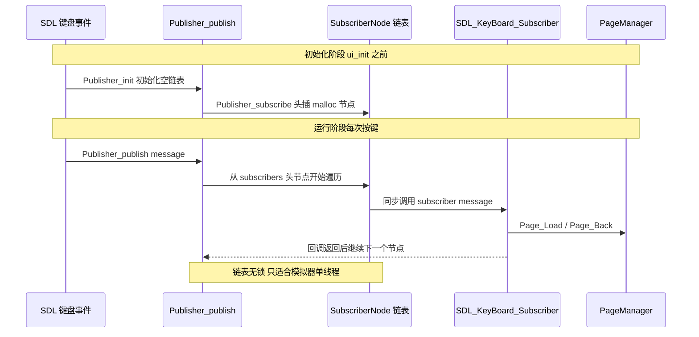

# OV-Watch 源码详解 04：数据流、HWInterface 与发布订阅

> 涉及文件：
> - `User/Func/Src/HWDataAccess.c` / `Inc/HWDataAccess.h`（硬件接口表）
> - `User/Func/Src/pubsub.c` / `Inc/pubsub.h`（发布订阅）
> - `lv_sim_vscode_win/user_test/GUI_App/ui.c`（pubsub 的实际使用点）
> - `User/Tasks/Src/user_SensUpdateTask.c`、`user_HRDataUpdateTask.c`

---

## 1. 一句话总结

固件里的数据流是 **“任务写全局接口表，页面定时器读”** 的拉模型；
`pubsub` 是一个极简观察者实现，只在 **PC 模拟器** 里用于分发 SDL 按键，
固件本身没有使用它。

---

## 2. HWInterface：一张函数指针表

`HWDataAccess.c` 末尾定义了全局变量：

```c
HW_InterfaceTypeDef HWInterface = {
    .RealTimeClock = { .GetTimeDate = HW_RTC_Get_TimeDate, ... },
    .BLE           = { .Init = HW_BLE_Init, ... },
    .Power         = { .power_remain = 0, .Init = HW_Power_Init, ... },
    .LCD           = { .SetLight = HW_LCD_Set_Light },
    .IMU           = { .ConnectionError = 1, .Steps = 0, ... },
    .AHT21         = { .ConnectionError = 1, .humidity = 67, .temperature = 26, ... },
    .Barometer     = { .ConnectionError = 1, .altitude = 19, ... },
    .Ecompass      = { .ConnectionError = 1, .direction = 45, ... },
    .HR_meter      = { .ConnectionError = 1, .HrRate = 0, .SPO2 = 99, ... },
};
```

它把“数据 + 操作”打包成一个结构体：

| 模块 | 字段（数据） | 函数指针（操作） |
|---|---|---|
| RealTimeClock | — | `GetTimeDate`、`SetDate`、`SetTime`、`CalculateWeekday` |
| BLE | — | `Init`、`Enable`、`Disable` |
| Power | `power_remain` | `Init`、`Shutdown`、`BatCalculate` |
| LCD | — | `SetLight` |
| IMU | `ConnectionError`、`Steps`、`wrist_is_enabled`、`wrist_state` | `Init`、`WristEnable/Disable`、`GetSteps`、`SetSteps` |
| AHT21 | `ConnectionError`、`humidity`、`temperature` | `Init`、`GetHumiTemp` |
| Barometer | `ConnectionError`、`altitude` | `Init` |
| Ecompass | `ConnectionError`、`direction` | `Init`、`Sleep` |
| HR_meter | `ConnectionError`、`HrRate`、`SPO2` | `Init`、`Sleep` |

### 2.1 上电默认值不是“真实数据”

```c
.AHT21  = { .humidity = 67, .temperature = 26 }
.Barometer = { .altitude = 19 }
.Ecompass  = { .direction = 45 }
.HR_meter  = { .SPO2 = 99 }
```

这些是给 UI 的占位值：传感器还没初始化好时，界面先显示一个合理数字，
避免出现 0 或乱码。`ConnectionError = 1` 表示“未连接/未初始化”，
上层在读写前一般会检查它。

### 2.2 为什么用函数指针表

1. **UI 不依赖具体驱动**：页面只写 `HWInterface.AHT21.GetHumiTemp(...)`；
2. **可替换**：换传感器只改表里的函数，不改页面；
3. **可仿真**：`HW_USE_HARDWARE=0` 时整张表换成桩函数，PC 上直接跑 UI。

---

## 3. HW_USE_HARDWARE 开关

`HWDataAccess.h`：

```c
#define HW_USE_HARDWARE 1

#if HW_USE_HARDWARE
  #define HW_USE_RTC    1
  #define HW_USE_BLE    1
  #define HW_USE_BAT    1
  #define HW_USE_LCD    1
  #define HW_USE_IMU    1
  #define HW_USE_AHT21  1
  #define HW_USE_SPL06  1
  #define HW_USE_LSM303 1
  #define HW_USE_EM7028 1
#endif
```

每个 `HW_xxx` 函数内部都是：

```c
#if HW_USE_AHT21
    return AHT_Init();
#else
    return -1;
#endif
```

把总开关改成 0 后：

- 所有 `#include "xxx.h"` 消失，不再需要 BSP；
- 所有硬件调用变成空实现/返回 0；
- 同一份 UI 代码可以在 Windows 模拟器里编译运行。

这就是 `lv_sim_vscode_win/user_test/` 能复用固件 UI 的原因。

---

## 4. 数据从哪来、到哪去

### 4.1 生产者（谁写数据）

| 数据 | 写入者 | 时机 |
|---|---|---|
| `IMU.Steps` | `SensorDataUpdateTask` | 每 500 ms，`GetSteps()` |
| `IMU.wrist_state` | `MPUCheckTask`、`StopEnterTask` | 300 ms / 唤醒时 |
| `AHT21.temperature/humidity` | `SensorDataUpdateTask` | 500 ms（首页/环境页） |
| `HR_meter.HrRate` | `HRDataUpdateTask` | 50 ms（仅心率页） |
| `HR_meter.SPO2` | 未实现 | — |
| `Ecompass.direction` | `SensorDataUpdateTask` | 500 ms（仅指南针页） |
| `Barometer.altitude` | `SensorDataUpdateTask` | 500 ms（仅指南针页） |
| `Power.power_remain` | `SensorDataUpdateTask` | 500 ms（首页刷新时） |
| `RTC 时间` | `MessageSendTask`（`OV+ST=`） | 收到命令时 |
| `wrist_is_enabled`、`ui_APPSy_EN` | 设置页 | 用户操作 |

### 4.2 消费者（谁读数据）

| 消费者 | 读什么 | 方式 |
|---|---|---|
| `ui_HomePage.c` 的 1 s 定时器 | 时间、步数、电量、温湿度 | 轮询 `HWInterface` |
| `ui_EnvPage.c` | 温湿度 | 轮询 |
| `ui_HRPage.c` | 心率 | 轮询 |
| `ui_CompassPage.c` | 方位角、高度 | 轮询 |
| `ui_ChargPage.c` | 电量/充电状态 | 轮询 |
| `MessageSendTask` | 温湿度/心率/步数/时间 | 收到 `OV+SEND` 时读 |
| `DataSaveTask` | 步数、设置 | 收到存数消息时读 |

### 4.3 为什么是“拉”而不是“推”

- 页面只在**显示时**才需要数据，轮询最简单；
- 避免每来一个传感器样本就刷新 UI（费电、费 CPU）；
- 页面定时器 1 s 一次，足够表盘显示；
- 心率页 50 ms 采样、页面 1 s 刷新，中间值保留在结构体里。

代价：数据不是实时推送，页面刷新有最多 1 s 延迟；对 Watch 场景足够。

**传感器到 UI 的全链路数据流**：



---

## 5. 首页刷新流程（完整链路）

```
LvHandlerTask: lv_task_handler() → lv_timer 到期（1 s）
  └─ HomePage_timer_cb()
       ├─ 判断 Page_Get_NowPage()->page_obj == &ui_HomePage
       ├─ HWInterface.RealTimeClock.GetTimeDate(&DateTime)
       ├─ 若分钟变化 → lv_label_set_text(ui_TimeMinuteLabel, ...)
       ├─ HWInterface.IMU.GetSteps() → 更新步数 label
       ├─ HWInterface.Power.BatCalculate() → 电量图标
       └─ HWInterface.AHT21.temperature/humidity → 温湿度 label
```

同时 `SensorDataUpdateTask` 每 500 ms 也在更新这些字段，两者是
“单写多读”的关系；8/16 位字段读写原子，float 存在理论上的撕裂风险
（见第 02 篇 7.1）。

**首页刷新执行流**：



### 5.1 HomeUpdata 消息

`User_Tasks_Init()` 末尾：

```c
uint8_t HomeUpdataStr;
osMessageQueuePut(HomeUpdata_MessageQueue, &HomeUpdataStr, 0, 1);
```

这是**一次性触发**：SensorDataUpdateTask 收到后，立即做一轮
“电量/步数/温湿度”采样，并给 DataSaveTask 发存数消息。之后这条队列
主要由 `StopEnterTask` 在唤醒后写入，用来让首页立刻刷新。

---

## 6. pubsub：46 行的观察者模式

### 6.1 数据结构

```c
typedef struct {
    int id;
    char data[256];
} PubSub_Message_t;

typedef void (*Subscriber)(PubSub_Message_t);

typedef struct SubscriberNode {
    Subscriber subscriber;
    struct SubscriberNode *next;
} SubscriberNode;

typedef struct {
    SubscriberNode *subscribers;
} PubSub_Publisher_t;
```

- 发布者持有**单向链表**；
- 订阅 = 头插一个节点（`malloc`）；
- 发布 = 遍历链表，依次同步调用回调；
- 取消订阅 = 遍历找到节点，摘链并 `free`。

### 6.2 代码要点

```c
void Publisher_subscribe(PubSub_Publisher_t *publisher, Subscriber subscriber)
{
    SubscriberNode *node = malloc(sizeof(SubscriberNode));
    if (node == NULL) return;              // 分配失败静默返回
    node->subscriber = subscriber;
    node->next = publisher->subscribers;
    publisher->subscribers = node;
}

void Publisher_publish(PubSub_Publisher_t *publisher, PubSub_Message_t message)
{
    SubscriberNode *node = publisher->subscribers;
    while (node != NULL) {
        node->subscriber(message);          // 同步调用
        node = node->next;
    }
}
```

### 6.3 它在本工程里到底用在哪

固件目录里**只有定义，没有调用点**。实际使用在模拟器：

`lv_sim_vscode_win/user_test/GUI_App/ui.c`：

```c
Publisher_init(&SDL_KeyBoard_Publisher);
Publisher_subscribe(&SDL_KeyBoard_Publisher, SDL_KeyBoard_Subscriber);
```

SDL 键盘事件 → `Publisher_publish(&SDL_KeyBoard_Publisher, msg)` →
`SDL_KeyBoard_Subscriber` 把按键转成页面操作。这样模拟器和固件的
按键路径可以共用同一套“页面动作”代码。

**发布订阅时序**：



### 6.4 局限（读代码时要注意）

1. **不是线程安全的**：链表无锁，多任务同时订阅/发布会破坏指针；
2. **同步回调**：`Publisher_publish` 会阻塞到所有订阅者返回，
   回调里不能做耗时操作；
3. **消息体 260 字节**：按值传递整个结构体，栈开销大（本工程只传小消息）；
4. **malloc/free**：嵌入式里应尽量静态分配，这里为了模拟器简单才用堆。

> 结论：把它当作“**模拟器里的按键分发器**”看即可，不要误以为
> 固件的传感器数据是走 pubsub 的。

---

## 7. 设置项的数据流

`ui_LTimeValue`（背光时间）、`ui_TTimeValue`（熄屏时间）、
`ui_LightSliderValue`（亮度）都是**全局 uint8_t**：

```
设置页滑块/选项 → 直接改全局变量
  ├─ IdleEnterTask 每 10 ms 读 ui_LTimeValue / ui_TTimeValue 做倒计时
  ├─ 背光变化时调 LCD_Set_Light(ui_LightSliderValue)
  └─ 用户改设置 → 发 DataSave_MessageQueue → DataSaveTask 写 EEPROM
```

没有加锁：8 位读写原子，最坏情况是“刚好在改的时候读到旧值”，
下一轮 10 ms 就会纠正。

---

## 8. 蓝牙数据流

```
手机 → KT6328A → USART1 RX → DMA(25 B) → IDLE 中断
  → osEventFlagsSet(HARDINT_EVENT_UART)
  → MessageSendTask 唤醒
      ├─ OV+SEND   → 组装时间/温湿度/心率/步数 → printf → USART1 TX
      └─ OV+ST=... → 解析时间 → RTC_SetDate/SetTime → 回 "TIMESETOK"
```

`printf` 被重定向到 USART1（`fputc` 在 `usart.c` 末尾），所以
“发送数据”就是调用 `printf`。协议细节见第 05 篇。

---

## 9. 设计取舍总结

| 设计 | 优点 | 代价 |
|---|---|---|
| 全局 `HWInterface` 结构 | 简单、零拷贝、页面直接读 | 无封装、无锁、字段可被任意改 |
| 页面轮询 | 逻辑简单、省电 | 刷新延迟最多 1 s |
| 页面定时器读硬件 | UI 与采集解耦 | 定时器生命周期要手工管理 |
| pubsub 链表 | 解耦发布/订阅 | 仅模拟器使用、非线程安全 |
| `HW_USE_HARDWARE` | 一套 UI 跑 PC/硬件 | 宏分支多，改驱动要同步改桩 |

---

## 10. 常见问题

**Q1：界面数据不动？**

- 对应任务没跑（堆不足/优先级被饿死）；
- 页面定时器没创建或被 deinit 删掉；
- `ConnectionError=1`，上层跳过读取。

**Q2：数据跳变/闪烁？**

- 任务写、页面读没有同步，float 可能撕裂；
- 页面每秒刷新一次，传感器 500 ms 更新一次，属于正常。

**Q3：模拟器按键没反应？**

- 检查 `Publisher_init/subscribe` 是否在 `ui_init()` 前调用；
- 检查 `SDL_KeyBoard_Subscriber` 是否真的被加入链表（malloc 失败会静默）。

**Q4：修改 `HW_USE_HARDWARE` 后编译报错？**

- 置 0 后所有 `HW_USE_xxx` 都未定义，`#if HW_USE_RTC` 会把未定义宏当 0，
  这是预期行为；如果报“找不到 xxx.h”，说明某个 `#include` 没放在
  `#if` 里，需要补。
