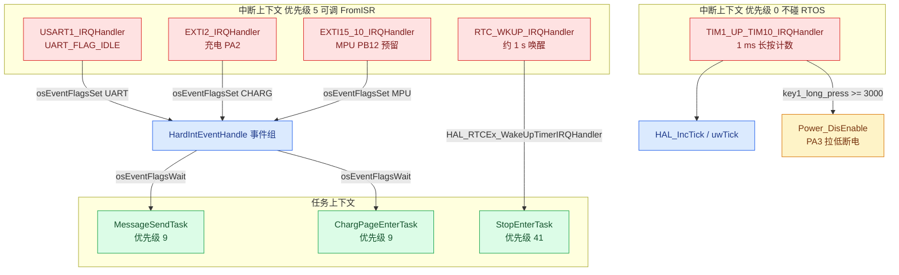
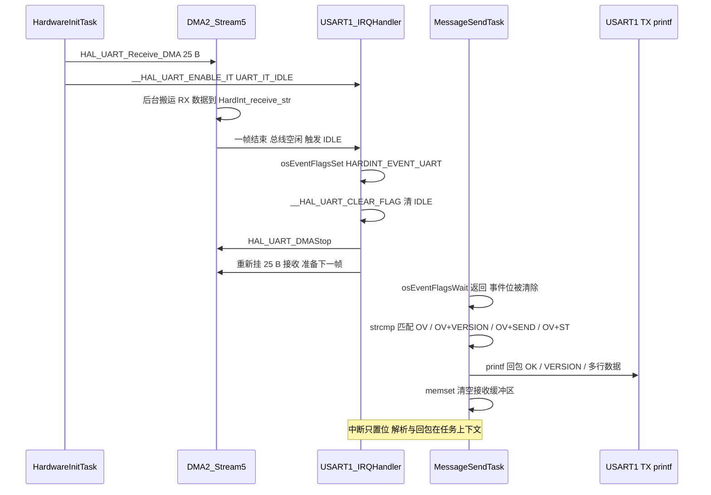

# OV-Watch 源码详解 05：中断系统与通信协议

> 涉及文件：
> - `Core/Src/stm32f4xx_it.c`（所有中断入口）
> - `Core/Src/usart.c`（USART1 + DMA + printf 重定向）
> - `Core/Inc/FreeRTOSConfig.h`（中断优先级约束）
> - `User/Tasks/Src/user_MessageSendTask.c`（协议解析）
> - `BSP/POWER/power.c`、`BSP/KEY/key.c`（EXTI 初始化）

---

## 1. 中断优先级规则（先记住这条）

FreeRTOS 的 `configMAX_SYSCALL_INTERRUPT_PRIORITY` 在本工程是 **5**：

```c
#define configLIBRARY_MAX_SYSCALL_INTERRUPT_PRIORITY 5
```

Cortex-M 的优先级数值**越小越高**。规则：

- 优先级 **0~4** 的中断：**不能**调用任何 FreeRTOS API（包括 `FromISR` 版本）；
- 优先级 **5~15** 的中断：可以调用 `xxxFromISR()`；
- 所有会调用 FreeRTOS API 的中断，优先级都必须 ≥5（数值）。

本工程的中断优先级：

| 中断 | 优先级 | 是否调用 FreeRTOS API |
|---|---|---|
| EXTI2（充电） | 5 | 是：`osEventFlagsSet` |
| EXTI4（KEY2） | 5 | 否（只清标志） |
| EXTI9_5（KEY1） | 5 | 否 |
| EXTI15_10（MPU） | 5 | 是：`osEventFlagsSet` |
| USART1 | 5 | 是：`osEventFlagsSet` |
| TIM1（HAL 时基） | 0 | 否（只 `HAL_IncTick`） |
| SysTick | 15（内核） | 内核自用 |
| PendSV | 15（内核） | 内核自用 |

> 这就是为什么 TIM1 可以用最高优先级 0：它只做 `uwTick++`，不碰 RTOS。
> 如果哪天在 TIM1 回调里调用 `osMessageQueuePutFromISR`，系统会直接崩。

**中断到任务的执行流**：



---

## 2. USART1：DMA + IDLE 收变长帧

### 2.1 硬件配置

`usart.c`：

| 项目 | 值 |
|---|---|
| 波特率 | 115200 |
| 数据位/停止位/校验 | 8 / 1 / None |
| 模式 | TX + RX |
| 流控 | 无 |
| TX/RX 引脚 | PA9 / PA10，AF7 |
| RX DMA | DMA2_Stream5，Channel 4，外设→内存，字节对齐 |
| TX DMA | DMA2_Stream7，Channel 4，内存→外设（`printf` 实际没用它） |
| 中断 | USART1_IRQn，优先级 5 |

### 2.2 接收流程

初始化（`user_HardwareInitTask.c`）：

```c
HAL_UART_Receive_DMA(&huart1, (uint8_t*)HardInt_receive_str, 25);
__HAL_UART_ENABLE_IT(&huart1, UART_IT_IDLE);
```

中断（`stm32f4xx_it.c`）：

```c
void USART1_IRQHandler(void)
{
    if (__HAL_UART_GET_FLAG(&huart1, UART_FLAG_IDLE) != RESET) {
        if (HardIntEventHandle != NULL)
            osEventFlagsSet(HardIntEventHandle, HARDINT_EVENT_UART);

        __HAL_UART_CLEAR_FLAG(&huart1, UART_FLAG_IDLE);
        HAL_UART_DMAStop(&huart1);
        HAL_UART_Receive_DMA(&huart1, HardInt_receive_str, 25);
    }
    HAL_UART_IRQHandler(&huart1);
}
```

原理：

1. DMA 在后台把串口数据搬进 `HardInt_receive_str[25]`，不占 CPU；
2. 一帧结束、总线空闲时产生 **IDLE 中断**；
3. 中断里置事件位，通知 `MessageSendTask`；
4. 停 DMA、重新挂 25 字节接收，准备下一帧。

`HardInt_receive_str` 定义在 `stm32f4xx_it.c`，长度 25 字节，
是所有串口命令的“邮箱”。

**UART 变长帧接收时序**：



### 2.3 printf 重定向

`usart.c` 末尾：

```c
int fputc(int ch, FILE *f)
{
    HAL_UART_Transmit(&huart1, (uint8_t *)&ch, 1, 0xffff);
    return ch;
}
```

- `printf` → 逐字节阻塞发送到 USART1；
- 每字节最多等 0xFFFF 个 HAL tick（约 65 s），实际很短；
- 因此 `printf` 在任务里是**阻塞**的，不要在中断里调用；
- TX DMA 虽然初始化了，但这里没用；如果需要高吞吐，应改成 DMA 发送。

**串口命令数据流**：

```mermaid
flowchart LR
    PHONE["手机 蓝牙"]
    BLE["KT6328A 透传"]
    RX["USART1 RX<br/>PA10 115200 8N1"]
    DMA["DMA2_Stream5<br/>外设到内存"]
    BUF["HardInt_receive_str<br/>25 B 邮箱"]
    IDLE["IDLE 标志<br/>__HAL_UART_CLEAR_FLAG"]
    EV["HARDINT_EVENT_UART"]
    TASK["MessageSendTask<br/>strcmp 分支"]
    RTC["RTC_SetDate / RTC_SetTime"]
    TX["printf -> fputc<br/>HAL_UART_Transmit"]
    PHONE --> BLE --> RX --> DMA --> BUF
    BUF --> IDLE
    IDLE -->|"osEventFlagsSet"| EV
    EV --> TASK
    TASK -->|"OV+ST=YYYYMMDDHHMMSS"| RTC
    TASK -->|"OV / OV+VERSION / OV+SEND 回包"| TX
    TX --> PHONE
    classDef phy fill:#fef3c7,stroke:#d97706,color:#78350f
    classDef mcu fill:#dbeafe,stroke:#2563eb,color:#1e3a8a
    classDef task fill:#dcfce7,stroke:#16a34a,color:#14532d
    class PHONE,BLE phy
    class RX,DMA,BUF,IDLE,EV,RTC,TX mcu
    class TASK task
```



---

## 3. 串口命令协议

### 3.1 命令表

| 命令（ASCII） | 长度 | 作用 | 回复 |
|---|---|---|---|
| `OV` | 2 | 握手/测试 | `OK\r\n` |
| `OV+VERSION` | 10 | 查版本 | `VERSION=V2.4.5` |
| `OV+SEND` | 7 | 上报全部数据 | 多行文本（见下） |
| `OV+ST=YYYYMMDDHHMMSS` | 20 | 设置时间 | `TIMESETOK\r\n` |

### 3.2 `OV+SEND` 回复格式

```
data:MM-DD
time:HH:MM:SS
humidity:xx%
temperature:xx
Heart Rate:xx%
SPO2:xx%
Step today:xxxx
```

数据来源：

- 时间：`HAL_RTC_GetTime/GetDate`
- 温湿度：`HWInterface.AHT21`
- 心率/血氧：`HWInterface.HR_meter`
- 步数：`HWInterface.IMU.Steps`

### 3.3 `OV+ST=` 解析

`TimeFormat_Get()` 从固定位置取数字：

```
O V + S T = 2 0 2 6 1 1 0 9 1 2 3 4 5 6
0 1 2 3 4 5 6 7 8 9 ...
                ↑ 年(2位) 月 日 时 分 秒
```

- 年：`str[8..9]`
- 月：`str[10..11]`
- 日：`str[12..13]`
- 时：`str[14..15]`
- 分：`str[16..17]`
- 秒：`str[18..19]`

范围检查通过后调用 `RTC_SetDate/RTC_SetTime`。

### 3.4 协议层的三个隐患

1. **没有帧头/长度/校验**：完全依赖“25 字节 + IDLE”判断一帧；
2. **没有保证 '\0' 结尾**：`HardInt_receive_str` 是 25 字节，如果收到正好
   25 字节，`strcmp/strlen` 会越界读；当前协议都短于 25，实际风险低；
3. **`StrCMD_Get()` 不检查 `\0`**：遇到没有 `=` 的字符串会一直读下去，
   属于潜在越界（`user_MessageSendTask.c` 里有注释标注）。

---

## 4. EXTI 外部中断

### 4.1 按键

`key.c`：

```c
KEY1: PA5, GPIO_MODE_IT_FALLING, 上拉     // 按下为低
KEY2: PA4, GPIO_MODE_IT_RISING,  无上拉
NVIC: EXTI9_5_IRQn / EXTI4_IRQn，优先级 5
```

中断入口只做一件事：`HAL_GPIO_EXTI_IRQHandler()` 清标志。
按键的实际扫描/消抖在 `KeyTask` 里轮询（`KeyScan`），EXTI 的作用是
**把 MCU 从 STOP 模式唤醒**，不是产生按键事件。

### 4.2 充电检测

`power.c`：

```c
CHARGE_PIN = PA2, GPIO_MODE_IT_RISING_FALLING
NVIC: EXTI2_IRQn，优先级 5
```

`EXTI2_IRQHandler()`：

```c
if (HardIntEventHandle != NULL)
    osEventFlagsSet(HardIntEventHandle, HARDINT_EVENT_CHARG);
HAL_GPIO_EXTI_IRQHandler(GPIO_PIN_2);
```

插入/拔出都会触发，`ChargPageEnterTask` 再读 `ChargeCheck()` 确认状态。

### 4.3 MPU 中断

PB12 → `EXTI15_10_IRQHandler` → 置 `HARDINT_EVENT_MPU`。
当前固件没有任务等待这个位，属于预留（抬腕中断唤醒方案未启用）。

### 4.4 长按 KEY1 关机

`TIM1_UP_TIM10_IRQHandler()` 里有一段“私货”：

```c
static uint16_t key1_long_press;
if (!KEY1) {
    key1_long_press += 1;
    if (key1_long_press >= 3000)
        Power_DisEnable();       // 切断整机电源
} else {
    key1_long_press = 0;
}
```

TIM1 是 HAL 时基，1 ms 一次，所以 3000 ≈ **3 秒**。
长按 KEY1 三秒直接断电，不经过任何任务。

---

## 5. RTC 唤醒中断

`RTC_WKUP_IRQHandler()` → `HAL_RTCEx_WakeUpTimerIRQHandler(&hrtc)`。

唤醒定时器在 `HardwareInitTask` 里配置：

```c
HAL_RTCEx_SetWakeUpTimer_IT(&hrtc, 2000, RTC_WAKEUPCLOCK_RTCCLK_DIV16);
```

- 时钟源 LSE 32.768 kHz，DIV16 → 2048 Hz；
- 计数值 2000 → 约 **0.98 s** 一次中断；
- 这个中断是 STOP 模式下主要的定时唤醒源（配合抬腕检测）。

---

## 6. DMA 中断

| 中断 | DMA | 用途 |
|---|---|---|
| `DMA2_Stream2_IRQHandler` | SPI1_TX | LCD 刷屏 |
| `DMA2_Stream5_IRQHandler` | USART1_RX | 串口接收 |
| `DMA2_Stream7_IRQHandler` | USART1_TX | 串口发送（当前未用） |

LCD 的 DMA 完成回调不在 `stm32f4xx_it.c`，而在 `lcd.c`：

```c
void HAL_SPI_TxCpltCallback(SPI_HandleTypeDef *hspi)
{
    if (hspi->Instance == SPI1) {
        while (hspi->Instance->SR & SPI_FLAG_BSY);  // 等最后一位移出
        if (lcd_ready_cb) lcd_ready_cb();           // 通知 LVGL
    }
}
```

---

## 7. 异常处理

`NMI_Handler`、`HardFault_Handler`、`MemManage_Handler`、`BusFault_Handler`、
`UsageFault_Handler` 都是 `while(1)` 死循环。

调试建议：

- 在 `HardFault_Handler` 里把 `SCB->CFSR/HFSR/MMFAR/BFAR` 存到全局变量，
  再用调试器看；
- 常见原因：栈溢出（16 KB 堆很紧）、野指针、中断优先级配置错误、
  在中断里调用了非 FromISR API。

---

## 8. 中断与任务的协作模型

```
中断上下文（快）                     任务上下文（慢）
─────────────────────────────────────────────────────
USART IDLE → 置 UART 事件      →  MessageSendTask 解析/回复
EXTI2 充电 → 置 CHARG 事件     →  ChargPageEnterTask 切页
EXTI MPU  → 置 MPU 事件        →  （预留）
SysTick   → TickHook 计时      →  IdleEnterTask/HRDataUpdateTask 使用计数
TIM1      → HAL_IncTick/长按   →  HAL_Delay 等
RTC WKUP  → HAL 处理           →  唤醒 STOP
```

原则：**中断只做“置位/清标志”，所有耗时操作放到任务里**。
这也是为什么 13 个任务里没有一个是“中断服务任务”。

---

## 9. 常见问题

**Q1：串口收不到数据？**

- `HAL_UART_Receive_DMA` 是否在初始化任务里调用；
- IDLE 中断是否使能；
- `HardIntEventHandle` 是否已创建（`User_Tasks_Init` 之前中断不会置位）。

**Q2：收到数据但命令不响应？**

- `MessageSendTask` 是否在运行（优先级 9，可能被高优先级任务饿死）；
- 命令是否严格匹配（区分大小写、无空格）；
- 缓冲区是否被上一帧残留污染（代码在末尾 `memset`）。

**Q3：充电页不弹？**

- EXTI2 是否触发（PA2 电平变化）；
- `ChargeCheck()` 的极性：1 表示充电中；
- 当前是否已经在充电页（会跳过）。

**Q4：长按 KEY1 不关机？**

- TIM1 中断是否在跑（HAL 时基依赖它）；
- `KEY1` 宏读到的是 PA5 电平，按下为 0；
- `key1_long_press` 是 16 位，3000 次不会溢出。

**Q5：中断里调用 FreeRTOS API 导致死机？**

- 检查该中断优先级是否 ≥5；
- 只能用 `FromISR` 结尾的 API；
- `osEventFlagsSet` 在 CMSIS-RTOS2 里是中断安全的。
