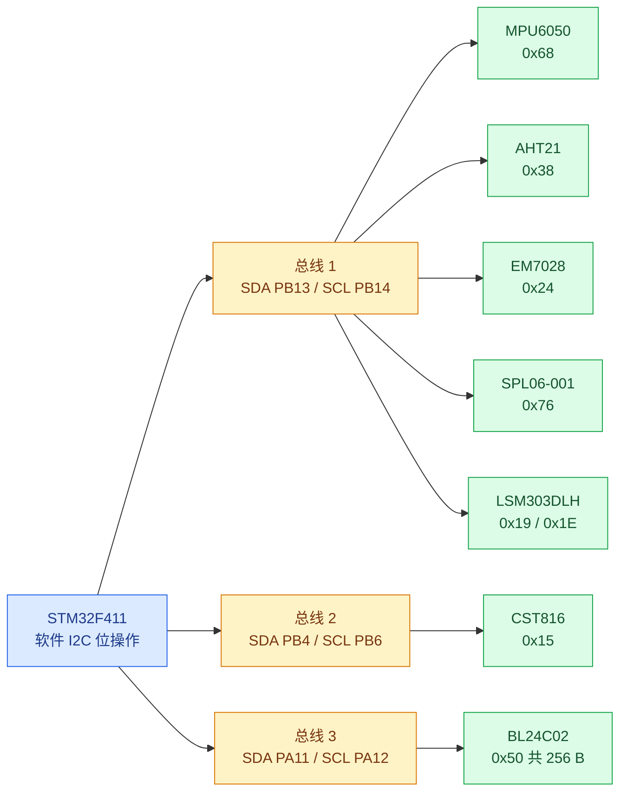
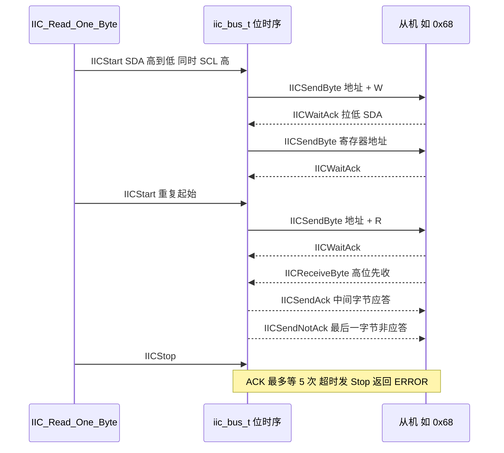
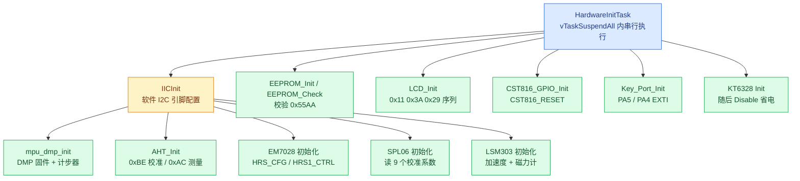
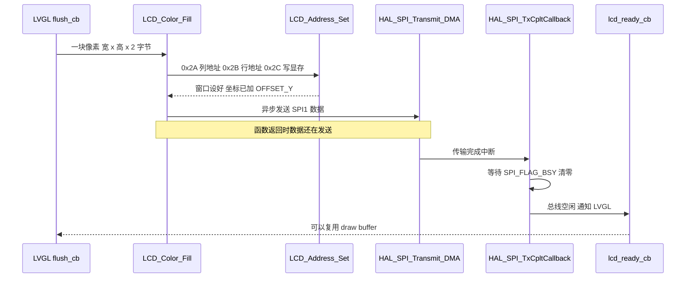

# OV-Watch 源码详解 06：外设驱动详解

> 涉及目录：`Software/OV_Watch/BSP/`
> 阅读顺序：软件 I2C → LCD → 触摸 → 传感器 → EEPROM → 按键/电源/看门狗/蓝牙。
> 每个驱动都按“硬件连接 → 寄存器/命令 → 代码流程 → 坑”四段讲。

---

## 1. 软件 I2C（`IIC/iic_hal.c`）

### 1.1 为什么不用硬件 I2C

- STM32F411 的硬件 I2C 有已知的“总线锁死”问题；
- 板子上 5 个传感器共用一组 I2C（PB13/PB14），用 GPIO 模拟更容易
  控制时序、做超时恢复；
- 任意 GPIO 都能当 I2C，方便改板。

### 1.2 总线分配

| 设备 | SDA | SCL | 从机地址 |
|---|---|---|---|
| MPU6050 | PB13 | PB14 | 0x68（AD0=0） |
| AHT21 | PB13 | PB14 | 0x38 |
| EM7028 | PB13 | PB14 | 0x24 |
| SPL06-001 | PB13 | PB14 | 0x76 |
| LSM303DLH | PB13 | PB14 | 加速度 0x19 / 磁力 0x1E |
| CST816（触摸） | PB4 | PB6 | 0x15 |
| BL24C02（EEPROM） | PA11 | PA12 | 0x50 |

> 5 个传感器挂同一条总线，靠地址区分；初始化时任何一个器件把 SDA 拉死，
> 整条总线都会失效——这是“某个传感器初始化失败导致全部失败”的常见原因。

**I2C 总线拓扑**：



### 1.3 数据结构

```c
typedef struct {
    GPIO_TypeDef *IIC_SDA_PORT;
    GPIO_TypeDef *IIC_SCL_PORT;
    uint16_t IIC_SDA_PIN;
    uint16_t IIC_SCL_PIN;
} iic_bus_t;
```

每个驱动定义自己的 `iic_bus_t`，调用 `IICInit()` 初始化。
同一组引脚可以被多个 `iic_bus_t` 重复初始化（MPU/AHT/EM/SPL/LSM 都是 PB13/14），
后果只是重复配置 GPIO，不会冲突。

### 1.4 电平操作

```c
SDA_Output(bus, 1) → GPIO BSRR 置位
SDA_Output(bus, 0) → GPIO BSRR 复位（低 16 位写 1）
SCL_Output 同理
```

直接写 `BSRR` 而不是 `HAL_GPIO_WritePin()`，省掉函数调用开销。

### 1.5 时序函数

| 函数 | 作用 | 时序 |
|---|---|---|
| `IICStart` | 起始：SDA 高→低，SCL 高 | 每步 1~2 µs |
| `IICStop` | 停止：SCL 低→SDA 低→SCL 高→SDA 高 | 同上 |
| `IICWaitAck` | 等从机拉低 SDA，最多 5 次 | 超时后发 Stop 并返回 ERROR |
| `IICSendAck/NotAck` | 主机应答/非应答 | 读最后一个字节要 NACK |
| `IICSendByte` | 8 位，高位先发 | 每位移位 |
| `IICReceiveByte` | 8 位，高位先收 | 读之前切 SDA 输入 |

### 1.6 读写封装

```c
IIC_Write_One_Byte(bus, daddr, reg, data)
IIC_Write_Multi_Byte(bus, daddr, reg, length, buff)
IIC_Read_One_Byte(bus, daddr, reg)
IIC_Read_Multi_Byte(bus, daddr, reg, length, buff)
```

读操作的“重复起始”：

```
Start → 写地址+W → ACK → 写寄存器 → ACK
      → Start → 写地址+R → ACK → 读 N 字节 → NACK → Stop
```

**I2C 读寄存器时序**：



### 1.7 坑

1. **没有总线恢复**：如果从机在传输中途复位，SDA 可能一直被拉低，
   后续所有传感器都读不到。标准做法是发 9 个 SCL 脉冲再 Stop。
2. **延时靠 `delay_us()`**，而 `delay_us` 用 SysTick；FreeRTOS 也用 SysTick，
   两者会互相影响（见 `SYSTEM/delay.c`）。
3. **ACK 超时只有 5 次**（约 5 µs），EEPROM 写周期（5 ms）后如果立刻读，
   可能 NACK；`DataSave.c` 里用 `delay_ms(10)` 规避。

**外设初始化依赖图**：



---

## 2. ST7789 LCD（`LCD/lcd_init.c` + `lcd.c`）

### 2.1 硬件连接

| 信号 | 引脚 | 说明 |
|---|---|---|
| SCLK | PB3 | SPI1 SCK |
| MOSI | PB5 | SPI1 MOSI |
| CS | PB8 | 片选，低有效 |
| DC | PB9 | 0=命令，1=数据 |
| RES | PB7 | 复位，低有效 |
| 背光 | TIM3_CH3 | PWM，5%~100% |

屏幕参数（`lcd_init.h`）：

```c
#define USE_HORIZONTAL 0   // 竖屏
#define LCD_W 240
#define LCD_H 280
```

### 2.2 写命令/数据

```c
void LCD_WR_REG(u8 dat)  { DC=0; SPI 发 1 字节; DC=1; }
void LCD_WR_DATA8(u8 d)  { SPI 发 1 字节; }
void LCD_WR_DATA(u16 d)  { SPI 发高字节 + 低字节; }
```

SPI 由 `HAL_SPI_Transmit(&hspi1, ...)` 完成，时钟极性/相位在
`MX_SPI1_Init()` 里配置（Mode 0，8 位，MSB first）。

### 2.3 初始化序列（`LCD_Init`）

| 命令 | 数据 | 含义 |
|---|---|---|
| 0x11 | — | Sleep Out，退出睡眠，延时 120 ms |
| 0x36 | 0x00 | MADCTL：竖屏、RGB 顺序 |
| 0x3A | 0x05 | 像素格式：16 位/像素（RGB565） |
| 0xB2 | 0C 0C 00 33 33 | Porch 设置（前后肩） |
| 0xB7 | 0x35 | Gate 控制 |
| 0xBB | 0x19 | VCOM 设置 |
| 0xC0 | 0x2C | LCM 控制 |
| 0xC2 | 0x01 | VDV/VRH 使能 |
| 0xC3 | 0x12 | VRH 设置 |
| 0xC4 | 0x20 | VDV 设置 |
| 0xC6 | 0x0F | 帧率控制 |
| 0xD0 | A4 A1 | 电源控制 |
| 0xE0 | 14 字节 | 正极性 Gamma |
| 0xE1 | 14 字节 | 负极性 Gamma |
| 0x21 | — | 反显开（IPS 屏常用） |
| 0x29 | — | Display On |

> 这些值来自厂家例程，换屏型号要重新要初始化表；不要随意改 Gamma。

### 2.4 设窗口 + 写像素

```c
void LCD_Address_Set(x1, y1, x2, y2)
{
    LCD_WR_REG(0x2A); LCD_WR_DATA(x1); LCD_WR_DATA(x2);  // 列地址
    LCD_WR_REG(0x2B); LCD_WR_DATA(y1); LCD_WR_DATA(y2);  // 行地址
    LCD_WR_REG(0x2C);                                    // 开始写显存
}
```

之后连续写像素，ST7789 会自动按窗口递增。

### 2.5 坐标偏移

```c
#define OFFSET_Y 20
LCD_Address_Set(xsta, ysta + OFFSET_Y, xend, yend + OFFSET_Y);
```

这块 240×280 的屏，实际可视区在 240×320 的显存里居中，Y 方向偏移 20。
不加上偏移，画面会整体上移/下移 20 像素。

### 2.6 刷屏与 DMA

```c
void LCD_Color_Fill(xsta, ysta, xend, yend, color_p)
{
    LCD_Address_Set(...);
    HAL_SPI_Transmit_DMA(&hspi1, (uint8_t*)color_p, width*height*2);
}
```

- LVGL 的 `flush_cb` 调用它，一次发一整块；
- 传输完成中断 `HAL_SPI_TxCpltCallback()` 等 SPI 总线空闲后调用
  `lcd_ready_cb()`，LVGL 才复用缓冲区；
- 如果不等 `BSY` 就通知，下一帧可能覆盖正在发送的数据，出现花屏。

**LCD 刷屏 DMA 时序**：



### 2.7 绘图层（`lcd.c`）

| 函数 | 用途 |
|---|---|
| `LCD_Fill` | 区域填充（逐像素，慢，初始化清屏用） |
| `LCD_Color_Fill` | 区域填充（DMA，LVGL 用） |
| `LCD_DrawPoint` | 画点 |
| `LCD_DrawLine` | 画线（Bresenham） |
| `LCD_DrawRectangle` | 矩形 |
| `Draw_Circle` | 圆 |
| `LCD_ShowChar` | ASCII 字符（12/16/24/32 点阵） |
| `LCD_ShowString` | 字符串 |
| `LCD_ShowChinese*` | 中文（取模数组） |
| `LCD_ShowIntNum/FloatNum1` | 数字显示 |
| `LCD_ShowPicture` | 图片 |

这些函数是“裸机时代”的遗留，LVGL 接管显示后主要用于开机画面和调试。

### 2.8 背光

```c
void LCD_Set_Light(uint8_t dc)   // 5~100
{
    if (dc >= 5 && dc <= 100)
        __HAL_TIM_SetCompare(&htim3, TIM_CHANNEL_3, dc * PWM_PERIOD / 100);
}
void LCD_Close_Light(void) { __HAL_TIM_SetCompare(..., 0); }
```

`LCD_Set_Light(5)` 是“变暗但没关”，`LCD_Close_Light()` 是“全黑”。

---

## 3. 触摸 CST816（`TOUCH/CST816.c`）

### 3.1 连接与地址

| 项目 | 值 |
|---|---|
| I2C | SDA PB4 / SCL PB6（软件 I2C） |
| 地址 | 0x15 |
| RST | PA15 |
| INT | PB1（当前未用） |

### 3.2 关键寄存器

| 寄存器 | 地址 | 作用 |
|---|---|---|
| `FingerNum` | 0x02 | 当前触点数，0xFF 表示睡眠 |
| `XposH` | 0x03 | X 坐标高 4 位（连续读 4 字节：XH/XL/YH/YL） |
| `ChipID` | 0xA7 | 芯片 ID |
| `SleepMode` | 0xE5 | 写 0x03 进入睡眠 |
| `MotionMask` | 0xEC | 手势使能 |
| `IrqPluseWidth` | 0xED | 中断脉冲宽度 |
| `NorScanPer` | 0xEE | 正常扫描周期（10 ms 单位） |
| `LpScanTH` | 0xF5 | 低功耗扫描阈值 |
| `AutoSleepTime` | 0xF9 | 自动休眠时间（秒） |

### 3.3 读坐标

```c
uint8_t DAT[4];
IIC_Read_Multi_Byte(&CST816_dev, 0x15, 0x03, 4, DAT);
X = ((DAT[0] & 0x0F) << 8) | DAT[1];
Y = ((DAT[2] & 0x0F) << 8) | DAT[3] + TOUCH_OFFSET_Y;
```

高 4 位在第一个字节的低半字节，低 8 位在第二个字节。

### 3.4 睡眠/唤醒

```c
CST816_Sleep();   // 写 SleepMode=0x03
CST816_Wakeup();  // 直接复位（RST 低 10 ms → 高 100 ms）
```

CST816 睡眠后不能用 I2C 唤醒，必须复位；所以 `StopEnterTask` 唤醒后
调用 `CST816_Wakeup()`。

---

## 4. MPU6050（`MPU6050/mpu6050.c` + `eMPL/`）

### 4.1 连接

- I2C PB13/PB14，地址 0x68；
- INT → PB12（EXTI15_10，预留）；
- 使用 InvenSense **DMP**（数字运动处理器）做计步和姿态。

### 4.2 初始化

```c
uint8_t mpu_dmp_init(void)
{
    // 1. 复位、唤醒、设置时钟源/量程/采样率
    // 2. 加载 DMP 固件（dmp_load_motion_driver_firmware）
    // 3. 设置 DMP 输出速率、方向矩阵
    // 4. 使能计步器（dmp_enable_feature(DMP_FEATURE_PEDOMETER)）
    // 5. 设置 FIFO 速率
}
```

DMP 固件是一段二进制（`eMPL/` 里的数组），加载后 MPU 自己算姿态/步数，
MCU 只读结果，省 CPU。

### 4.3 常用 API

| 函数 | 作用 |
|---|---|
| `mpu_dmp_init()` | 初始化 DMP |
| `dmp_get_pedometer_step_count(&steps)` | 读步数 |
| `dmp_set_pedometer_step_count(steps)` | 写步数（开机恢复） |
| `MPU_Get_Accelerometer(&ax,&ay,&az)` | 读加速度原始值 |
| `MPU_Get_Angles(&roll,&pitch)` | 算横滚/俯仰（弧度） |
| `MPU_isHorizontal()` | roll、pitch 都在 ±0.5 rad 内 → 水平 |

`MPU_isHorizontal()` 的 ±0.50 是**弧度**（约 ±28.6°），不是角度；
这个阈值很宽，所以“抬腕”判断比较宽松。

### 4.4 低功耗

`StopEnterTask` 睡眠前会把 MPU 配成低功耗运动检测（DMP 库默认功耗高，
作者在 README 里特别说明要手工调寄存器）。相关代码在
`user_RunModeTasks.c` 的注释里，属于“踩坑点”。

---

## 5. AHT21 温湿度（`AHT21/AHT21.c`）

### 5.1 连接与命令

- I2C PB13/PB14，地址 0x38（写地址 0x70，读地址 0x71）；
- 上电后需要 40 ms 稳定，再发初始化命令。

| 命令 | 说明 |
|---|---|
| 0xBE | 初始化（0xBE 0x08 0x00） |
| 0xAC | 触发测量（0xAC 0x33 0x00） |
| 0x71 | 读状态（bit7=忙） |
| 0x70 | 写 |
| 0xBA | 软复位 |

### 5.2 读流程

```c
IICSendByte(&AHT_bus, 0x70);
IICSendByte(&AHT_bus, 0xAC);
IICSendByte(&AHT_bus, 0x33);
IICSendByte(&AHT_bus, 0x00);
// 等 80 ms，轮询状态 bit7
IICSendByte(&AHT_bus, 0x71);
// 读 7 字节：状态 + 湿度 20 位 + 温度 20 位
```

### 5.3 换算

```c
湿度 = raw_humi * 1000 / 2^20 / 10;      // 单位 %RH
温度 = (raw_temp * 2000 / 2^20 - 500) / 10;  // 单位 °C
```

代码里用移位实现：

```c
*humi = (RetuData * 1000 >> 20);  *humi /= 10;
*temp = ((RetuData * 2000 >> 20) - 500);  *temp /= 10;
```

> 注意运算符优先级：`AHT_Read_Status() & 0x80 == 0x80` 实际是
> `AHT_Read_Status() & (0x80 == 0x80)`，恒为 1。这是个已知 bug，
> 但不影响功能（循环有超时计数）。读代码时不要被它绕进去。
>
> 同类问题还有 `AHT_Init()`：`AHT_Read_Status() && 0x08 != 0x08` 恒为假，
> 导致 0xBE 校准初始化命令**从未发出**。传感器仍能测量，但校准状态
> 没有按数据手册流程建立；换一批 AHT21 时如果精度异常，先查这里。

---

## 6. EM7028 心率（`EM7028/em70x8.c` + `HrAlgorythm.c`）

### 6.1 连接与寄存器

- I2C PB13/PB14，地址 0x24，ID 寄存器 0x00 应为 0x36；
- 关键寄存器：`HRS_CFG(0x01)`、`HRS1_CTRL(0x0D)`、`HRS1_DATA0~3(0x28~0x2F)`、
  `SOFT_RESET(0x0F)`。

### 6.2 初始化序列

```c
HRS_CFG = 0x00;          // 先关
HRS2_DATA_OFFSET = 0x00;
HRS2_GAIN_CTRL = 0x7F;   // HRS2 增益 1
HRS1_CTRL = 0x47;        // 增益 1、量程 8、2.62144 MHz、16 位
INT_CTRL = 0x00;         // LED 电流 2.5 mA
```

使能：

```c
HRS_CFG = 0x08;          // 开 HRS1
```

### 6.3 读心率

```c
uint16_t EM7028_Get_HRS1(void);   // 读 HRS1_DATA0~3，拼成 16 位
```

### 6.4 心率算法（`HR_Calculate`）

```c
// datas/times 是长度为 7 的环形队列
enqueue(&datas, present_dat);
enqueue(&times, present_time);

// 检测局部峰值：当前点比左右各 3 个点都高
if (datas[3] >= datas[2] && ... && datas[3] > datas[0] && ...) {
    if (times[3] - peaks_time[0] > 425) {   // 两次峰值间隔 > 425 ms
        peaks_time[1] = peaks_time[0];
        peaks_time[0] = times[3];
        enqueue(&HR_List, 60000 / (peaks_time[0] - peaks_time[1]));  // 60 s / 间隔
        if (HR_List.data[6] != 0)
            HR = Hr_Ave_Filter(HR_List.data, 7);   // 7 点平均
    }
}
```

- 采样周期由 `HRDataUpdateTask` 的 `osDelay(50)` 决定，约 20 Hz；
- 峰值间隔 425 ms 对应最高约 141 BPM；
- 结果再用 7 个心跳周期平均。

> **已知 bug**：`Hr_Ave_Filter()` 没有 `return` 语句，`ave` 也未初始化，
> 属于未定义行为（实际返回寄存器里的随机值）。阅读时注意，
> 修正方法是 `uint32_t ave = 0; ... return ave;`。

---

## 7. SPL06-001 气压计（`SPL06_001/SPL06_001.c`）

### 7.1 连接与寄存器

- I2C PB13/PB14，地址 0x76，ID 0x10；
- 寄存器：`PRS_B2/B1/B0(0x00~0x02)`、`TMP_B2/B1/B0(0x03~0x05)`、
  `PRS_CFG(0x06)`、`TMP_CFG(0x07)`、`MEAS_CFG(0x08)`、`CFG_REG(0x09)`。

### 7.2 初始化

1. 读 ID 确认；
2. 读 9 个校准系数（`c0/c1/c00/c10/c01/c11/c20/c21/c30/c31/c40`）；
3. 配置过采样率和测量速率；
4. 启动连续测量。

### 7.3 计算

```c
// 原始值 24 位有符号
Praw = (B2<<16)|(B1<<8)|B0;
Traw = ...;

// 温度补偿（见数据手册公式）
Pcomp = ...;

// 高度
float Altitude_Calculate(void)
{
    return 44330 * (1 - powf(Pressure_Calculate()/101325, 0.1903));
}
```

`44330 m` 是国际标准大气公式的基准，`0.1903` 是空气密度指数。

---

## 8. LSM303DLH 电子罗盘（`LSM303DLH/LSM303.c`）

### 8.1 连接

- I2C PB13/PB14；
- 加速度计寄存器 0x20~0x37，输出 0x28~0x2D；
- 磁力计输出 0x03~0x08；
- 初始化：设置加速度计/磁力计量程、速率、连续转换模式。

### 8.2 读数据

```c
LSM303_ReadAcceleration(&Xa,&Ya,&Za);
LSM303_ReadMagnetic(&Xm,&Ym,&Zm);
```

### 8.3 方位角

```c
pitch = atan2f(Xa, sqrtf(Ya*Ya + Za*Za));
roll  = atan2f(Ya, sqrtf(Xa*Xa + Za*Za));
Hy = Ym*cos(roll) + Xm*sin(roll)*sin(pitch) - Zm*cos(pitch)*sin(roll);
Hx = Xm*cos(pitch) + Zm*sin(pitch);
Azimuth = atan2f(Hy, Hx) * 180 / PI;
```

- 先用加速度计做倾斜补偿，再把磁力计投影到水平面；
- 结果范围 -180°~180°，`SensorDataUpdateTask` 里负值 +360 归一到 0~360。

### 8.4 睡眠

`LSM303DLH_Sleep()` 把两颗芯片都切到掉电/低功耗模式，离开指南针页时调用。

---

## 9. BL24C02 EEPROM（`BL24C02/`）

### 9.1 连接

- I2C PA11/PA12，地址 0x50；
- 容量 256 字节（2 Kbit）；
- 写周期约 5 ms，读写之间要延时。

### 9.2 读写

```c
BL24C02_Write(addr, length, buff);   // 页写，最多 8 字节/页
BL24C02_Read(addr, length, buff);
```

`DataSave.c` 封装了 `EEPROM_Check()`、`SettingSave()`、`SettingGet()`：

- 0x00/0x01 存 `0x55/0xAA` 作为“已初始化”标志；
- 地址 >1 才允许读写（保护标志字节）。

### 9.3 页边界

BL24C02 每页 8 字节。`SettingSave(0x20, 3)` 写 0x20~0x22，未跨页；
如果以后要写超过 8 字节且跨页，必须分页写，否则会回卷覆盖。

---

## 10. 按键（`KEY/key.c`）

### 10.1 硬件

- KEY1 → PA5，下降沿中断，上拉（按下为 0）；
- KEY2 → PA4，上升沿中断（按下为 1）；
- EXTI 只负责唤醒/清标志，扫描在 `KeyTask`。

### 10.2 扫描状态机

```c
uint8_t KeyScan(uint8_t mode)
{
    static uint8_t key_up = 1, key_down = 0;

    if (key_up && ((!KEY1) || KEY2)) {
        osDelay(3);                 // 消抖
        if (!KEY1) key_down = 1;
        if (KEY2)  key_down = 2;
        if (key_down) key_up = 0;
    }

    if (key_down && (KEY1 && !KEY2)) {   // 等待释放
        osDelay(3);
        if (KEY1 && !KEY2) {
            key_up = 1;
            keyvalue = key_down;
            key_down = 0;
        }
    }
    return keyvalue;
}
```

- **按下沿**记录键值；**释放沿**才返回键值（松手触发）；
- `osDelay(3)` 是 RTOS 延时，依赖调度器；在 `HardwareInitTask`
  挂起调度期间调用会忙等。

---

## 11. 电源管理（`POWER/power.c`）

### 11.1 引脚

| 信号 | 引脚 | 说明 |
|---|---|---|
| POWER_EN | PA3 | 高=保持供电，低=断电 |
| CHARGE | PA2 | 1=正在充电 |
| BAT_ADC | PA1 | 电池分压采样 |

### 11.2 电压/电量

```c
BatVoltage = dat * 2 * 3.3 / 4096;
```

- ADC 12 位，参考 3.3 V；
- 分压比 1/2，所以乘 2；
- 充电时减去 `0.128 V × 1 A` 的内阻压降（`INTERNAL_RES`、`CHARGING_CUR`）。

电量映射（`PowerCalculate`）不是线性的，按电压分段：

| 电压 | 电量 |
|---|---|
| ≥4.20 V | 100% |
| 4.06~4.20 | 90% |
| 3.98~4.06 | 80% |
| 3.92~3.98 | 70% |
| 3.87~3.92 | 60% |
| 3.82~3.87 | 50% |
| 3.79~3.82 | 40% |
| 3.77~3.79 | 30% |
| 3.74~3.77 | 20% |
| 3.68~3.74 | 10% |
| 3.45~3.68 | 5% |

### 11.3 关机

```c
Power_DisEnable();   // PA3 拉低，TPS63020 关断，整机断电
```

长按 KEY1 3 s 或首页按 KEY2 都会走到这里。

---

## 12. 看门狗（`OWDG/WDOG.c`）

- EN → PB1（低有效，拉低使能）；
- WDI → PB2（翻转喂狗）；
- `WDOGFeedTask` 每 100 ms `WDOG_Feed()` + `WDOG_Enable()`；
- STОП 前 `WDOG_Disnable()`，醒来 `WDOG_Feed()`。

---

## 13. KT6328 蓝牙（`KT6328/KT6328.c`）

- 使能脚 PA8；
- `KT6328_Enable()` 拉高，`KT6328_Disable()` 拉低；
- 串口接 USART1（115200），透传模式；
- 开机初始化后立刻 `Disable()`，省电；需要时再使能。

---

## 14. 驱动调试清单

| 现象 | 先查 |
|---|---|
| 所有 I2C 传感器都失败 | PB13/14 是否被某个器件拉死；上拉电阻；`IICInit` 是否调用 |
| 单个传感器失败 | 从机地址、电源、初始化序列；`ConnectionError` 是否被重试清零 |
| 屏花屏/错位 | `OFFSET_Y`、MADCTL、SPI 模式、DMA 完成回调 |
| 触摸坐标不准 | X/Y 交换、镜像、`TOUCH_OFFSET_Y`、CST816 初始化 |
| 心率乱跳 | 传感器贴合、LED 电流、峰值阈值 425 ms、`Hr_Ave_Filter` 的 bug |
| 电量跳变 | ADC 参考电压、分压比、充电压降补偿 |
| 睡下去醒不来 | 触摸/MPU 是否真的进入低功耗、唤醒源是否使能 |
