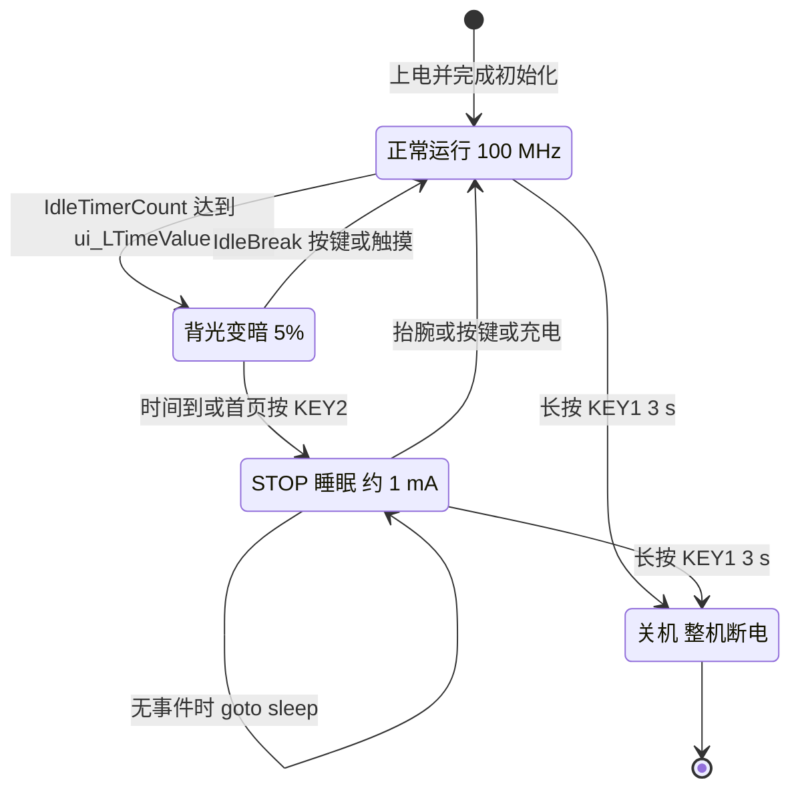
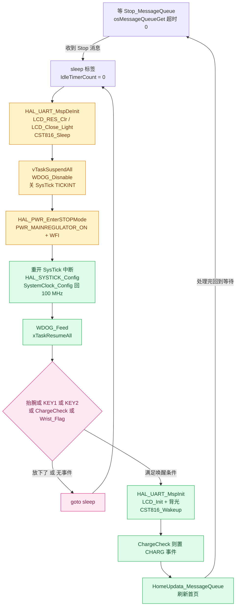
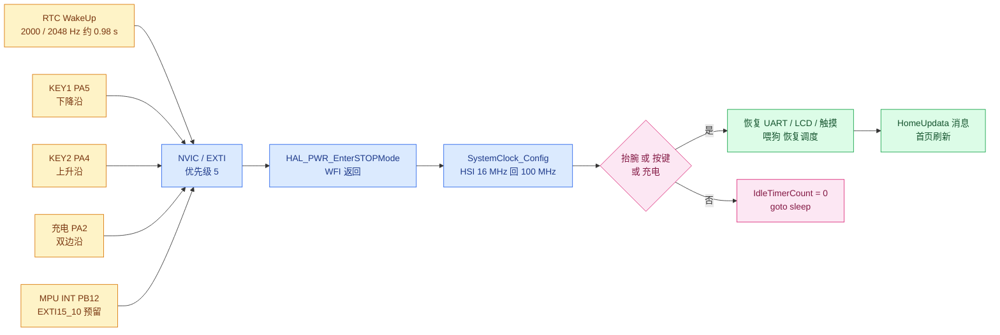

# OV-Watch 源码详解 07：低功耗与运行模式

> 涉及文件：
> - `User/Tasks/Src/user_RunModeTasks.c`
> - `User/Tasks/Src/user_TasksInit.c`（`TaskTickHook`）
> - `BSP/POWER/power.c`、`BSP/LCD/lcd_init.c`、`BSP/TOUCH/CST816.c`
> - `BSP/MPU6050/mpu6050.c`（`MPU_Sleep/MPU_Wakeup`）
> - `Software/OV_Watch/Core/Src/main.c`（时钟恢复）

---

## 1. 三种运行模式

```
┌────────────┐   10 s 无操作    ┌────────────┐   15 s 无操作   ┌────────────┐
│  正常运行   │ ───────────────► │  背光变暗   │ ──────────────► │  STOP 睡眠  │
│ 100 MHz    │                  │ 背光=5%    │                 │ 主稳压器开  │
│ 70~80 mA   │ ◄─────────────── │            │ ◄────────────── │ ~1 mA      │
└────────────┘   按键/触摸/     └────────────┘   RTC/按键/充电/  └────────────┘
                  抬腕/充电                        抬腕唤醒
       │
       │ 长按 KEY1 3 s / 首页按 KEY2
       ▼
┌────────────┐
│   关机      │  Power_DisEnable()：PA3 拉低，TPS63020 断开
└────────────┘
```

- 默认背光时间 10 s（`ui_LTimeValue`），熄屏时间 15 s（`ui_TTimeValue`），
  可在设置页修改；
- 运行电流约 70~80 mA，待机约 1 mA（README 实测数据）；
- 关机不是软件待机，而是**切断整机电源**，只能再按开机键上电。

**运行模式状态机**：



---

## 2. 空闲计时：谁在数时间

`TaskTickHook()` 在 SysTick 中断里每 1 ms 执行：

```c
if (ui_TimerPageFlag) {
    IdleTimerCount = 0;               // 计时器页保持常亮
    ui_TimerPage_elapsed_ms += 1;
} else {
    IdleTimerCount += 1;              // 其它页面累计空闲
}
```

`IdleEnterTask`（优先级 40）每 10 ms 检查一次：

```c
if (IdleTimerCount >= ui_LTimeValue * 1000)  → 发 Idle 消息（变暗）
if (IdleTimerCount >= ui_TTimeValue * 1000)  → 发 Stop 消息（睡眠）
```

### 2.1 IdleEnterTask 的完整逻辑

```c
uint8_t light_off_sent = 0;
while (1) {
    // 1) 收到“变暗”消息
    if (osMessageQueueGet(Idle_MessageQueue, &Idlestr, NULL, 1) == osOK) {
        LCD_Set_Light(5);
        light_off_sent = 1;
    }

    // 2) 收到“打断空闲”消息（按键/触摸/串口/充电）
    if (osMessageQueueGet(IdleBreak_MessageQueue, &IdleBreakstr, NULL, 1) == osOK) {
        IdleTimerCount = 0;
        light_off_sent = 0;
        LCD_Set_Light(ui_LightSliderValue);   // 恢复用户亮度
    }

    // 3) 到背光时间 → 自己给自己发 Idle 消息
    if (!light_off_sent && IdleTimerCount >= ui_LTimeValue * 1000U) {
        uint8_t IdleMsg = 0;
        osMessageQueuePut(Idle_MessageQueue, &IdleMsg, 0, 0);
    }

    // 4) 到熄屏时间 → 发 Stop
    if (IdleTimerCount >= ui_TTimeValue * 1000U) {
        uint8_t Stopstr = 1;
        IdleTimerCount = 0;
        light_off_sent = 0;
        osMessageQueuePut(Stop_MessageQueue, &Stopstr, 0, 0);
    }

    osDelay(10);
}
```

设计细节：

- `light_off_sent` 防止重复发“变暗”消息；
- 收到 IdleBreak 会把计时清零并恢复亮度；
- 到熄屏时间会**同时**把 `light_off_sent` 清零，下次唤醒后可以再次变暗。

### 2.2 谁会发 IdleBreak

| 来源 | 触发 |
|---|---|
| `KeyTask` | 任意按键 |
| `LvHandlerTask` | `lv_disp_get_inactive_time() < 1000`（用户刚触摸过） |
| `SensorDataUpdateTask` | 在心率/环境/指南针页采集时 |
| `HRDataUpdateTask` | 心率页每 50 ms |
| `ChargPageEnterTask` | 充电插拔 |
| `MessageSendTask` | 收到串口命令 |

---

## 3. StopEnterTask：STOP 模式全流程

### 3.1 进入睡眠前

| 步骤 | 代码 | 目的 |
|---|---|---|
| 1 | `IdleTimerCount = 0` | 重置空闲计时 |
| 2 | `HAL_UART_MspDeInit(&huart1)` | 关 USART1 时钟/GPIO/DMA，省电 |
| 3 | `LCD_RES_Clr()` | 屏复位拉低（屏进入复位） |
| 4 | `LCD_Close_Light()` | 背光 PWM 占空比 0 |
| 5 | `CST816_Sleep()` | 触摸写 SleepMode=0x03 |
| 6 | `vTaskSuspendAll()` | 挂起调度器，防止睡眠期间任务切换 |
| 7 | `WDOG_Disnable()` | 关外部看门狗（否则睡眠超时被复位） |
| 8 | `CLEAR_BIT(SysTick->CTRL, TICKINT)` | 关 SysTick 中断 |
| 9 | `HAL_PWR_EnterSTOPMode(PWR_MAINREGULATOR_ON, WFI)` | 进入 STOP，等中断唤醒 |

STOP 模式特点：

- 1.2 V 主稳压器保持，SRAM/寄存器内容保留；
- HSI/HSE/PLL 关闭，CPU 时钟停止；
- 任何 EXTI/RTC 中断都能唤醒；
- 唤醒后系统时钟自动切回 **HSI 16 MHz**。

### 3.2 唤醒后恢复

| 步骤 | 代码 | 说明 |
|---|---|---|
| 1 | `SET_BIT(SysTick->CTRL, TICKINT)` | 重新开 SysTick 中断 |
| 2 | `HAL_SYSTICK_Config(SystemCoreClock / 1000)` | 按当前时钟重配 1 ms |
| 3 | `SystemClock_Config()` | HSI → PLL → 100 MHz |
| 4 | `WDOG_Feed()` | 喂狗 |
| 5 | `xTaskResumeAll()` | 恢复调度 |
| 6 | MPU 姿态判断 | 抬腕/放下 |
| 7 | 按键/充电判断 | 决定继续睡还是醒 |
| 8 | `HAL_UART_MspInit()` | 重新初始化串口 |
| 9 | `LCD_Init()` + 背光 | 屏重新初始化 |
| 10 | `CST816_Wakeup()` | 触摸复位唤醒 |
| 11 | 充电则置 `HARDINT_EVENT_CHARG` | 弹充电页 |
| 12 | `HomeUpdata_MessageQueue` | 首页刷新 |

**StopEnterTask 执行流**：



### 3.3 唤醒源

| 唤醒源 | 配置 | 频率 |
|---|---|---|
| RTC WakeUp | `HAL_RTCEx_SetWakeUpTimer_IT(&hrtc, 2000, DIV16)` | 约 1 s |
| KEY1 | PA5 下降沿 EXTI | 按下时 |
| KEY2 | PA4 上升沿 EXTI | 按下时 |
| 充电插拔 | PA2 双边沿 EXTI | 插拔时 |
| MPU INT | PB12 EXTI | 运动时（预留） |

RTC 每约 1 s 醒一次，醒来后读 MPU 判断是否抬腕；
如果没有抬腕/按键/充电，就 `goto sleep` 继续睡。

**唤醒源数据流**：



### 3.4 醒来后的判断树

```c
if (HWInterface.IMU.wrist_is_enabled) {
    hor = MPU_isHorizontal();
    if (hor && wrist_state == WRIST_DOWN) {
        wrist_state = WRIST_UP;
        Wrist_Flag = 1;                  // 抬腕 → 唤醒
    } else if (!hor && wrist_state == WRIST_UP) {
        wrist_state = WRIST_DOWN;
        IdleTimerCount = 0;
        goto sleep;                      // 放下 → 继续睡
    }
}

if (!KEY1 || KEY2 || ChargeCheck() || Wrist_Flag) {
    Wrist_Flag = 0;                      // 有事件 → 真正唤醒
} else {
    IdleTimerCount = 0;
    goto sleep;                          // 无事 → 继续睡
}
```

注意 `KEY1` 是“按下为 0”，所以 `!KEY1` 表示 KEY1 被按下；
`KEY2` 是“按下为 1”，所以直接判断 `KEY2`。

---

## 4. 低功耗相关的关键细节

### 4.1 SysTick 必须关掉再睡

STOP 模式会停掉 SysTick 时钟。如果不在睡前关中断、醒后重配，
FreeRTOS 的 tick 会错乱（任务延时变长/变短，甚至调度器停摆）。

### 4.2 时钟必须重配

STOP 唤醒后系统时钟是 HSI 16 MHz，而 FreeRTOS 的 tick 重载值是按
100 MHz 算的。不调用 `SystemClock_Config()`，串口波特率、SPI 时序、
延时都会错。

### 4.3 看门狗必须禁用

外部看门狗在睡眠期间没人喂，超时会复位整机。代码在睡前
`WDOG_Disnable()`，醒来第一件事 `WDOG_Feed()`。

### 4.4 外设必须重新初始化

- **UART**：`HAL_UART_MspDeInit()` 把时钟/GPIO/DMA 都关了，醒来要
  `HAL_UART_MspInit()`；
- **LCD**：复位脚被拉低、背光关，醒来要 `LCD_Init()`；
- **触摸**：CST816 进入 Sleep，必须复位唤醒。

### 4.5 MPU6050 的低功耗（重要发现）

`mpu6050.c` 里有现成的函数：

```c
void MPU_Sleep(void)
{
    MPU_Write_Byte(MPU_PWR_MGMT1_REG, 0x48);  // sleep=1, temp_dis=1, 内部 8 MHz
}
void MPU_Wakeup(void)
{
    MPU_Write_Byte(MPU_PWR_MGMT1_REG, 0x28);  // sleep=0, cycle=1, temp_dis=1
}
```

但**当前工程里没有任何地方调用它们**（grep 只能找到定义）。
`StopEnterTask` 睡眠前只关了 UART/LCD/触摸，MPU 仍保持 DMP 工作模式。
如果实测待机电流偏高，优先检查这里：睡前 `MPU_Sleep()`、醒后
`MPU_Wakeup()`（或重新 `mpu_dmp_init()`）通常能省几 mA。

### 4.6 串口唤醒后的接收

`StopEnterTask` 醒来只调用了 `HAL_UART_MspInit()`，**没有重新**
`HAL_UART_Receive_DMA()` + `__HAL_UART_ENABLE_IT(UART_IT_IDLE)`。
这意味着第一次睡眠唤醒后，串口接收可能不再工作（DMA 没有重新挂载）。
如果发现“睡一觉后蓝牙命令没反应”，检查这里，补上：

```c
HAL_UART_Receive_DMA(&huart1, (uint8_t*)HardInt_receive_str, 25);
__HAL_UART_ENABLE_IT(&huart1, UART_IT_IDLE);
```

---

## 5. 功耗实测与优化清单

| 场景 | 电流（README 数据） |
|---|---|
| 正常运行（屏亮 50%） | 70~80 mA |
| 背光变暗 5% | 约 50~60 mA（屏仍亮） |
| STOP 睡眠 | 约 1 mA |

优化优先级：

1. **背光**：屏幕是最大头，亮度 50→5 能省 20~30 mA；
2. **MPU**：DMP 常开功耗高，睡前 `MPU_Sleep()`；
3. **触摸**：CST816 已进 Sleep；
4. **UART/蓝牙**：睡前 `MspDeInit` + `KT6328_Disable()`；
5. **LCD**：屏复位 + 背光 0；
6. **未用外设**：ADC/SPI/TIM 在睡眠时由 STOP 自动停时钟，无需手动关。

---

## 6. 修改低功耗代码的注意事项

1. **`goto sleep` 的目标在 `if` 块内**：不要在 `sleep:` 标签前插入
   会用局部变量的代码（`goto` 会跳过初始化）；
2. **`vTaskSuspendAll()` 必须成对**：每次 `goto sleep` 都会重新挂起，
   醒来 `xTaskResumeAll()`；漏一次调度器就永久挂起；
3. **不要在 STOP 前调用 `printf`**：UART 已 DeInit，会阻塞/丢数据；
4. **RTC 唤醒周期**：2000 计数值 / 2048 Hz ≈ 0.98 s，想更省电可以改大，
   但抬腕响应会变慢；
5. **唤醒后 `SystemClock_Config()` 之前不要操作 SPI/I2C**：时钟还是 16 MHz，
   时序会变。

---

## 7. 常见问题

**Q1：睡下去后电流仍有几十 mA？**

- 背光没关（`LCD_Close_Light` 是否执行）；
- 屏没进复位/睡眠（`LCD_RES_Clr`）；
- MPU DMP 仍在跑（没有调用 `MPU_Sleep`）；
- 蓝牙模块没关（`KT6328_Disable`）；
- 用万用表串联电池测，排除 USB 供电干扰。

**Q2：睡下去就醒不来？**

- 唤醒源没使能（RTC WakeUp / EXTI）；
- 睡前把 WDOG 关了但醒来没喂，直接复位；
- `HAL_PWR_EnterSTOPMode` 之前没有清 EXTI pending 标志，可能立刻被旧中断唤醒。

**Q3：醒来后时间不对/串口乱码？**

- 没有重新 `SystemClock_Config()`；
- 没有重配 SysTick；
- 串口没有重新 `HAL_UART_MspInit` / DMA。

**Q4：按 KEY1 无法唤醒？**

- KEY1 是 PA5 下降沿，按下为低；检查上拉和 EXTI 是否使能；
- `StopEnterTask` 里判断的是 `!KEY1`。

**Q5：抬腕不亮屏？**

- `wrist_is_enabled` 是否为 1（设置项/EEPROM 恢复）；
- `MPU_isHorizontal()` 的 ±0.5 rad 阈值；
- MPU 中断/轮询是否正常。
