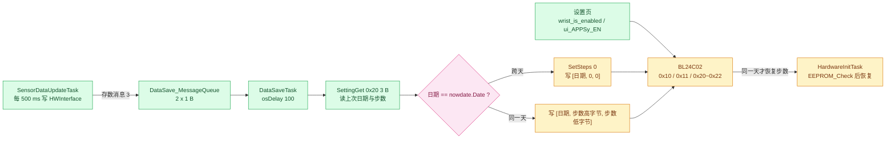
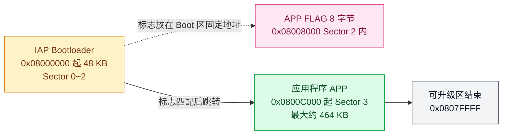
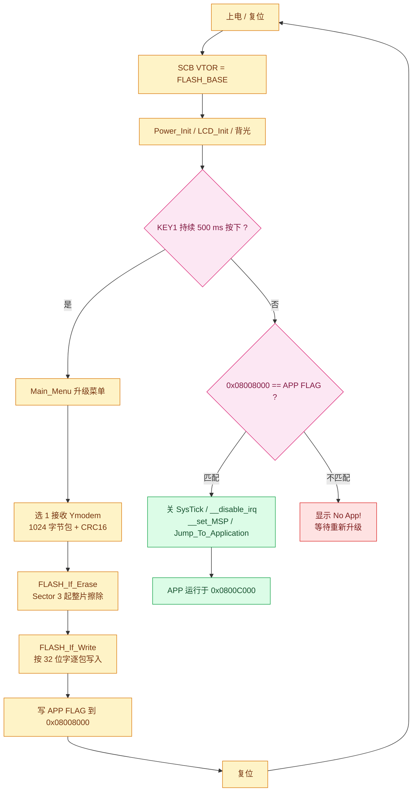

# OV-Watch 源码详解 08：数据存储与 IAP 升级

> 涉及文件：
> - `User/Tasks/Src/user_DataSaveTask.c`
> - `BSP/BL24C02/BL24C02.c`、`DataSave.c`
> - `Software/IAP_F411/Core/Src/main.c`
> - `Software/IAP_F411/Ymodem/menu.c`、`flash_if.c`

---

## 1. EEPROM 数据布局（BL24C02，256 字节）

### 1.1 地址表

| 地址 | 长度 | 内容 | 说明 |
|---|---|---|---|
| 0x00 | 1 | `0x55` | 初始化标志 1 |
| 0x01 | 1 | `0xAA` | 初始化标志 2 |
| 0x10 | 1 | `wrist_is_enabled` | 抬腕亮屏开关（0/1） |
| 0x11 | 1 | `ui_APPSy_EN` | APP 时间同步开关（0/1） |
| 0x20 | 1 | 最后保存日期 | 1~31，与 RTC 的 Date 比较 |
| 0x21 | 1 | 步数高字节 | `steps >> 8` |
| 0x22 | 1 | 步数低字节 | `steps & 0xFF` |

> 步数是 **16 位大端**存放：高字节在 0x21，低字节在 0x22。
> `HardwareInitTask` 恢复时：

```c
uint16_t steps = 0;
steps = recbuf[1] & 0x00FF;   // 高字节
steps = steps << 8 | recbuf[2];  // 拼低字节
dmp_set_pedometer_step_count(steps);
```

### 1.2 初始化标志

`EEPROM_Check()`：

```c
BL24C02_Read(0, 2, check_buff);
if (check_buff[0] == 0x55 && check_buff[1] == 0xAA)
    return 0;                       // 已初始化

check_buff[0] = 0x55;
check_buff[1] = 0xAA;
BL24C02_Write(0, 2, check_buff);    // 首次上电写标志
delay_ms(10);
BL24C02_Read(0, 2, check_buff);
if (check_buff[0] == 0x55 && check_buff[1] == 0xAA)
    return 0;
return 1;                           // EEPROM 故障
```

`SettingSave/SettingGet` 里有保护：

```c
if (addr > 1 && !EEPROM_Check()) { ... }
```

地址 ≤1 是标志区，不允许业务写。

### 1.3 为什么用 EEPROM 而不是内部 Flash

- 内部 Flash 擦除粒度大（16 KB 扇区），存 3 字节要擦 16 KB；
- EEPROM 支持字节写、擦写寿命高（百万次）；
- BL24C02 只有 256 B，够存设置和当日步数。

---

## 2. DataSaveTask：什么时候写、写什么

### 2.1 触发

`SensorDataUpdateTask` 收到 `HomeUpdata` 消息后：

```c
uint8_t Datastr = 3;
osMessageQueuePut(DataSave_MessageQueue, &Datastr, 0, 1);
```

也就是说：**首页刷新（约每 500 ms/1 s）就会触发一次保存**，
但 `DataSaveTask` 每轮只处理一条消息，实际写入频率约 1 Hz。

### 2.2 保存逻辑

```c
uint8_t dat[3];
dat[0] = wrist_is_enabled;
dat[1] = ui_APPSy_EN;
SettingSave(dat, 0x10, 2);          // 保存两个开关

HAL_RTC_GetDate(&hrtc, &nowdate, RTC_FORMAT_BIN);

SettingGet(dat, 0x20, 3);           // 读上次保存的日期/步数
if (dat[0] != nowdate.Date) {       // 跨天
    HWInterface.IMU.SetSteps(0);    // 步数清零
    dat[0] = nowdate.Date;
    dat[1] = 0;
    dat[2] = 0;
    SettingSave(dat, 0x20, 3);
} else {                            // 同一天
    uint16_t temp = HWInterface.IMU.GetSteps();
    dat[0] = nowdate.Date;
    dat[1] = (temp >> 8) & 0xFF;
    dat[2] = temp & 0xFF;
    SettingSave(dat, 0x20, 3);
}
```

要点：

1. **先读后写**：0x20 的日期是“上次保存日”，不是“今天”；
2. **跨天清零**：日期变化时把 DMP 计步器清零，并写入 0；
3. **掉电保护**：每轮都写一次，拔出电池最多丢 1 s 的步数；
4. **写周期**：BL24C02 每次写后要 5 ms 内部烧写，`SettingSave` 里
   `delay_ms(10)` 规避；`DataSaveTask` 的 `osDelay(100)` 进一步拉开间隔。

### 2.3 开机恢复

`HardwareInitTask`：

```c
EEPROM_Init();
if (!EEPROM_Check()) {
    SettingGet(recbuf, 0x10, 2);
    // 校验 0/1，非法则用默认值（抬腕关、APP 开关关）
    wrist_is_enabled = recbuf[0];
    ui_APPSy_EN = recbuf[1];

    HAL_RTC_GetDate(&hrtc, &nowdate, RTC_FORMAT_BIN);
    SettingGet(recbuf, 0x20, 3);
    if (recbuf[0] == nowdate.Date) {     // 同一天才恢复步数
        steps = recbuf[1] << 8 | recbuf[2];
        dmp_set_pedometer_step_count(steps);
    }
}
```

如果日期不是今天，**不恢复步数**（相当于跨天清零）。

**设置与步数的存储数据流**：



---

## 3. IAP Bootloader

### 3.1 Flash 分区

```
0x08000000 ┌──────────────────────────────┐
           │ IAP Bootloader（Ymodem）      │ 48 KB（Sector 0~2）
0x08008000 │ "APP FLAG"（8 字节）          │ 在 Sector 2 内
0x0800C000 ├──────────────────────────────┤
           │ 应用程序 APP                  │ 从 Sector 3 开始
           │                              │
0x0807FFFF └──────────────────────────────┘ 可升级区结束
```

- `APPLICATION_ADDRESS = 0x0800C000`
- `USER_FLASH_END_ADDRESS = 0x0807FFFF`
- Bootloader 的向量表在 `0x08000000`（`SCB->VTOR = FLASH_BASE`）
- APP 的向量表在 `0x0800C000`（`SCB->VTOR = 0x0000C000`）

**Flash 分区布局**：



### 3.2 开机流程

```
上电
 ├─ SCB->VTOR = FLASH_BASE
 ├─ Power_Init / LCD_Init / 背光
 ├─ 如果 KEY1 按下（持续 500 ms）
 │    └─ 显示 "Bootload"，进入 Main_Menu()（Ymodem 升级）
 └─ 否则
      ├─ 读 0x08008000 的 8 字节
      ├─ == "APP FLAG" → 跳转 0x0800C000
      └─ != "APP FLAG" → 显示 "No App! Please Download"
```

**IAP 升级执行流**：



### 3.3 跳转代码

```c
SysTick->CTRL = 0;
SysTick->LOAD = 0;
SysTick->VAL  = 0;
__disable_irq();

JumpAddress = *(__IO uint32_t*)(APPLICATION_ADDRESS + 4);
Jump_To_Application = (pFunction)JumpAddress;
__set_MSP(*(__IO uint32_t*)APPLICATION_ADDRESS);
Jump_To_Application();
```

四步缺一不可：

1. 关 SysTick；
2. 关全局中断；
3. 取 APP 的初始 MSP；
4. 跳 Reset_Handler。

### 3.4 Ymodem 升级菜单

串口 115200，开机按住 KEY1 进入：

```
================== Main Menu ============================
  Download Image To the STM32F4xx Internal Flash ------- 1
  Upload Image From the STM32F4xx Internal Flash ------- 2
  Execute The New Program ------------------------------ 3
  Disable the write protection ------------------------- 4
==========================================================
```

- **1**：Ymodem 接收 `.bin`，擦除 `0x0800C000` 起的所有扇区，逐包写入；
- **2**：上传（已禁用，提示用 1）；
- **3**：跳转执行新程序；
- **4**：解除写保护（如果 Flash 被保护）。

### 3.5 "APP FLAG" 是什么

`menu.c` 里：

```c
const char *str_flag = "APP FLAG";
uint32_t *APP_FLAG = (uint32_t *)str_flag;
FLASH_If_Write(&flashdestination, (uint32_t*)APP_FLAG, 2);
```

- 升级完成后，在 `flashdestination`（0x08008000）写入 8 字节 ASCII；
- 下次开机 Bootloader 看到它，才认为 APP 有效；
- 如果升级中途断电，标志没写成功 → 开机停在 "No App!"，需要重新升级。

> 注意：这个标志不是“校验和”，只是“曾经下载成功”的标记。
> APP 本身损坏（例如擦除后只写了一半）时，标志可能已经写入，
> 仍会跳转并跑飞。严谨做法应加 CRC/长度校验。

### 3.6 Flash 写入细节

`FLASH_If_Write()`：

- 按 32 位字写；
- 写入前检查目标地址是否已擦除（0xFFFFFFFF）；
- 每次写一个 word，`FLASH_Program_Word`；
- 擦除按 Sector，`VOLTAGE_RANGE_3`（2.7~3.6 V）。

`FLASH_If_Erase()` 从 `APPLICATION_ADDRESS` 所在 Sector 擦到
`USER_FLASH_END_ADDRESS` 所在 Sector，**一次擦完整个 APP 区**。

---

## 4. 升级操作步骤（串口 Ymodem）

1. 准备 USB-TTL，接 USART1（PA9/PA10，115200 8N1）；
2. 按住 KEY1，复位/上电，进入 Bootload 菜单；
3. 串口终端选“1”，用支持 Ymodem 的工具（SecureCRT/Xshell/
   `sb`/`lrzsz`）发送编译出的 `.bin`；
4. 等待进度到 100%，出现菜单；
5. 选“3”运行新程序，或直接复位；
6. 若显示 "No App!"，说明标志未写入，重新升级。

> Keil 的 output 目录会生成 `.hex` 和 `.bin`；Ymodem 要的是 **bin**，
> 起始地址必须是 `0x0800C000`（Keil IROM1 已配置）。

---

## 5. 存储/升级常见问题

**Q1：每次开机步数归零？**

- EEPROM 的 0x20 日期与 RTC 日期不一致（跨天或 RTC 没走）；
- `dmp_set_pedometer_step_count()` 失败（MPU 未初始化）；
- EEPROM 写失败（I2C 无应答）。

**Q2：设置保存后重启丢失？**

- `DataSaveTask` 没收到消息（队列满/任务没跑）；
- EEPROM 地址被写坏（`EEPROM_Check` 失败，`SettingSave` 直接返回 1）；
- BL24C02 写保护（WP 引脚，硬件）。

**Q3：升级后不跳转？**

- "APP FLAG" 没写入（升级中断/写保护）；
- APP 的 IROM 起始地址不是 0x0800C000；
- APP 的 `SCB->VTOR` 不是 0x0000C000。

**Q4：升级中途断电变砖？**

- 重新进 Bootload（按住 KEY1 上电）再升级即可，Bootloader 不会被擦；
- Bootloader 本身只能通过 SWD 烧录。

**Q5：能直接用 ST-Link 烧 APP 吗？**

- 可以，但要先烧 Bootloader，再把 APP 烧到 0x0800C000；
- 或者把 APP 的 IROM 改成 0x08000000、VTOR 改 0，做成“无 Bootloader”版本。
