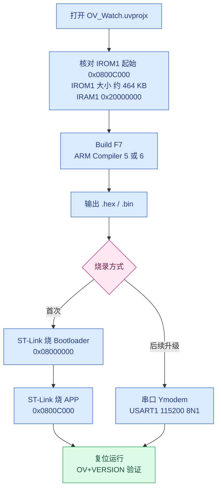
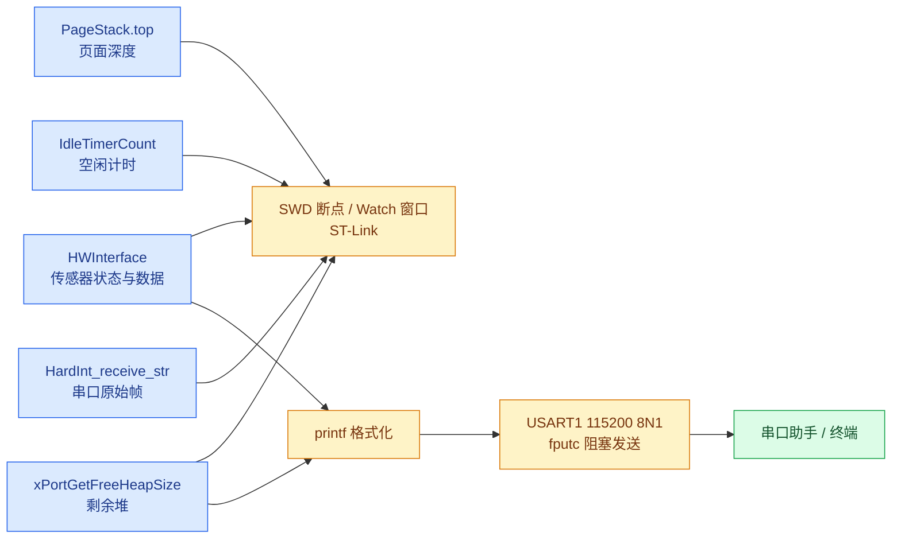
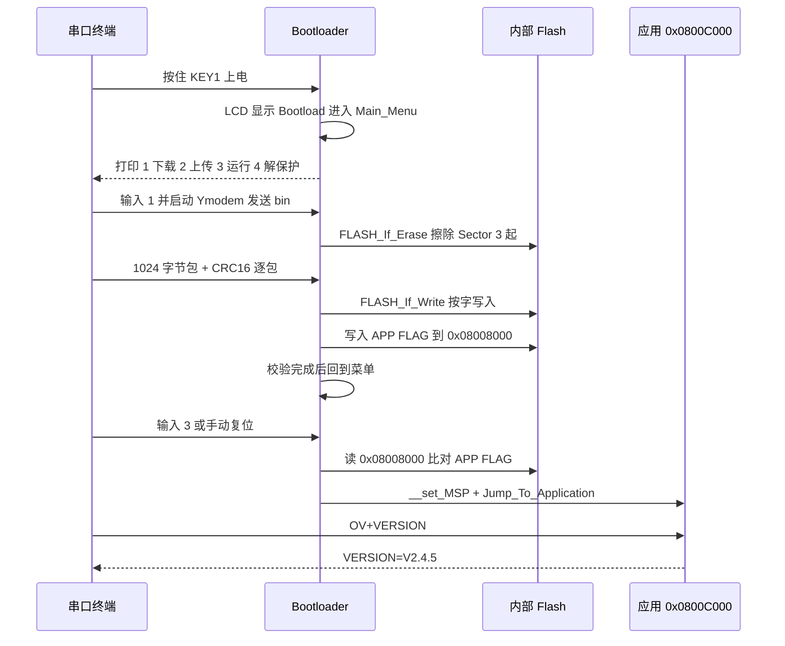

# OV-Watch 源码详解 09：构建、调试与实验指南

> 本篇不贴大段源码，讲“怎么把工程跑起来、怎么验证你读懂了”。

---

## 1. 构建固件（Keil MDK）

### 1.1 工程位置

```
Software/OV_Watch/MDK-ARM/OV_Watch.uvprojx
```

需要：

- Keil MDK-ARM 5.x；
- STM32F4xx Device Family Pack（DFP）；
- ARM Compiler 5 或 6（工程按 CubeMX 默认配置生成）。

### 1.2 关键工程配置（必须核对）

| 配置 | 值 | 不对的后果 |
|---|---|---|
| IROM1 起始 | `0x0800C000` | 烧进去不跑/跳转失败 |
| IROM1 大小 | 剩余 Flash（约 464 KB） | 链接溢出 |
| IRAM1 起始 | `0x20000000` | 正常 |
| 输出 | `.hex` / `.bin` | Ymodem 升级需要 bin |
| 调试器 | ST-Link / J-Link | 按手头硬件选 |

### 1.3 编译

1. 打开 `OV_Watch.uvprojx`；
2. 选目标（Target）→ Build（F7）；
3. 输出在 `MDK-ARM/output/`（或工程配置的 Output 目录）；
4. 首次编译若报 “cannot open source input file”，检查
   `Drivers/`、`Middlewares/` 是否完整（本仓库已包含）。

### 1.4 烧录顺序

```
第一次：Bootloader（IAP_F411）→ 0x08000000
        APP（OV_Watch）      → 0x0800C000
之后：  APP 可以通过串口 Ymodem 升级，不必再接 SWD
```

用 ST-Link 烧 APP 时，务必确认 Keil 的 IROM 是 `0x0800C000`，
否则会把 Bootloader 覆盖掉。

**构建与烧录执行流**：



---

## 2. PC 模拟器（不买硬件也能跑 UI）

`lv_sim_vscode_win/` 是 LVGL 的 Windows 模拟器：

- 图形后端：SDL2；
- 与固件共用 `User/GUI_App` 的页面代码（`user_test/` 是副本）；
- `HW_USE_HARDWARE=0`，硬件调用全部走桩。

构建（README 步骤）：

```bash
# 1. 安装 SDL2（官网下载开发包，或 brew install sdl2）
# 2. 进入工程
cd lv_sim_vscode_win
mkdir build && cd build
cmake ..
cmake --build . --parallel
./main        # 或双击生成的 exe
```

用途：

- 调页面布局/动画，不用反复烧板；
- 验证 PageManager 的 push/pop；
- 用 SDL 按键模拟手表按键（`SDL_KeyBoard_Publisher`）。

> 模拟器不包含真实传感器/低功耗逻辑，只验证 UI 与页面架构。

---

## 3. 调试手段

### 3.1 SWD 调试

- ST-Link 接 SWDIO/SWCLK/GND/3V3；
- Keil 里设断点、Watch 变量；
- 常用观察点：

| 变量 | 位置 | 用途 |
|---|---|---|
| `HWInterface` | `HWDataAccess.c` | 所有传感器状态/数据 |
| `PageStack.top` | `PageManager.c` | 当前页面深度 |
| `IdleTimerCount` | `user_RunModeTasks.c` | 空闲计时 |
| `HardInt_receive_str` | `stm32f4xx_it.c` | 串口收到的原始帧 |
| `xPortGetFreeHeapSize()` | FreeRTOS | 剩余堆 |

**调试数据流**：



### 3.2 printf 调试

`fputc()` 已重定向到 USART1，直接：

```c
printf("heap=%u\r\n", (unsigned)xPortGetFreeHeapSize());
printf("step=%u temp=%d\r\n", HWInterface.IMU.Steps, HWInterface.AHT21.temperature);
```

注意：

- `printf` 是阻塞发送，不要在中断/高优先级任务里频繁打印；
- 打印会拖慢 LVGL，调试完要删。

### 3.3 逻辑分析仪/示波器

- I2C（PB13/14）：看 ACK、时钟频率（软件 I2C 约 100~200 kHz）；
- SPI（PB3/PB5）：看 LCD 初始化序列；
- 背光 PWM（TIM3_CH3）：看占空比；
- 电流：串联电池测 STOP 电流。

---

## 4. 动手实验（由易到难）

### 实验 1：改开机画面

文件：`user_HardwareInitTask.c`

```c
LCD_ShowString(72, LCD_H/2, (uint8_t*)"Welcome!", ...);
sprintf(lcd_buf_str, "OV-Watch V%d.%d.%d", ...);
```

改成自己的文字/版本号，重新编译烧录，验证启动链没坏。

### 实验 2：加一个页面

按第 03 篇第 9 节的 6 步：

1. 复制一个简单页面（如 `ui_AboutPage.c`）改名为 `ui_TestPage.c`；
2. 改 `Page_t Page_Test = { init, deinit, &ui_TestPage }`；
3. 在菜单里加按钮 `Page_Load(&Page_Test)`；
4. 编译 → 进菜单 → 点按钮 → 返回。

验证点：连续进出 20 次，内存不涨（`xPortGetFreeHeapSize` 稳定）。

### 实验 3：加一个任务

按第 02 篇第 9 节：

- 每 2 s 打印一次气压；
- 观察串口输出与堆剩余；
- 再把栈从 256 B 改成 128 B，看是否栈溢出（HardFault）。

### 实验 4：改背光/熄屏时间

`ui_OffTimePage.c` 的 `ui_LTimeValue`、`ui_TTimeValue` 默认值
（10 s / 15 s）改小，观察 IdleEnterTask 的行为。

### 实验 5：测 STOP 电流

1. 断开 USB，电池串联万用表；
2. 等 15 s 自动熄屏；
3. 记录电流；
4. 在 `StopEnterTask` 睡前加 `MPU_Sleep()`，再测一次；
5. 对比差值（预期几 mA）。

### 实验 6：串口协议

用串口助手发：

```
OV
OV+VERSION
OV+SEND
OV+ST=20261109120000
```

观察回复；再故意发超长/无 `=` 的字符串，验证第 05 篇提到的越界风险。

### 实验 7：IAP 升级

1. 改版本号（`User/version.h`）→ 编译出 bin；
2. 按住 KEY1 上电 → 菜单 1 → Ymodem 发送；
3. 菜单 3 运行；
4. 用 `OV+VERSION` 确认版本变化。

**Ymodem 升级实验时序**：



---

## 5. 代码中已知的问题/坑（阅读时注意）

| # | 位置 | 问题 | 影响 |
|---|---|---|---|
| 1 | `HrAlgorythm.c` `Hr_Ave_Filter` | 没有 `return`，`ave` 未初始化 | 心率平均值是随机值（未定义行为） |
| 2 | `AHT21.c` | `AHT_Read_Status() & 0x80 == 0x80` 优先级错误 | 忙判断恒真，靠超时退出 |
| 3 | `user_MessageSendTask.c` `StrCMD_Get` | 不检查 `\0` | 无 `=` 的帧会越界 |
| 4 | `stm32f4xx_it.c` 串口缓冲 | 25 字节无 `\0` 保证 | 正好 25 字节时 `strcmp` 越界 |
| 5 | `user_RunModeTasks.c` | 唤醒后没重新 `HAL_UART_Receive_DMA` | 睡一觉后串口接收可能失效 |
| 6 | `user_RunModeTasks.c` | `MPU_Sleep/Wakeup` 未被调用 | 待机电流偏高 |
| 7 | `StrCalculate.c` `NumStackDel` | `data[Top_Point--] = 0` 清错元素 | 栈顶残留，影响下一次计算 |
| 8 | `StrCalculate.c` `SymisHighPriority` | 部分分支无返回值 | 未定义行为 |
| 9 | `pubsub.c` | `malloc` 链表、无锁、无释放 | 只适合模拟器单线程 |
| 10 | `user_TasksInit.c` | 不检查 `osThreadNew` 返回值 | 堆不足时任务静默不跑 |
| 11 | `key.c` | EXTI 中断只清标志，不产生事件 | 按键靠轮询，EXTI 只用于唤醒 |
| 12 | `HardwareInitTask` | `vTaskSuspendAll` 期间 `osDelay` 忙等 | 初始化耗时被放大 |
| 13 | `AHT21.c` `AHT_Init` | `AHT_Read_Status() && 0x08!=0x08` 恒假 | 0xBE 校准初始化命令从未发出 |
| 14 | `power.c` `PowerCalculate` | 电压 <3.45 V 时 `power` 未赋值 | 电量显示随机值 |
| 15 | `lcd.c` | `LCD_Fill` 开区间、`LCD_Color_Fill` 闭区间混用；画点函数不加 `OFFSET_Y` | 填充/画点坐标错位 |
| 16 | `StrCalculate.c` | 连续减法右结合（`8-2-3` 算成 9）；不支持一元负号 | 计算结果错误 |
| 17 | `StrCalculate.c` `strput` | 容量判断用 `15-1`，但 `strque` 只有 10 字节 | 可能越界写 |
| 18 | `SPL06_001.c` | 气压原始值分 3 次单字节读 | 读数可能撕裂 |
| 19 | `LSM303.c` | 用 `RegAddr>0x19` 切换加速度/磁力地址；磁力数据顺序为 X/Z/Y | 换型号/读温度时容易错 |
| 20 | `CST816.c` | 深度睡眠后 I2C 唤不醒 | 只能复位唤醒 |

> 这些不是“让你去改”的作业，而是读代码时的“防坑地图”。
> 真正要改，建议一次只改一个，并在第 4 节实验里验证。

---

## 6. 代码走读自测题

1. `HardwareInitTask` 为什么用 `vTaskSuspendAll()` 而不是关中断？
2. `osPriorityHigh3` 对应 FreeRTOS 的哪个优先级？为什么 `configMAX_PRIORITIES=56`？
3. 16 KB 堆里，14 个任务的栈总共占多少？还剩多少给 TCB/队列？
4. `Page_Load` 为什么先 `deinit` 旧页再 `push` 新页？顺序反过来会怎样？
5. `Page_Back` 在栈空时为什么要 push Home + Menu？
6. `TaskTickHook` 里三个计数器分别服务谁？为什么必须在中断里加？
7. STOP 模式前后，SysTick 和系统时钟各做了什么？漏一步会怎样？
8. 充电中断到充电页显示，完整经过哪些函数？
9. IAP 跳转的四步是什么？为什么必须关 SysTick 和全局中断？
10. EEPROM 的步数为什么高字节在前？跨天逻辑在哪判断？

---

## 7. 一周阅读计划（建议）

| 天 | 内容 | 产出 |
|---|---|---|
| 1 | 第 00/01 篇 + `main.c`/`freertos.c` | 画出启动链 |
| 2 | 第 02 篇 + `user_TasksInit.c` + 各任务 | 画出任务/队列关系图 |
| 3 | 第 03 篇 + `PageManager.c` + `ui.c` | 在模拟器加一个页面 |
| 4 | 第 04/05 篇 + `HWDataAccess.c` + `stm32f4xx_it.c` | 用串口发命令 |
| 5 | 第 06 篇 + I2C/LCD/触摸驱动 | 用逻辑分析仪看 I2C |
| 6 | 第 07 篇 + `user_RunModeTasks.c` | 测一次 STOP 电流 |
| 7 | 第 08/09 篇 + IAP | 做一次 Ymodem 升级 |

---

## 8. 交付检查清单

- [ ] Keil 能零警告编译（至少零错误）
- [ ] 模拟器能跑首页
- [ ] 真机能开机、显示版本号
- [ ] 按键/触摸能切页
- [ ] 串口 `OV+VERSION` 有回复
- [ ] 15 s 后能进 STOP，按键能唤醒
- [ ] 断电重启后步数/设置保留
- [ ] 能通过 Ymodem 升级并跳转
