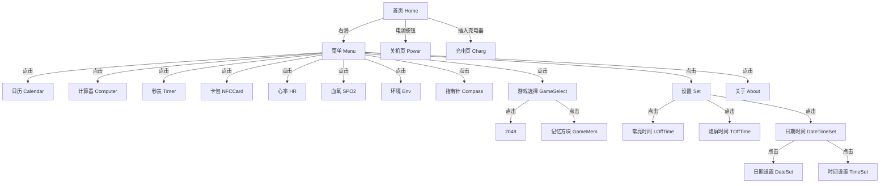
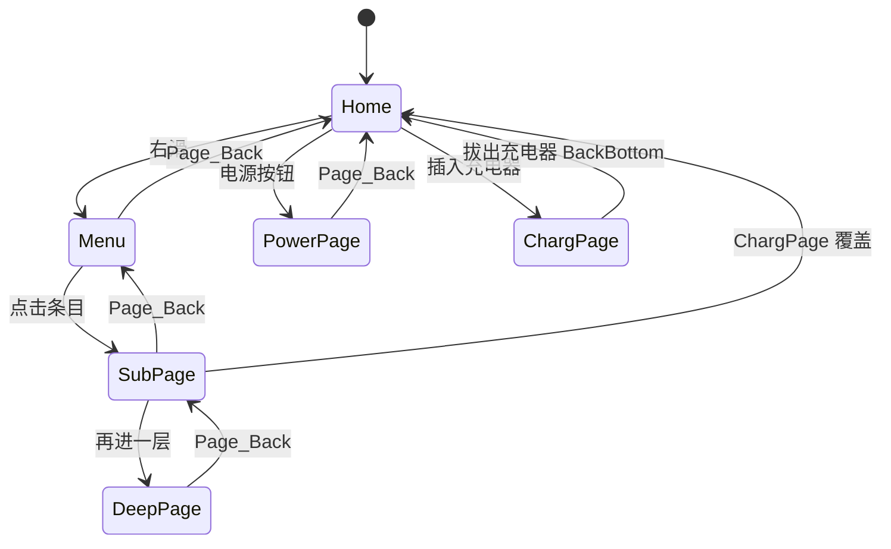
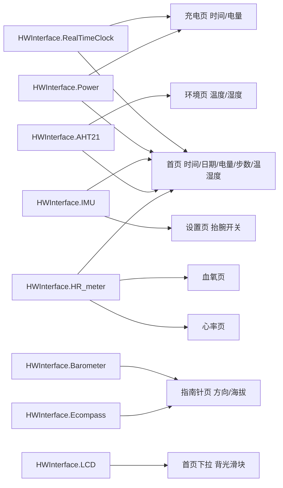

# OV-Watch 源码详解 10：UI 页面逐页精读

> 涉及文件：
> - `User/GUI_App/Screens/Src/ui_HomePage.c`（894 行）
> - `User/GUI_App/Screens/Src/ui_MenuPage.c`（943 行）
> - `User/GUI_App/Screens/Src/ui_SetPage.c`（423 行）
> - `User/GUI_App/Screens/Src/ui_ChargPage.c`（218 行）
> - `User/GUI_App/Screens/Src/ui_TimerPage.c`（269 行）
> - `User/GUI_App/Screens/Src/ui_EnvPage.c`（191 行）
> - `User/GUI_App/Screens/Src/ui_CompassPage.c`（184 行）
> - `User/GUI_App/Screens/Src/ui_CalendarPage.c`（70 行）
> - `User/GUI_App/Screens/Src/ui_NFCCardPage.c`（371 行）
> - `User/GUI_App/Screens/Src/ui_Megboxes.c`（170 行）
> - `User/GUI_App/Screens/Src/ui_Game2048Page.c`（749 行）
> - `User/GUI_App/Screens/Src/ui_GameMemPage.c`（298 行）
> - `User/GUI_App/Screens/Src/ui_GameSelectPage.c`（232 行）
> - `User/GUI_App/Screens/Src/ui_DateTimeSetPage.c`（617 行）
> - `User/GUI_App/Screens/Src/ui_OffTimePage.c`（280 行）
> - `User/GUI_App/Screens/Src/ui_AboutPage.c`（221 行）
> - `User/GUI_App/Screens/Src/ui_SPO2Page.c`（117 行）
> - `User/GUI_App/Screens/Src/ui_HRPage.c`（131 行）
> - `User/GUI_App/Screens/Src/ui_ComputerPage.c`（308 行）

---

## 1. 阅读地图：19 个文件、22 个 Page_t

一个 `.c` 可以注册多个页面（`ui_DateTimeSetPage.c` 3 个、`ui_OffTimePage.c` 2 个、
`ui_HomePage.c` 2 个），所以 19 个文件对应 22 个 `Page_t`：

| 页面 | Page_t | 屏幕对象 | 定时器 | 主要数据源 | 入口 |
|---|---|---|---|---|---|
| 首页 | `Page_Home` | `ui_HomePage` | 500 ms | RTC/电量/步数/AHT21/HR | 启动默认页 |
| 关机页 | `Page_Power` | `ui_PowerPage` | 无 | — | 首页电源按钮 |
| 菜单 | `Page_Menu` | `ui_MenuPage` | 无 | — | 首页右滑 |
| 设置 | `Page_Set` | `ui_SetPage` | 无 | `IMU.wrist_is_enabled` | 菜单 |
| 充电 | `Page_Charg` | `ui_ChargPage` | 2000 ms | RTC/电量 | 插入充电器 |
| 秒表 | `Page_Timer` | `ui_TimerPage` | 10 ms | 软件计时 | 菜单 |
| 环境 | `Page_Env` | `ui_EnvPage` | 500 ms | `AHT21.*` | 菜单 |
| 指南针 | `Page_Compass` | `ui_CompassPage` | 500 ms | `Ecompass.direction`、`Barometer.altitude` | 菜单 |
| 日历 | `Page_Calender` | `ui_CalendarPage` | 无 | RTC 一次 | 菜单 |
| 卡包 | `Page_NFCCard` | `ui_NFCCardPage` | 无 | 无 | 菜单 |
| 游戏选择 | `Page_GameSelect` | `ui_GameSelectPage` | 无 | 无 | 菜单 |
| 2048 | `Page_Game_2048` | `ui_Game2048Page` | 无 | 全局 `Game_2048` | 游戏选择 |
| 记忆方块 | `Page_GameMem` | `ui_GameMem_Page` | 无 | 全局 `Game_Mem` | 游戏选择 |
| 日期时间入口 | `Page_DateTimeSet` | `ui_DateTimeSetPage` | 无 | RTC | 设置 |
| 日期设置 | `Page_DateSet` | `ui_DateSetPage` | 无 | RTC | 日期时间入口 |
| 时间设置 | `Page_TimeSet` | `ui_TimeSetPage` | 无 | RTC | 日期时间入口 |
| 常亮时间 | `Page_LOffTimeSet` | `ui_LOffTimeSetPage` | 无 | 全局 `ui_LTimeValue` | 设置 |
| 熄屏时间 | `Page_TOffTimeSet` | `ui_TOffTimeSetPage` | 无 | 全局 `ui_TTimeValue` | 设置 |
| 关于 | `Page_About` | `ui_AboutPage` | 无 | `version.h` | 菜单 |
| 计算器 | `Page_Computer` | `ui_Computerpage` | 无 | `StrCalculate` 全局栈 | 菜单 |
| 血氧 | `Page_SPO2` | `ui_SPO2Page` | 500 ms | `HR_meter.SPO2` | 菜单 |
| 心率 | `Page_HR` | `ui_HRPage` | 50 ms | `HR_meter.HrRate` | 菜单 |

另外 `ui_Megboxes.c` 不是页面：它把弹窗直接建在 `lv_scr_act()` 上，
没有 `Page_t`，关闭时 `lv_obj_del`。

## 2. 页面栈与跳转

### 2.1 全量跳转图



所有子页面都靠“右滑”或 `Page_Back()` 回上一页；充电页例外，
它是被 `ChargPageEnterTask` 强插进来的，拔出时 `Page_Back_Bottom()` 直接回首页。

### 2.2 页面栈状态



`MAX_DEPTH=6`、`Page_Load` 在 `top>=5` 时拒绝，所以从首页算起最多 5 层。
实际最深路径是 首页 → 菜单 → 游戏选择 → 2048，只有 4 层。

## 3. 首页：信息密度最高的一页

### 3.1 控件树

```
ui_HomePage (screen, 240x280)
├─ ui_TimeHourLabel     右对齐 x=-105 y=-70, Cuyuan48
├─ ui_TimeColonLabel    冒号, 灰色 0x808080
├─ ui_TimeMinuteLabel   右对齐 x=-20  y=-70, Cuyuan48
├─ ui_BatArc            50x50 圆弧, 绿色 0x19C819
├─ ui_BaticonLabel      iconfont16 电池图标
├─ ui_BatNumLabel       "70%"
├─ ui_DateLabel         "6-23", 红色 0xFF461E
├─ ui_DayLabel          "Sun."
├─ ui_StepiconLabel     iconfont24
├─ ui_StepCnLabel       "今日步数"
├─ ui_StepNumLabel      Cuyuan/Montserrat 18
├─ ui_StepNumBar        200x10 进度条（固定 40%）
├─ ui_TempArc           50x50, 量程 -20~60
├─ ui_HumiArc           50x50, 背景弧 270~620 度
├─ ui_HRArc             50x50, 红色
└─ ui_DropDownPanel     240x420, 可纵向滚动
   ├─ ui_UpBGPanel      240x130 半透明底
   ├─ ui_NFCButton      50x50 CHECKABLE
   ├─ ui_BLEButton      50x50 CHECKABLE
   ├─ ui_PowerButton    50x50
   ├─ ui_SetButton      50x50
   ├─ ui_LightSlider    50x110 竖向
   └─ ui_DownBGPanel    240x130 透明
```

下拉面板初始 `y=-10` 再 `scroll_by(-130)`，把内容藏到屏幕上方；
用户从顶部往下拖才能看到快捷开关。`DownBGPanel` 的作用是撑出滚动区域，
让面板能停在中间而不是弹回顶部。

### 3.2 数据刷新

`HomePage_timer_cb`（`ui_HomePage.c:115`）每 500 ms 跑一次，先判断自己是否在栈顶：

```c
  if(Page_Get_NowPage()->page_obj  == &ui_HomePage)
	{
```

然后逐项“比较缓存值，变了才刷”：

| 字段 | 缓存变量 | 比较对象 | 控件 |
|---|---|---|---|
| 分钟 | `ui_TimeMinuteValue` | `DateTime.Minutes` | `ui_TimeMinuteLabel` |
| 小时 | `ui_TimeHourValue` | `DateTime.Hours` | `ui_TimeHourLabel` |
| 日 | `ui_DateDayValue` | `DateTime.Date` | `ui_DateLabel`/`ui_DayLabel` |
| 月 | `ui_DateMonthValue` | `DateTime.Month` | 同上 |
| 电量 | `ui_BatArcValue` | `Power.power_remain` | `ui_BatArc`/`ui_BatNumLabel` |
| 步数 | `ui_StepNumValue` | `IMU.Steps` | `ui_StepNumLabel` |
| 温度 | `ui_HomePageTempValue` | `AHT21.temperature` | `ui_TempArc`/`ui_TempNumLabel` |
| 湿度 | `ui_HomePageHumiValue` | `AHT21.humidity` | `ui_HumiArc`/`ui_HumiNumLabel` |

这种写法的收益：LVGL 内部虽然也会判断文本相同则跳过重绘，但
`sprintf` + `lv_arc_set_value` 本身有开销，先比较能省掉大部分调用。

注意 `ui_HRNumLabel` 只在 `init` 时写一次，**不在定时器里刷新**——
首页的心率数字是“进页那一刻的值”，不会跳变。这是一个容易忽略的细节。

### 3.3 交互

| 控件 | 事件 | 动作 |
|---|---|---|
| `ui_HomePage` | `LV_EVENT_GESTURE` 右滑 | `Page_Load(&Page_Menu)` |
| `ui_NFCButton` | `VALUE_CHANGED` | 维护 `ui_HomePageNFCEN`（驱动未接） |
| `ui_BLEButton` | `VALUE_CHANGED` | `HWInterface.BLE.Enable/Disable` |
| `ui_PowerButton` | `CLICKED` | `Page_Load(&Page_Power)` |
| `ui_PowerSlider` | `CLICKED` 且值 >=90 | `HWInterface.Power.Shutdown()` |
| `ui_SetButton` | `CLICKED` | `Page_Load(&Page_Set)` |
| `ui_LightSlider` | `VALUE_CHANGED` | `HWInterface.LCD.SetLight(value)` |

## 4. 菜单页：12 个入口 + 滚动记忆

菜单页是 12 个 240×70 的 Panel 纵向排列，总高 840，一屏只能看 4 个：

```
y=0    日历     y=70   计算器   y=140  秒表
y=210  卡包     y=280  运动     y=350  心率
y=420  血氧     y=490  环境     y=560  指南针
y=630  游戏     y=700  设置     y=770  关于
```

每个 Panel 的结构完全相同：透明容器（PRESSED 态灰底）+ 40×40 圆角图标按钮
+ 60 px 处的中文 Label。Button 被 `clear_flag(CLICKABLE)`，点击落到 Panel 上，
所以整行都能点。

滚动位置记忆（`ui_MenuPage.c`）：

```c
		if(event_code == LV_EVENT_SCROLL_END)
    {
        ui_MenuScrollY = lv_obj_get_scroll_y(ui_MenuPage);
    }
```

回到菜单页时 `lv_obj_scroll_to(ui_MenuPage,0,ui_MenuScrollY,LV_ANIM_OFF)` 还原。
首页 init 里会把 `ui_MenuScrollY` 清零，所以“回首页再进菜单”会回到顶部。

12 个入口里有 1 个是空实现：运动（`ui_event_MenuSprPanel` 的 `#if` 分支为空）。
其余都按 `#if XXX_PAGE_EN` 编译裁剪，关掉的页面既不占 Flash 也不会误跳转。

## 5. 设置页：5 行 + 1 个开关

| 行 | y | 控件 | 动作 |
|---|---|---|---|
| 常亮时间 | 0 | Panel + 蓝色圆钮 + Label | `Page_Load(&Page_LOffTimeSet)` |
| 熄屏时间 | 70 | 橙色圆钮 | `Page_Load(&Page_TOffTimeSet)` |
| 时间日期 | 140 | 蓝色圆钮 | `Page_Load(&Page_DateTimeSet)` |
| 抬腕亮屏 | 210 | 紫色圆钮 + `lv_switch` | `WristEnable/Disable` |
| 密码设置 | 280 | 橙色圆钮 | 空实现 |

抬腕开关是唯一有状态的控件，重建时读 `HWInterface.IMU.wrist_is_enabled` 恢复：

```c
		if(HWInterface.IMU.wrist_is_enabled)
		{lv_obj_add_state(ui_WristSwitch, LV_STATE_CHECKED);}
```

注意这一行在 `ui_SetPage.c:361` 附近，属于“UI 直接读硬件门面字段”的典型用法。

## 6. 充电页：2 秒刷新 + 现场算电量

布局：左半屏电量圆弧 + 电池图标 + 百分比，右半屏 100 号大字“时:分”。

`ChargPage_timer_cb`（`ui_ChargPage.c:52`）每 2 s：

```c
			ui_BatArcValue = HWInterface.Power.BatCalculate();
			if(ui_BatArcValue>0 && ui_BatArcValue<=100)
			{
				lv_arc_set_value(ui_CharPageBatArc, ui_BatArcValue);
```

与首页不同，这里**每 2 s 真的重新采样 ADC**（8 次平均，约 8 ms），
而不是读 `power_remain` 缓存。原因是充电时电量变化快，缓存值可能滞后。

已知问题：`uint8_t value_strbuf[5]` 配 `"%2d%%"`，电量 100 时
`"100%"` 需要 5 字符 + `\0` = 6 字节，栈上越界 1 字节。
当前靠对齐侥幸没崩，属于必须记录的问题。

## 7. 秒表页：10 ms 定时器与一个未完成的计时

界面是 `lv_meter` 画 60 格刻度，中央“分:秒.厘秒”四个 Label，
下方左复位、右启停两个圆形按钮。

```c
    ui_TimerPage_min = (elapsed / 60000U) % 60U;
    ui_TimerPage_sec = (elapsed / 1000U) % 60U;
    ui_TimerPage_10ms = (elapsed / 10U) % 100U;
    ui_TimerPage_ms = elapsed % 10U;
```

`elapsed` 来自全局 `ui_TimerPage_elapsed_ms`，由 `TaskTickHook` 每 1 ms 加 1
（只在 `ui_TimerPageFlag` 为 1 时）。这解释了为什么秒表运行时
`IdleTimerCount` 被清零——系统认为“用户正在用秒表”，不该熄屏。

两个问题：

1. `LabelRefresh_timer` 只读 `elapsed_ms`，**从未累加**，也没有用
   `lv_tick_get()` 做差值，所以秒表显示恒为 00:00.00；
2. `strbuf[2]` 装 `"%02d"` 需要 3 字节，栈上越界 1 字节。

`ui_TimerPage_screen_deinit` 是空函数，定时器没删，离开页面后仍在跑并访问
已释放的 Label——这是本文件最危险的问题。

## 8. 环境页：两根竖条

左温度（量程 -10~50，红）、右湿度（0~100，蓝），条高 150、宽 20，
下方 30 号字数值 + 单位，条顶图标。

`EnvPage_timer_cb`（`ui_EnvPage.c:53`）每 500 ms 无条件写：

```c
    lv_bar_set_value(ui_EnvTempBar, HWInterface.AHT21.temperature, LV_ANIM_OFF);
    lv_bar_set_value(ui_EnvHumiBar, HWInterface.AHT21.humidity, LV_ANIM_OFF);
```

没有“先比较再刷”的优化，因为 bar 的 set_value 本身很便宜；
代价是数值没变也会触发一次重绘。

坑：`temperature` 是 `uint8_t`，负温会回绕成 200+，-10 的量程永远用不到。

## 9. 指南针页：双层刻度 + 指针图

`lv_meter` 230×230，外圈 61 个刻度（0~360 度），内圈 12 个大刻度，
指针是 23×171 的 PNG，以图片中心为轴旋转。

```c
    lv_img_set_angle(ui_Compassneedle, HWInterface.Ecompass.direction * 10);
```

`direction` 单位是度，LVGL 角度单位是 0.1 度，所以乘 10。
底部两个 100×30 的半透明“信息牌”分别显示方向和海拔，都清掉了 CLICKABLE。

海拔来自气压计而不是罗盘，两个传感器共用这一页展示；
`Barometer.altitude` 是 `uint16_t`，在 `SensUpdateTask` 里由
`(int16_t)alti` 强转后写入，负海拔会回绕。

## 10. 日历页：全工程最短

```c
    lv_calendar_set_today_date(ui_CalendarPageCalendar, 2000+DateTime.Year, DateTime.Month, DateTime.Date);
    lv_calendar_set_showed_date(ui_CalendarPageCalendar, 2000+DateTime.Year, DateTime.Month);
```

只读一次 RTC，之后不再刷新；翻月由 `lv_calendar_header_arrow_create`
自带的箭头处理。RTC 年份是 0~99，LVGL 需要完整年份，所以 `2000+`。

## 11. 卡包页：三张卡片，只有第一张能点

三张 200×100 的卡片（校园卡/门禁卡/交通卡），每张含图标按钮、卡名、
“改写”“选择”两个 80×30 描边按钮。第三张 y=260，已在屏幕外，需要上滑。

现状：

- 只有第 1 张卡绑定了回调；
- “改写”弹 `ui_mbox_create("开发中")`；
- “选择”是空函数；
- 第 2/3 张卡的 `clear_flag` 误写成 `ui_Card1Btn`（复制粘贴遗留），
  导致 2/3 号图标按钮仍可点击。

## 12. 游戏三页

### 12.1 游戏选择

三行：2048（青绿）、记忆方块（橙）、反弹球（粉红）。
前两个绑定了 `Page_Load`，反弹球没有回调——未实现。

### 12.2 2048

棋盘用 `lv_btnmatrix` 4×4，手势驱动。核心数据是“指数矩阵”：
0=空、1=2、2=4、…、11=2048。移动算法用一个小栈做合并：

```c
                if(num_stack.Data[num_stack.Top_Point-1] == num_stack.Data[num_stack.Top_Point-2])
                {
                    uint16_t temp;
                    temp = num_stack.Data[num_stack.Top_Point-1] + 1;
                    Stack_Pop(&num_stack);
                    Stack_Pop(&num_stack);
                    Stack_Push(&num_stack,temp);
                    *score += 1<<(temp-1);
                    moved = 1;
                }
```

四个方向各一份 `move_*`，只是遍历顺序不同。
`Game_2048_init` 重置分数、清 map、放两个随机数；重玩按钮是**长按**触发，
避免游戏中误触。

已知问题：`game_over()` 只判断“还有没有空格”，棋盘一满就判负，
即使还能合并；`Stack_init` 的 `memset` 长度写成 `STACK_DEPTH`（5 字节），
只清了一半的 `uint16_t` 数组。

### 12.3 记忆方块

16 格藏 8 对数字，`lv_btnmatrix` 的 `btnm_map` 用 `"\n"` 分行，
`DRAW_PART_BEGIN` 里按 `label_opa_map` 控制每格透明度。

翻牌逻辑在 `ui_event_GameMemBtnM_handler`：

- 第一次点：记 `present_id`；
- 第二次点：数字相同 → 两格 `HIDDEN`、matrix 清 0；不同 → 新格显示、
  旧格盖回；
- 全清后显示“重玩”。

已知问题：`previous_id/present_id` 是 `uint8_t`，初始化为 -1 实际是 255，
首次点击 `matrix[255]` 越界读 1 字节。

## 13. 其余页面速查

| 页面 | 结构 | 关键点 |
|---|---|---|
| 心率 | 80 号大字 + “次/分” + 图标 | 50 ms 刷新；提示文本固定“正在测量...” |
| 血氧 | 同心率，单位 `%` | 500 ms；`SPO2` 当前无写入者，恒 99 |
| 关于 | 8 组“标题+内容”标签 | 版本来自 `version.h`，`str_buf[8]` 偏紧 |
| 计算器 | 4×4 键盘 + 只读 textarea | 算法在 `StrCalculate.c`，UI 只做按键路由 |
| 日期时间入口 | 同步开关 + 日期行 + 时间行 | `ui_APPSy_EN` 目前无消费者 |
| 日期设置 | 年/月/日三个 roller | 日固定 31 天表，2 月能选 31 日 |
| 时间设置 | 时/分/秒三个 roller | 秒复用 `minoptions`（都是 00~59） |
| 常亮/熄屏 | 一个 roller + 单位 + OK | 6 档预设；熄屏值误用常亮表 |
| 弹窗 | 200×130 白色面板 | 建在 `lv_scr_act()`，非页面 |

## 14. 控件 ← 数据源



## 15. 陷阱与实测建议

1. **首页心率不刷新**：`ui_HRNumLabel` 只在 init 写一次，想看实时心率要去心率页。
2. **充电页缓冲区越界**：`value_strbuf[5]` + `"%2d%%"`，100% 时溢出。
3. **秒表不计数**：`elapsed_ms` 从未累加；且 deinit 没删定时器。
4. **菜单滚动位置**：只有 `SCROLL_END` 才记录，快速拖拽后立刻松手可能记到惯性前的位置。
5. **卡包 2/3 号卡未绑事件**：点击无反应是预期行为，不是触摸坏了。
6. **2048 终局判定过早**：棋盘满但还能合并时会提前判负。
7. **记忆方块首点越界**：`previous_id=255` 时读 `matrix[255]`，靠数组后面的内存“恰好可读”没崩。
8. **设置页开关重建**：抬腕开关靠 `HWInterface` 恢复，NFC/BLE 靠全局标志恢复；
   新增有状态控件时别忘了这一步。

## 16. 读码路径

1. 先读 `ui_HomePage.c`：它包含“数据刷新 + 手势 + 下拉面板 + 关机页”四种模式；
2. 再读 `ui_MenuPage.c`：理解 12 个入口的组织与滚动记忆；
3. 然后按兴趣挑 `ui_EnvPage.c`（最简单）、`ui_ChargPage.c`（消息驱动）、
   `ui_Game2048Page.c`（算法最重）；
4. 最后读 `ui_DateTimeSetPage.c`：一个文件 3 个页面，理解 Page_t 的复用。

相关文档：`Docs/03-页面管理器与GUI架构.md`（路由层）、
`Docs/11-传感器与数据算法.md`（数据从哪来）、
`Knowledge-Base/ovwatch/GUI_Framework.md`（框架约定）。
