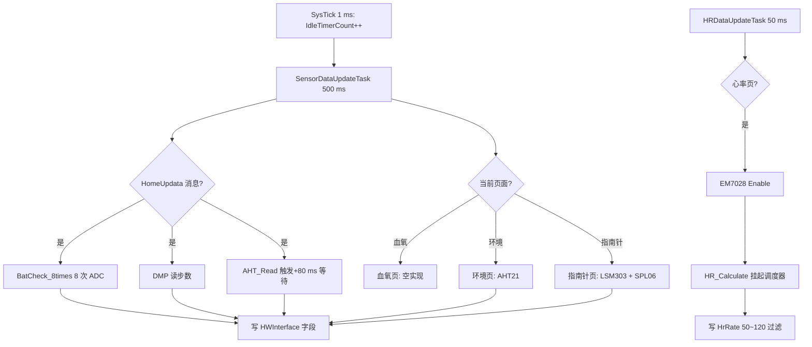
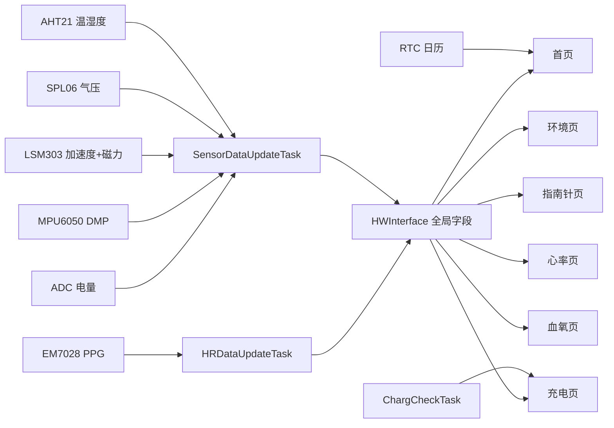
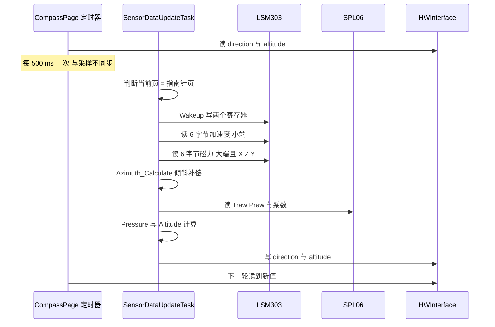

# OV-Watch 源码详解 11：传感器与数据算法

> 涉及文件：
> - `BSP/AHT21/AHT21.c`（209 行）
> - `BSP/SPL06_001/SPL06_001.c`（427 行）
> - `BSP/LSM303DLH/LSM303.c`（479 行）
> - `BSP/MPU6050/mpu6050.c`（603 行）
> - `BSP/EM7028/HrAlgorythm.c`（心率算法）
> - `User/Tasks/Src/user_SensUpdateTask.c`（243 行）
> - `User/Func/Src/HWDataAccess.c`（717 行）

---

## 1. 四类传感器与一条总线

| 传感器 | 物理量 | 原理 | 接口 | 采样率 | 分辨率 |
|---|---|---|---|---|---|
| AHT21 | 温度、湿度 | 电容式湿敏 + 集成测温 | I2C 0x38 | 按需（≥80 ms） | 20 位 |
| SPL06-001 | 气压、温度 | MEMS 压阻式 | I2C 0x76 | 连续（2 倍过采样） | 24 位 |
| LSM303DLH | 加速度、磁场 | MEMS 电容式 + 磁阻式 | I2C 0x19/0x1E | 10 Hz / 15 Hz | 16 位 |
| MPU6050 | 加速度、角速度 | MEMS 电容式 | I2C 0x68 | DMP 内部（约 50 Hz） | 16 位 |
| EM7028 | PPG（心率/血氧） | 光电容积脉搏波 | I2C 0x24 | 50 ms | — |

除触摸和 EEPROM 外，它们都挂在 PB13/PB14 这条软件 I2C 上。
软件 I2C 的好处是引脚随便选、时序可控；代价是每次传输都占 CPU，
而且没有总线仲裁/时钟拉伸处理。

## 2. AHT21：电容式湿度的 20 位换算

### 2.1 物理原理

湿敏电容的容值随环境相对湿度线性变化，芯片内部把它转换成 20 位数字量；
温度用片上二极管（或热敏电阻）测，也是 20 位。两者共用一次测量命令
`0xAC 0x33 0x00`，转换时间典型 80 ms。

### 2.2 寄存器/命令

| 命令 | 方向 | 含义 |
|---|---|---|
| 0x70 | 写 | 从机地址 + 写位（0x38<<1） |
| 0x71 | 读 | 从机地址 + 读位 |
| 0xAC 0x33 0x00 | 写 | 触发温湿度测量 |
| 0xBA | 写 | 软复位 |
| 0xBE 0x08 0x00 | 写 | 校准初始化（代码里实际没发出去） |

### 2.3 换算公式

20 位原始值 `raw`：

```
RH(%) = raw / 2^20 * 100
T(℃)  = raw / 2^20 * 200 - 50
```

代码用整数实现（`AHT21.c:197`、`AHT21.c:205`）：

```c
	*humi = (RetuData * 1000 >> 20); // 先乘后移，避免整数除法丢精度
	*humi /= 10;
```

```c
	*temp = ((RetuData * 2000 >> 20)- 500); // 公式：T = raw*2000/2^20 - 50
	*temp /= 10;
```

验算：`raw = 0x80000 = 524288`（半量程）：

- 湿度 = 524288 × 1000 >> 20 = 500 → /10 = **50 %RH**；
- 温度 = 524288 × 2000 >> 20 = 1000 → (1000-500)/10 = **50℃**。

量程端点：raw=0 → 0 %RH / -50℃；raw=2^20-1 → 约 100 %RH / 150℃。
温度上限 150℃ 是芯片规格，不是代码限制。

### 2.4 精度与误差

- 湿度典型精度 ±2 %RH（20~80%RH），超出范围 ±3 %RH；
- 温度典型 ±0.3℃；
- 代码没有做多点校准，也没有 CRC 校验（第 7 字节 CRC 没读）；
- 状态忙判断有优先级 bug（`&` 与 `==`），实际没等忙标志。

## 3. SPL06-001：压阻式气压与二阶补偿

### 3.1 物理原理

MEMS 压阻薄膜在气压下形变，惠斯通电桥输出差分电压，ADC 转成 24 位。
压阻传感器对温度敏感，所以每颗芯片出厂时都有一组校准系数，
必须用多项式补偿才能得到真实气压。

### 3.2 寄存器配置

| 寄存器 | 值 | 含义 |
|---|---|---|
| `PRS_CFG` 0x06 | 0x01 | 气压 2 倍过采样 |
| `TMP_CFG` 0x07 | 0x80 | 使用内部温度传感器，1 倍过采样 |
| `MEAS_CFG` 0x08 | 0x07 | 气压+温度连续测量 |
| `CFG_REG` 0x09 | 0x00 | 中断/滤波全关 |

### 3.3 标度因子

```
kT = 524288  = 2^19          （温度 1 倍过采样）
kP = 1572864 = 3 * 2^19      （气压 2 倍过采样）
Traw_sc = Traw / kT
Praw_sc = Praw / kP
```

`3 * 2^19` 里的 3 来自过采样倍率与内部累加器位宽的组合，改过采样配置
就必须同步改 kP，否则气压整体差一个固定倍数。

### 3.4 补偿多项式

```
Tcomp = c0 * 0.5 + c1 * Traw_sc

Pcomp = c00
      + Praw_sc * (c10 + Praw_sc * (c20 + Praw_sc * c30))
      + Traw_sc * c01
      + Traw_sc * Praw_sc * (c11 + Praw_sc * c21)
```

代码用 Horner 展开（`SPL06_001.c:407`），6 次乘法完成。
系数是有符号的，c0/c1 12 位、c00/c10 20 位、其余 16 位，
拼接时要处理半字节共享和符号扩展（见 `BSP_Sensors.md` 第 3.2 节）。

### 3.5 海拔换算

```
h = 44330 * (1 - (P / 101325)^0.1903)
```

推导：国际标准大气假设温度随高度线性递减（6.5 K/km），
由静力学方程积分得到。`44330 m` 是对应 101325 Pa 的基准高度。

误差来源：

| 来源 | 影响 |
|---|---|
| 天气变化（±10 hPa） | ±80 m |
| 温度漂移 | ±10~20 m |
| 传感器噪声（2 倍过采样） | ±0.1 m |
| 室内外压差 | 几米到几十米 |

所以这块表的海拔只能看趋势，不能当高度计用。

## 4. LSM303DLH：加速度 + 磁力融合出方位角

### 4.1 物理原理

- 加速度计：MEMS 质量块在加速度下位移，电容变化转成 16 位；
  静止时测到的是重力矢量，可反推倾角。
- 磁力计：磁阻材料在磁场中电阻变化，测三轴磁场分量；
  水平放置时 `atan2(Ym, Xm)` 就是方位角。

问题是表盘很少绝对水平，倾斜时 Z 分量会混进水平分量，
所以必须用加速度算出的 pitch/roll 做倾斜补偿。

### 4.2 量程与灵敏度

| 器件 | 配置 | 量程 | 灵敏度 |
|---|---|---|---|
| 加速度计 | `CTRL_REG4_A=0x10` | ±4 g | 约 134 LSB/g（驱动注释值，以手册为准） |
| 磁力计 | `CRB_REG_M=0x80` | ±4.0 Gauss | XY 450 LSB/Gauss，Z 400 LSB/Gauss |

代码只输出原始码值，不做物理单位换算；方位角计算也不需要灵敏度，
因为 `atan2` 会把比例因子约掉。

### 4.3 倾斜补偿公式

```c
	pitch   = atan2f(Xa, sqrtf(Ya * Ya + Za * Za));
	roll    = atan2f(Ya, sqrtf(Xa * Xa + Za * Za));
	Hy      = Ym * cosf(roll) + Xm * sinf(roll) * sinf(pitch) - Zm * cosf(pitch) * sinf(roll);
	Hx      = Xm * cosf(pitch) + Zm * sinf(pitch);
	Azimuth = atan2f(Hy,Hx)*180.0/PI;
```

这是“把磁矢量旋转到水平面”的标准做法：

1. 用重力矢量求 pitch/roll；
2. 绕 X 轴转 roll、绕 Y 轴转 pitch，把机体坐标的磁矢量变到水平坐标；
3. `atan2(Hy, Hx)` 得相对北的角度，范围 -180~180。

`SensUpdateTask` 里再 `if(temp<0) temp+=360;` 归一到 0~360。

### 4.4 校准缺失

代码没有：

- 磁偏角修正（中国各地约 -2°~-12°）；
- 硬铁校准（手机/扬声器磁铁造成的固定偏移）；
- 软铁校准（金属外壳造成的各轴比例/交叉耦合差异）。

结果是绝对方向有 5~15° 误差，转一圈的曲线也不是正圆。
要做准，需要“8 字校准”：记录各轴 min/max，归一化到 [-1,1]，
再算 `offset=(max+min)/2`、`scale=(max-min)/2`。

## 5. MPU6050：DMP 计步与加速度判姿态

### 5.1 两条路径

工程里有两套代码：

| 路径 | 入口 | 是否使用 |
|---|---|---|
| 自定义低功耗 | `MPU_Init()`（`mpu6050.c:109`） | 否（调用被注释） |
| eMPL DMP | `mpu_dmp_init()` | 是（`HWInterface.IMU.Init`） |

DMP 是 MPU6050 内部的协处理器，跑 InvenSense 的固件，能直接输出
四元数、计步数，不需要主控做姿态解算。代价是要下载约 3 KB 微码，
初始化几十毫秒，而且固件是黑盒。

### 5.2 计步

`dmp_get_pedometer_step_count()` 返回 32 位累计步数，
`HW_MPU_Get_Steps` 强转 `uint16_t`（`HWDataAccess.c:425`），
超过 65535 回绕。

DMP 的计步算法没有公开，大致是“加速度带通滤波 + 峰值检测 + 步频约束”。
它不区分走路/跑步/骑车，也不做跨天清零。

### 5.3 抬腕：只有加速度

`MPU_Get_Angles`（`mpu6050.c:572`）：

```c
	*pitch = -atanf(ax/sqrtf(ay*ay+az*az));
	*roll = atanf((float)ay/(float)az);
```

`MPU_isHorizontal` 判断 roll/pitch 是否都在 ±0.50 弧度（约 ±28.6°）内。
这个判据只用了加速度，优点是简单、不依赖 DMP；缺点是：

- 挥臂时线性加速度会叠加，可能误判；
- 只有“水平/不水平”两态，没有“抬起角度”；
- 手表戴松时重力方向变化，阈值要重新调。

`RunModeTasks` 在唤醒后用同一函数判断“抬腕”与“放下”，
`SensUpdateTask` 每 300 ms 也判一次，两处共享 `wrist_state`。

## 6. EM7028 与心率算法

### 6.1 PPG 原理

LED 照亮皮肤，光电二极管接收反射光。心脏搏动时血管容积变化，
反射光强随之波动，形成 PPG 波形。EM7028 内部完成 LED 驱动、
ADC 和初步滤波，主控只读原始采样值。

### 6.2 峰值检测

`HR_Calculate`（`HrAlgorythm.c:86`）用三个长度 7 的环形队列：

- `datas`：最近 7 个原始采样；
- `times`：对应时刻；
- `HR_List`：最近 7 个瞬时心率。

峰值判据：`datas[3]` 比左右各 3 个点都高（局部极大）。
再用“与上一个峰的时间差 > 425 ms”过滤重复峰——425 ms 对应 141 BPM，
既限制上限，也能挡住抖动。

```
瞬时 BPM = 60000 / (本次峰时刻 - 上次峰时刻)
最终 BPM = 最近 7 个瞬时值的平均
```

### 6.3 已知 bug

1. `Hr_Ave_Filter()` 声明返回 `uint8_t` 却没有 `return`，`ave` 也没初始化
   ——未定义行为，返回值是寄存器里的随机值；
2. 第一次检测到峰值时 `peaks_time[0]=0`，`60000/(times[3]-0)` 算的是
   “60000/系统运行时间”，不是心率，会污染一次 `HR_List`；
3. `HR_List.data[6] != 0` 被当作“攒够 7 个”，但环形队列的 `data[6]`
   只是固定槽位，与有效个数无关。

上层还有一层范围过滤（`SensUpdateTask.c:107`）：

```c
				if(HWInterface.HR_meter.HrRate != hr_temp && hr_temp>50 && hr_temp<120) // 心率判断
```

只接受 50~120 BPM。能挡住算法噪声，但真实高心率会被丢弃。

## 7. 采样执行流



一次首页刷新的时间预算：

| 步骤 | 耗时 |
|---|---|
| 电量（8 次 ADC + 1 ms 间隔） | ~8 ms |
| 步数（DMP I2C 读） | <1 ms |
| AHT21（80 ms 转换 + 6 字节读） | ~82 ms |
| 合计 | ~91 ms |

这 91 ms 里任务不响应其它消息，但因为优先级是 Low1，GUI/按键仍能抢占。

## 8. 数据流：传感器 → 门面 → UI



注意这条链路是“拉”模型：任务把值写进 `HWInterface`，页面定时器自己读。
没有回调、没有通知，所以页面最多看到 500 ms 前的数据。

## 9. 一次指南针采样的时序



相位不同步的后果：页面可能在任务写字段的前一刻读，看到的是上一轮的值，
最坏延迟约 500 ms。对指南针来说可接受（人手转动约 90°/s，
500 ms 会差 45°，实际观感是“指针略微滞后”）。

## 10. 精度与误差汇总

| 量 | 标称精度 | 工程实际 | 主要误差源 |
|---|---|---|---|
| 温度 | ±0.3℃ | ±1℃ | 板级热源、无校准 |
| 湿度 | ±2 %RH | ±5 %RH | 无校准、封装内凝露 |
| 气压 | ±0.06 hPa | ±0.5 hPa | 过采样低、无滤波 |
| 海拔 | — | ±80 m | 天气、基准气压 |
| 方位角 | — | ±15° | 无磁偏角/硬铁/软铁校准 |
| 心率 | — | ±10 BPM | 算法 bug、运动伪影 |
| 步数 | — | ±10% | DMP 黑盒、无跨天清零 |

## 11. 如果要做得更准

1. **AHT21**：修 `&`/`==` 优先级 bug，读 CRC 并校验，做两点校准
   （33%RH 与 75%RH 饱和盐溶液）。
2. **SPL06**：把过采样提到 8/16 倍，读 `MEAS_CFG` 的 ready 位后再突发读，
   避免跨帧撕裂；海拔用“基准气压 + 相对高度”。
3. **LSM303**：加 8 字校准，记录 min/max 做硬铁补偿；再用椭球拟合做软铁。
4. **MPU6050**：抬腕融合陀螺仪（互补滤波），减少挥臂误判；
   或者直接用 DMP 的四元数。
5. **心率**：修 `Hr_Ave_Filter` 的返回值，初始化 `peaks_time`，
   用滑动窗口中位数替代平均，抗运动伪影。

## 12. 陷阱与实测建议

1. **AHT21 一次测量阻塞 80 ms**：`SensorDataUpdateTask` 的 500 ms 周期里，
   这段时间不响应任何消息；不要把它挪进 GUI 定时器。
2. **SPL06 的 3 次单字节读不是原子快照**：转换刚好在两次读之间完成时会拼出
   跨帧数据，气压偶发跳变几十 Pa；严谨做法是先读 `MEAS_CFG` 的 ready 位。
3. **LSM303 的地址分界是 0x19**：新增寄存器读写前先确认它属于磁力计还是
   加速度计，温度必须走 `LSM303_Temp_ReadOneReg`。
4. **MPU6050 的 DMP 与自定义驱动不要混用**：`mpu_dmp_init` 会复位芯片并重载
   微码，之后再调 `MPU_Init` 会把 DMP 配置冲掉。
5. **心率算法的返回值未定义**：`Hr_Ave_Filter` 没有 `return`，实测心率会乱跳；
   上层 50~120 的过滤只能挡住一部分。
6. **所有传感器共享 PB13/PB14**：不要在中断里读传感器，也不要在两个任务里
   同时访问；当前靠“只在 SensorDataUpdateTask 里串行读”保证。
7. **实测顺序**：先读 ID（AHT 状态、SPL 0x0D、MPU 0x75、CST816 0xA7）
   确认器件在线，再看数据；ID 不对时先查供电和上拉，不要先怀疑算法。

## 13. 读码路径

1. 先读 `AHT21.c` 的 `AHT_Read`：理解“命令式传感器”的完整时序；
2. 再读 `SPL06_001.c` 的 `SPL_init` 与 `Pressure_Calculate`：
   理解校准系数与多项式补偿；
3. 然后读 `LSM303.c` 的 `Azimuth_Calculate`：理解加速度+磁力融合；
4. 最后读 `HrAlgorythm.c`：理解峰值检测与环形队列（以及它的 bug）。

相关文档：`Docs/06-外设驱动详解.md`（逐寄存器）、
`Docs/10-UI页面逐页精读.md`（UI 如何消费）、
`Knowledge-Base/ovwatch/BSP_Sensors.md`（驱动组合）、
`Knowledge-Base/ovwatch/Tasks_SensRunMode.md`（采样周期）。
